# RememberMe (AndroidEventScheduler): arquitetura e funcionalidades

> Documento de referência sobre **como o app está construído** e **como os dados fluem** em cada funcionalidade:
> da UI (Compose) ao ViewModel, passando pelo UseCase (quando existe) e pelo repositório, e voltando ao ViewModel.
> Todas as classes citadas têm link para o código-fonte. As regras que o código segue estão em
> [`.kiro/steering/arquitetura.md`](../.kiro/steering/arquitetura.md); as specs de cada funcionalidade, em
> [`.kiro/specs/`](../.kiro/specs/README.md).

## Sumário

- [Parte I: Arquitetura](#parte-i-arquitetura)
  - [1. Visão geral](#1-visão-geral)
  - [2. Organização em pacotes e regras de dependência](#2-organização-em-pacotes-e-regras-de-dependência)
  - [3. Camadas e fluxo unidirecional](#3-camadas-e-fluxo-unidirecional)
  - [4. O contrato da camada de apresentação: State, Event e Effect](#4-o-contrato-da-camada-de-apresentação-state-event-e-effect)
    - [4.1 Efeitos: por que o ViewModel expõe um `Flow` e esconde o `Channel`](#41-efeitos-por-que-o-viewmodel-expõe-um-flow-e-esconde-o-channel)
  - [5. Política de UseCases](#5-política-de-usecases)
  - [6. Persistência: Room e DataStore](#6-persistência-room-e-datastore)
  - [7. Navegação (Navigation 3)](#7-navegação-navigation-3)
  - [8. Injeção de dependência com Koin](#8-injeção-de-dependência-com-koin)
  - [9. Prós e contras de usar uma ferramenta de DI neste projeto](#9-prós-e-contras-de-usar-uma-ferramenta-de-di-neste-projeto)
  - [10. Koin em vez de Hilt: a análise](#10-koin-em-vez-de-hilt-a-análise)
- [Parte II: Funcionalidades](#parte-ii-funcionalidades)
  - [F1. Inicialização do app e shell de navegação](#f1-inicialização-do-app-e-shell-de-navegação)
  - [F2. Splash](#f2-splash)
  - [F3. Home: calendário mensal, gaveta, filtros, adesivo do dia e toque duplo](#f3-home-calendário-mensal-gaveta-filtros-adesivo-do-dia-e-toque-duplo)
  - [F4. Criar e editar agendamento (com recorrência, cor e adesivo)](#f4-criar-e-editar-agendamento-com-recorrência-cor-e-adesivo)
  - [F5. Detalhes do agendamento: duplicar, excluir e compartilhar](#f5-detalhes-do-agendamento-duplicar-excluir-e-compartilhar)
  - [F6. Pesquisa](#f6-pesquisa)
  - [F7. Configurações e tema claro/escuro](#f7-configurações-e-tema-claroescuro)
  - [F8. Alarmes e notificações (disparo e deep link)](#f8-alarmes-e-notificações-disparo-e-deep-link)
  - [F9. Alarme em tela cheia e adiar](#f9-alarme-em-tela-cheia-e-adiar)
  - [F10. Restauração dos alarmes após boot](#f10-restauração-dos-alarmes-após-boot)
  - [F11. Importar e exportar a agenda](#f11-importar-e-exportar-a-agenda)
- [Apêndice A: Mapa de classes por funcionalidade](#apêndice-a-mapa-de-classes-por-funcionalidade)
- [Apêndice B: Funcionalidade planejada e não implementada](#apêndice-b-funcionalidade-planejada-e-não-implementada)

---

# Parte I: Arquitetura

## 1. Visão geral

O RememberMe é um app de agenda **100% offline**: eventos e lembretes, com recorrência, alertas por
notificação ou em tela cheia, pesquisa, configurações, tema claro/escuro e backup em JSON.

| Aspecto | Escolha | Onde ver |
|---|---|---|
| Estilo | Clean Architecture + MVVM com o trio MVI State/Event/Effect | [`arquitetura.md`](../.kiro/steering/arquitetura.md) |
| Módulos Gradle | **Um único módulo `:app`**, organizado por pacotes que espelham futuros módulos | [`settings.gradle.kts`](../settings.gradle.kts) |
| UI | Jetpack Compose + Material 3 | [`core/designsystem`](../app/src/main/java/com/br/androideventscheduler/core/designsystem) |
| DI | **Koin 4.2** (`koin-android`, `koin-compose`, `koin-compose-viewmodel`) | [`AppModules.kt`](../app/src/main/java/com/br/androideventscheduler/app/AppModules.kt) |
| Inicialização | Jetpack App Startup (`androidx.startup`) | [`KoinInitializer`](../app/src/main/java/com/br/androideventscheduler/app/KoinInitializer.kt) |
| Banco | Room (KSP), schema exportado em `app/schemas` | [`RememberMeDatabase`](../app/src/main/java/com/br/androideventscheduler/core/database/RememberMeDatabase.kt) |
| Preferências | DataStore Preferences (um arquivo único) | [`DataStoreModule`](../app/src/main/java/com/br/androideventscheduler/core/datastore/DataStoreModule.kt) |
| Assíncrono | Coroutines + Flow, dispatchers injetados | [`DispatchersModule`](../app/src/main/java/com/br/androideventscheduler/core/di/DispatchersModule.kt) |
| Datas | `java.time` com *desugaring* (minSdk 24), `Clock` injetado | [`AlarmModule`](../app/src/main/java/com/br/androideventscheduler/core/alarm/di/AlarmModule.kt) |
| Navegação | Navigation 3 (back stack como estado) | [`AppNavHost`](../app/src/main/java/com/br/androideventscheduler/app/AppNavHost.kt) |
| Alarmes | `AlarmManager` + `NotificationManager` | [`AndroidAlarmScheduler`](../app/src/main/java/com/br/androideventscheduler/core/alarm/data/AndroidAlarmScheduler.kt) |
| Testes | JUnit4, MockK, coroutines-test, Robolectric, Compose UI Test, `koin-test` | [`app/src/test`](../app/src/test) |

As versões vivem em [`gradle/libs.versions.toml`](../gradle/libs.versions.toml).

## 2. Organização em pacotes e regras de dependência

Pacote base `com.br.androideventscheduler`, com três áreas:

```
com.br.androideventscheduler/
├── MainActivity.kt
├── app/        → composição: KoinInitializer, AppModules, AppNavHost, deep link, arquivo recebido
├── core/       → compartilhado
│   ├── designsystem/  ui/  navigation/  common/  di/  database/  datastore/  permissions/   (infraestrutura)
│   └── schedule/  alarm/  preferences/                                                     (domínio compartilhado)
└── feature/    → splash · home · upsert · detail · search · settings · alarm · backup
    └── <feature>/ data/ domain/ presentation/ navigation/ di/
```

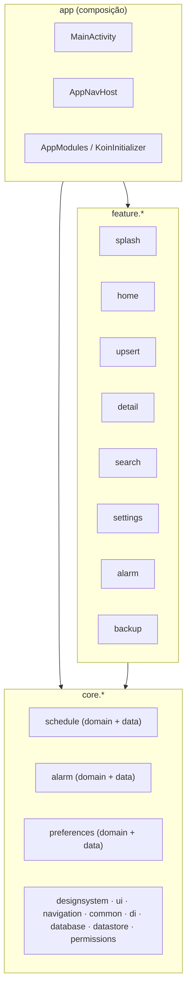

Regras que o código respeita (e que tornam a futura modularização um "recortar e colar"):

1. **Uma feature nunca importa outra.** O que é usado por duas ou mais sobe para `core` (por isso
   `ScheduleRepository`, `ScheduleNextAlarmUseCase` e `UserSettingsRepository` estão em `core`).
2. **`core` não importa `feature` nem `app`.** Por isso o `AppNavHost` fica em `app`: ele precisa conhecer
   todas as telas. As rotas ([`AppRoute.kt`](../app/src/main/java/com/br/androideventscheduler/core/navigation/AppRoute.kt))
   ficam em `core.navigation` para que qualquer feature possa referenciá-las sem importar outra feature.
3. **A API pública de uma feature é só `navigation/<Feature>Entry.kt` e `di/<Feature>Module.kt`.** Telas, ViewModels,
   estados e mappers são `internal`.
4. **`domain` não importa `android.*`** (só `java.time`). Exemplo: [`ExportTarget`](../app/src/main/java/com/br/androideventscheduler/feature/backup/domain/model/ExportModels.kt)
   carrega a URI como `String` para não depender de `android.net.Uri`.

## 3. Camadas e fluxo unidirecional

Toda funcionalidade segue o mesmo caminho de dados (UDF):

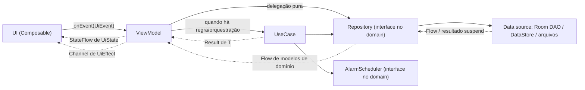

Dois "retornos" diferentes chegam ao ViewModel:

- **Reativo (Flow):** o Room e o DataStore reemitem sempre que os dados mudam. É o que faz a Home se atualizar
  sozinha depois que o usuário salva um agendamento em outra tela, sem nenhum evento explícito de "recarregar".
- **Pontual (`suspend` + `Result`):** gravações e operações de UseCase devolvem `Result<T>`; o ViewModel converte
  sucesso/falha em novo `UiState` e/ou em `UiEffect` (mensagem, navegação).

Os dispatchers são injetados por nome ([`DispatcherNames`](../app/src/main/java/com/br/androideventscheduler/core/di/DispatcherNames.kt)):
**ViewModels recebem `main`** (`Dispatchers.Main.immediate`) e os repositórios trocam para `io` internamente
(`withContext(ioDispatcher)` / `flowOn(ioDispatcher)`), como em
[`ScheduleRepositoryImpl`](../app/src/main/java/com/br/androideventscheduler/core/schedule/data/repository/ScheduleRepositoryImpl.kt).

## 4. O contrato da camada de apresentação: State, Event e Effect

Cada tela tem três tipos, em subpacotes próprios (`state/`, `event/`, `effect/`):

| Peça | Tipo Kotlin | Transporte | Para quê |
|---|---|---|---|
| `XxxUiState` | `sealed class` imutável (`Loading`, `Content`, `Error`...) | `StateFlow` | o que a tela mostra agora |
| `XxxUiEvent` | `sealed interface` | chamada `viewModel.onEvent(event)` | o que o usuário fez |
| `XxxUiEffect` | `sealed interface` | `Channel(BUFFERED)` privado, exposto como `Flow` via `receiveAsFlow()` ([§4.1](#41-efeitos-por-que-o-viewmodel-expõe-um-flow-e-esconde-o-channel)) | algo que acontece **uma vez** (navegar, Toast, Snackbar, abrir Intent) |

**Não há ViewModel base**: cada ViewModel estende `androidx.lifecycle.ViewModel` e declara explicitamente o
`MutableStateFlow` e o `Channel`. A discussão de adotar uma base `MviViewModel` está em
[`docs/decisoes/mvi-viewmodel-abstrata.md`](decisoes/mvi-viewmodel-abstrata.md).

Na UI, cada tela segue o mesmo esqueleto:

1. obtém o ViewModel por `koinViewModel()` (ou `koinViewModel { parametersOf(...) }` quando precisa da rota);
2. coleta o estado com `collectAsStateWithLifecycle()`;
3. coleta os efeitos **uma única vez** com [`CollectEffects`](../app/src/main/java/com/br/androideventscheduler/core/ui/CollectEffects.kt)
   (`repeatOnLifecycle(STARTED)`: efeitos emitidos com a tela parada ficam no buffer do `Channel` e são entregues ao voltar);
4. delega o desenho a um Composable *stateless* `XxxContent(uiState, onEvent)`, que é o alvo das `@Preview`.

**Famílias de eventos.** Telas com muitos eventos agrupam-nos em `sealed interface` aninhadas
(ex.: `HomeUiEvent.DrawerEvent`, `UpsertScheduleUiEvent.RecurrenceEvent`). O `onEvent` despacha por família e cada
handler faz um `when` exaustivo. Isso mantém os `when` abaixo do limite de complexidade do detekt sem `@Suppress`
e sem `else ->`, então um evento novo sem tratamento continua sendo erro de compilação.

### 4.1 Efeitos: por que o ViewModel expõe um `Flow` e esconde o `Channel`

Todo ViewModel do app declara os efeitos assim:

```kotlin
// Dentro do ViewModel
private val _uiEffect = Channel<HomeUiEffect>(Channel.BUFFERED)   // implementação: privada
val uiEffect: Flow<HomeUiEffect> = _uiEffect.receiveAsFlow()       // contrato: público e somente leitura
```

São duas decisões em uma:

- **por baixo, um `Channel`**, e não um `StateFlow` ou `SharedFlow`;
- **para fora, um `Flow`**, e não o próprio `Channel`.

Esta seção explica as duas, a partir do problema que um efeito resolve.

#### 4.1.1 O problema: algo que deve acontecer uma vez, e só uma

Estado e efeito são coisas diferentes:

| | Estado (`UiState`) | Efeito (`UiEffect`) |
|---|---|---|
| Pergunta que responde | "O que a tela mostra **agora**?" | "O que deve **acontecer** agora?" |
| Exemplos | lista de agendamentos, campo com erro, `isSaving` | navegar para o detalhe, mostrar um Toast, abrir o compartilhamento |
| Se for entregue de novo | inofensivo: redesenha a mesma coisa | **errado**: navega duas vezes, mostra o Toast de novo |
| Se for perdido | o próximo valor corrige | **errado**: o usuário salva e a tela não fecha |

Imagine "voltar após salvar" guardado no estado, como `navigateBack = true` num `StateFlow`. O usuário salva, a tela
volta, e numa rotação ou recomposição o valor `true` continua lá e seria tratado de novo. O efeito precisa de um
transporte com duas garantias: **não perder** (mesmo que a tela não esteja ouvindo naquele instante) e **não
repetir**.

#### 4.1.2 Por que o transporte é um `Channel`

| Transporte | Sem ninguém coletando | Com a tela voltando | Entregas | Serve para efeito? |
|---|---|---|---|---|
| `StateFlow` | guarda **só o último valor** | reentrega o último valor | o mesmo valor pode ser lido várias vezes | Não: repete, e dois efeitos seguidos (Toast e voltar) viram um só |
| `SharedFlow` (`replay = 0`) | **descarta** o evento | nada | perde o que foi emitido sem coletor | Não: o efeito emitido durante uma rotação se perde |
| `SharedFlow` (`replay = 1`) | guarda o último | reentrega o último | repete | Não: mesmo problema do `StateFlow` |
| **`Channel(BUFFERED)`** | **guarda em fila** (até 64; cheio, o `send` espera) | entrega o que ficou na fila, em ordem | **cada elemento sai uma vez** | **Sim** |

O `Channel` é uma fila entre corrotinas: o ViewModel coloca (`send`) e a tela retira (`receive`). O que foi
retirado sai da fila, então não tem como ser entregue de novo. O que ninguém retirou fica esperando.

No app isso importa em casos concretos:

- **Configurações → Salvar** emite `ShowSavedConfirmation` e `NavigateBack`, nessa ordem. A fila preserva os dois e
  a ordem: o Toast aparece e a tela volta.
- **Item excluído em outra tela** (Detalhe): o Detalhe observa o item; se ele some enquanto a tela está em segundo
  plano, o `NavigateBack` fica na fila e é entregue quando a tela volta a `STARTED`.

#### 4.1.3 Por que expor `Flow`, e não o `Channel`

Um `Channel` tem duas pontas: a de **envio** (`SendChannel`: `send`, `trySend`, `close`) e a de **recepção**
(`ReceiveChannel`: `receive`, `cancel`, iterar). Se o ViewModel publicasse o `Channel`, ou mesmo só o
`ReceiveChannel`, a tela ganharia poderes que não deveria ter.

**1. Só o ViewModel pode emitir efeitos (encapsulamento).**

```kotlin
// Se o ViewModel expusesse: val uiEffect: Channel<HomeUiEffect>
viewModel.uiEffect.trySend(HomeUiEffect.NavigateToSearch)   // a tela "inventa" um efeito: quebra o fluxo unidirecional
viewModel.uiEffect.close()                                  // a tela encerra o canal: o próximo send do ViewModel lança exceção
```

O fluxo unidirecional (§3) diz que a tela **pede** (`onEvent`) e o ViewModel **decide** (estado e efeito). Com um
`Flow`, a única coisa que a tela consegue fazer é coletar.

**2. Mesmo o `ReceiveChannel` é perigoso: cancelar a recepção fecha o canal para sempre.**

```kotlin
// Se o ViewModel expusesse: val uiEffect: ReceiveChannel<HomeUiEffect>
LaunchedEffect(Unit) {
    for (effect in viewModel.uiEffect) { handle(effect) }   // consumir o canal...
}
// ...ou viewModel.uiEffect.cancel() em algum descarte: o canal é fechado.
```

`ReceiveChannel.cancel()` não significa "parei de ouvir por enquanto". Significa "este canal acabou": os elementos
pendentes são descartados e o próximo `send` do ViewModel lança exceção. Como o ViewModel sobrevive à rotação e a
tela não, um descarte da tela mataria os efeitos do ViewModel até ele ser destruído. (`consumeEach` e `consumeAsFlow`
cancelam o canal desse jeito ao terminar ou ser cancelados.)

**3. O `Flow` certo pode ser coletado, parado e coletado de novo, sem perder nada.**

A tela não coleta o tempo todo. O [`CollectEffects`](../app/src/main/java/com/br/androideventscheduler/core/ui/CollectEffects.kt)
coleta só enquanto ela está visível:

```kotlin
@Composable
fun <T> CollectEffects(effects: Flow<T>, onEffect: suspend (T) -> Unit) {
    val lifecycleOwner = LocalLifecycleOwner.current
    val currentOnEffect = rememberUpdatedState(onEffect)
    LaunchedEffect(effects, lifecycleOwner) {
        lifecycleOwner.repeatOnLifecycle(Lifecycle.State.STARTED) {   // começa em STARTED, cancela em STOPPED
            effects.collect { currentOnEffect.value(it) }
        }
    }
}
```

`repeatOnLifecycle` **cancela** a coleta quando a tela para e **começa outra** quando ela volta. Por isso a função
que converte o canal em `Flow` faz toda a diferença:

| Conversão | Coletar mais de uma vez | Quando o coletor é cancelado | Resultado com `repeatOnLifecycle` |
|---|---|---|---|
| **`receiveAsFlow()`** (o app usa) | sim | o canal **continua aberto** | parou e voltou: os efeitos da fila são entregues |
| `consumeAsFlow()` | não (lança exceção na 2ª coleta) | o canal é **cancelado** | na primeira ida para segundo plano, os efeitos acabam |
| `channel.consumeEach { }` direto | não (consome o canal) | o canal é **cancelado** | igual ao `consumeAsFlow` |
| `for (e in channel)` direto | sim | o canal continua aberto | funciona, mas exige o `ReceiveChannel` público (itens 1 e 2) |

O ciclo completo, com a tela indo para segundo plano no meio de um salvamento:

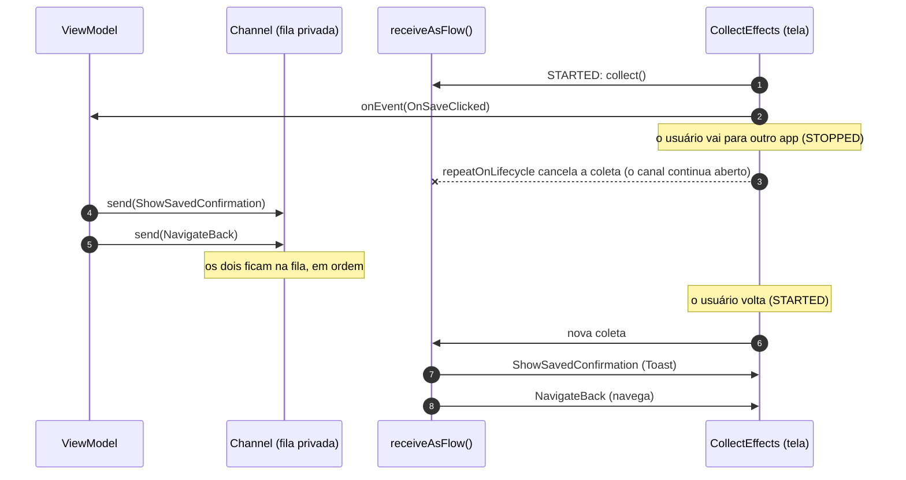

**4. Uma forma só de consumir, na tela e nos testes.**

Para a tela, `uiEffect` é um `Flow` como qualquer outro: o mesmo `CollectEffects` serve a todas as telas. Nos testes,
os operadores de `Flow` resolvem tudo, sem Turbine e sem conhecer a fila:

```kotlin
// No estilo do UpsertScheduleViewModelTest (EffectRecorder): grava os efeitos enquanto o teste roda
val effects = mutableListOf<UpsertScheduleUiEffect>()
val job = launch { viewModel.uiEffect.collect { effects += it } }
viewModel.onEvent(UpsertScheduleUiEvent.OnSaveClicked)
advanceUntilIdle()
assertEquals(listOf(UpsertScheduleUiEffect.NavigateBack), effects)
job.cancel()   // cancelar a coleta não fecha o canal: outro teste da mesma instância poderia coletar de novo
```

**5. A implementação pode mudar sem mexer em quem consome.**

O tipo público diz só "uma sequência de efeitos". Se um ViewModel precisar de outra fonte (por exemplo, juntar dois
canais com `merge`), as telas e os testes que coletam `uiEffect` continuam iguais. Se o tipo público fosse
`Channel`, toda tela dependeria desse detalhe.

#### 4.1.4 Como emitir

`send` é `suspend` e o `onEvent` não é. Por isso os ViewModels emitem dentro de uma corrotina:

```kotlin
private fun sendEffect(effect: HomeUiEffect) {
    viewModelScope.launch { _uiEffect.send(effect) }
}
```

Com `BUFFERED`, o `send` só suspende se houver 64 efeitos esperando, o que não acontece numa tela real. Dentro de uma
corrotina que já existe (salvar, excluir), o ViewModel chama `_uiEffect.send(...)` direto, na ordem em que os efeitos
devem chegar. O canal não é fechado explicitamente: ele vive e morre com o ViewModel.

#### 4.1.5 Garantias e limites

O que o padrão garante:

- **cada efeito é entregue no máximo uma vez**, e na ordem de envio;
- **efeito emitido com a tela parada não se perde**: espera na fila até a próxima coleta;
- **a tela não consegue emitir, fechar nem cancelar** o canal.

O que ele não garante, e como o app lida com isso:

| Limite | Por quê | Como o app trata |
|---|---|---|
| **Um coletor por vez.** Com dois coletores, cada efeito vai para **um** deles (o `receiveAsFlow` reparte, não duplica) | É uma fila, não uma transmissão | Cada tela coleta uma única vez, com o `CollectEffects`. Nunca colete `uiEffect` em dois lugares |
| **Janela de perda rara.** Se a coleta for cancelada exatamente entre o efeito sair da fila e o tratamento rodar, esse efeito se perde | O elemento já saiu do canal, mas a corrotina que o trataria foi cancelada antes de rodar | ViewModel e tela trabalham na main thread, e os tratamentos são curtos e síncronos (navegar, mostrar Toast). A janela fica restrita a uma parada exatamente nesse instante. O app aceita o risco |
| **Não sobrevive à morte do processo.** A fila vive na memória do ViewModel | `Channel` não é salvo em `SavedStateHandle` | Efeitos são reações imediatas. O que precisa sobreviver (diálogo aberto, texto da busca) vai para o **estado** com `SavedStateHandle` |

A alternativa que elimina a janela de perda, recomendada nas diretrizes de arquitetura do Android, é modelar o
evento **como estado** (por exemplo, `pendingNavigation`) e fazer a tela confirmar o consumo com um evento de volta
(`onNavigationHandled()`), que limpa o campo. O app não adotou isso porque cada efeito viraria um campo de estado e
mais um evento de confirmação, em toda tela, para fechar uma janela que as condições acima já tornam rara.

#### 4.1.6 Regras para um ViewModel novo

- [ ] `private val _uiEffect = Channel<XxxUiEffect>(Channel.BUFFERED)` e
      `val uiEffect: Flow<XxxUiEffect> = _uiEffect.receiveAsFlow()`. Nunca exponha `Channel`, `SendChannel` nem
      `ReceiveChannel`.
- [ ] Use `receiveAsFlow()`, nunca `consumeAsFlow()`: a tela para e volta a coletar.
- [ ] Na tela, colete com `CollectEffects(viewModel.uiEffect) { … }`, uma única vez.
- [ ] Efeito é só o que acontece uma vez (navegar, mensagem, abrir Intent/seletor). O que a tela **mostra** é estado,
      mesmo que mude por causa de uma ação.
- [ ] Efeitos encadeados (`ShowSavedConfirmation` e depois `NavigateBack`) são enviados em sequência, na mesma
      corrotina, na ordem em que devem acontecer.
- [ ] Nos testes, colete com `launch { viewModel.uiEffect.collect { … } }` ou `first()`, sem Turbine.

## 5. Política de UseCases

UseCase existe **só** quando há pelo menos um destes motivos: (1) regra compartilhada por dois ou mais pontos de
entrada; (2) orquestração de duas fontes que precisam ficar consistentes (banco + alarme); (3) regra de negócio
que merece teste isolado. Delegação pura (observar, buscar por id, pesquisar) **não** vira UseCase: o ViewModel
injeta a interface do repositório.

Resultado no código: **7 UseCases**, todos orquestrando banco e alarme ou com regra própria.

| UseCase | Pacote | Motivo | Usado por |
|---|---|---|---|
| [`ScheduleNextAlarmUseCase`](../app/src/main/java/com/br/androideventscheduler/core/alarm/domain/usecase/ScheduleNextAlarmUseCase.kt) | `core.alarm` | (1) e (3): calcula o próximo disparo de uma série | Save, Duplicate, Import, Reschedule, `ScheduleAlarmReceiver` |
| [`SnoozeAlarmUseCase`](../app/src/main/java/com/br/androideventscheduler/core/alarm/domain/usecase/SnoozeAlarmUseCase.kt) | `core.alarm` | (2): lê o item e agenda novo disparo | `FullScreenAlarmViewModel` |
| [`RescheduleAllAlarmsUseCase`](../app/src/main/java/com/br/androideventscheduler/core/alarm/domain/usecase/RescheduleAllAlarmsUseCase.kt) | `core.alarm` | (2) e (3): reagenda tudo, contando sucesso/falha | `BootCompletedReceiver` |
| [`SaveScheduleUseCase`](../app/src/main/java/com/br/androideventscheduler/feature/upsert/domain/usecase/SaveScheduleUseCase.kt) | `feature.upsert` | (2) e (3): valida, grava, agenda | `UpsertScheduleViewModel` |
| [`DuplicateScheduleUseCase`](../app/src/main/java/com/br/androideventscheduler/feature/detail/domain/usecase/DuplicateScheduleUseCase.kt) | `feature.detail` | (2): copia e agenda | `ScheduleDetailViewModel` |
| [`DeleteScheduleUseCase`](../app/src/main/java/com/br/androideventscheduler/feature/detail/domain/usecase/DeleteScheduleUseCase.kt) | `feature.detail` | (2): apaga e cancela alarme, nessa ordem | `ScheduleDetailViewModel` |
| [`ImportAgendaUseCase`](../app/src/main/java/com/br/androideventscheduler/feature/backup/domain/usecase/ImportAgendaUseCase.kt) | `feature.backup` | (2) e (3): estratégia de conflito, gravação atômica, alarmes | `BackupViewModel` |

Regra comum a todos que orquestram banco + alarme: **a falha do alarme nunca desfaz a gravação** (o
`scheduleNextAlarm(...)` vai dentro de um `runCatching` próprio depois do `upsert`).

## 6. Persistência: Room e DataStore

**Room.** Uma tabela, `schedules`
([`ScheduleEntity`](../app/src/main/java/com/br/androideventscheduler/core/schedule/data/local/ScheduleEntity.kt),
[`ScheduleDao`](../app/src/main/java/com/br/androideventscheduler/core/schedule/data/local/ScheduleDao.kt)), mapeada para o
modelo de domínio [`ScheduleItem`](../app/src/main/java/com/br/androideventscheduler/core/schedule/domain/model/ScheduleItem.kt)
por [`ScheduleMapper`](../app/src/main/java/com/br/androideventscheduler/core/schedule/data/mapper/ScheduleMapper.kt). Dois detalhes importantes:

- **Recorrência não é gravada como ocorrências.** O item guarda o início da série e o
  [`RecurrencePattern`](../app/src/main/java/com/br/androideventscheduler/core/schedule/domain/model/RecurrencePattern.kt)
  (`None`, `Daily`, `Weekly`, com limite opcional). As ocorrências são **calculadas** pelo
  [`RecurrenceEngine`](../app/src/main/java/com/br/androideventscheduler/core/schedule/domain/recurrence/RecurrenceEngine.kt),
  puro e determinístico, dentro de `ScheduleRepositoryImpl.observeOccurrences`.
- **Busca sem acento nem caixa.** O mapper grava a coluna `searchText` normalizada por
  [`SearchTextNormalizer`](../app/src/main/java/com/br/androideventscheduler/core/schedule/domain/search/SearchTextNormalizer.kt)
  (o SQLite só ignora caixa em ASCII).

**DataStore.** Um único `DataStore<Preferences>` por processo (`remember_me_prefs`), com três repositórios sobre ele:

| Repositório | Chaves | Quem usa |
|---|---|---|
| [`UserSettingsRepository`](../app/src/main/java/com/br/androideventscheduler/core/preferences/domain/UserSettingsRepository.kt) → [`UserSettingsRepositoryImpl`](../app/src/main/java/com/br/androideventscheduler/core/preferences/data/UserSettingsRepositoryImpl.kt) | e-mail, alerta padrão, adiar padrão, tela cheia | Settings, Home, Upsert, Detail, Search, alarmes |
| [`ThemePreferenceRepository`](../app/src/main/java/com/br/androideventscheduler/core/preferences/domain/ThemePreferenceRepository.kt) → [`ThemePreferenceRepositoryImpl`](../app/src/main/java/com/br/androideventscheduler/core/preferences/data/ThemePreferenceRepositoryImpl.kt) | `theme_mode` | `MainActivity`, `FullScreenAlarmActivity`, Settings |
| [`HomePreferencesRepository`](../app/src/main/java/com/br/androideventscheduler/feature/home/domain/repository/HomePreferencesRepository.kt) → [`HomePreferencesRepositoryImpl`](../app/src/main/java/com/br/androideventscheduler/feature/home/data/repository/HomePreferencesRepositoryImpl.kt) | calendários visíveis, adesivo de cada dia | só a Home |

Todos tratam `IOException` emitindo preferências vazias (o app volta aos padrões em vez de quebrar). A escolha de
DataStore em vez de SharedPreferences para o tema está em
[`docs/decisoes/persistencia-do-tema-datastore-vs-sharedpreferences.md`](decisoes/persistencia-do-tema-datastore-vs-sharedpreferences.md).

## 7. Navegação (Navigation 3)

> Explicação detalhada (`entryProvider`, extensões de entrada, `NavDisplay` por dentro e como adicionar uma tela):
> [navegacao.md](navegacao.md).

- **Rotas** são `@Serializable NavKey` em [`AppRoute.kt`](../app/src/main/java/com/br/androideventscheduler/core/navigation/AppRoute.kt):
  `Splash`, `Home`, `Search`, `Settings`, `ScheduleDetail(scheduleId)`, `UpsertSchedule(scheduleId?, initialDateEpochDay?)`,
  `AgendaBackup(pendingImportUri?)`.
- **Back stack** é uma lista mutável (`rememberNavBackStack(Splash)`) em
  [`AppNavHost`](../app/src/main/java/com/br/androideventscheduler/app/AppNavHost.kt). Navegar é `add`/`removeLastOrNull`.
- **Cada feature contribui com uma extensão** `EntryProviderScope<NavKey>.<feature>Entry(...)` e recebe **lambdas**
  de navegação: nenhuma feature enxerga o back stack nem as rotas de outra.
- `rememberViewModelStoreNavEntryDecorator()` dá a cada entrada do back stack o seu próprio `ViewModelStore`:
  o `koinViewModel()` dentro de uma entrada fica escopado a ela e é limpo quando a entrada sai da pilha.

A navegação disparada pelo usuário sempre passa pelo ViewModel: o evento vira um `UiEffect.NavigateToX`, a tela o
coleta e chama a lambda recebida do host. Exemplo do caminho completo na [F3](#f3-home-calendário-mensal-gaveta-filtros-adesivo-do-dia-e-toque-duplo).

## 8. Injeção de dependência com Koin

### 8.1 Como o grafo é montado

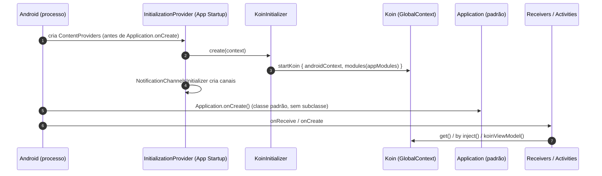

- Não há `Application` própria: o `<application>` do manifest não declara `android:name` (a subclasse vazia foi removida no PR #33);
  o Koin sobe pelo [`KoinInitializer`](../app/src/main/java/com/br/androideventscheduler/app/KoinInitializer.kt),
  registrado como `meta-data` do `InitializationProvider` no [`AndroidManifest.xml`](../app/src/main/AndroidManifest.xml).
  Como o App Startup roda **antes** de `Application.onCreate`, os `BroadcastReceiver`s de alarme e de boot já
  encontram o grafo pronto, mesmo quando o processo é criado só para entregar o broadcast.
- [`appModules`](../app/src/main/java/com/br/androideventscheduler/app/AppModules.kt) é a lista única de módulos:
  primeiro os de `core`, depois um por feature. Cada feature expõe o seu `di/<Feature>Module.kt`.

### 8.2 Módulos e o que cada um fornece

| Módulo | Arquivo | Definições principais | Escopo |
|---|---|---|---|
| `dispatchersModule` | [`DispatchersModule.kt`](../app/src/main/java/com/br/androideventscheduler/core/di/DispatchersModule.kt) | `CoroutineDispatcher` `named("io"/"default"/"main")` | `single` |
| `databaseModule` | [`DatabaseModule.kt`](../app/src/main/java/com/br/androideventscheduler/core/database/DatabaseModule.kt) | `RememberMeDatabase`, `ScheduleDao` | `single` |
| `scheduleCoreModule` | [`ScheduleCoreModule.kt`](../app/src/main/java/com/br/androideventscheduler/core/schedule/di/ScheduleCoreModule.kt) | `RecurrenceEngine`, `ScheduleRepository` | `single` |
| `dataStoreModule` | [`DataStoreModule.kt`](../app/src/main/java/com/br/androideventscheduler/core/datastore/DataStoreModule.kt) | `DataStore<Preferences>` (um por processo) | `single` |
| `preferencesModule` | [`PreferencesModule.kt`](../app/src/main/java/com/br/androideventscheduler/core/preferences/di/PreferencesModule.kt) | `UserSettingsRepository`, `ThemePreferenceRepository` | `single` |
| `commonModule` | [`CommonModule.kt`](../app/src/main/java/com/br/androideventscheduler/core/common/CommonModule.kt) | `StringProvider` | `single` |
| `alarmModule` | [`AlarmModule.kt`](../app/src/main/java/com/br/androideventscheduler/core/alarm/di/AlarmModule.kt) | `Clock`, `AlarmScheduler`, `ScheduleNotifier`, `ScheduleNextAlarmUseCase`, `SnoozeAlarmUseCase`; `RescheduleAllAlarmsUseCase` | `single`; `factory` |
| `deepLinkModule` / `incomingFileModule` | [`DeepLinkState.kt`](../app/src/main/java/com/br/androideventscheduler/app/DeepLinkState.kt), [`IncomingFileState.kt`](../app/src/main/java/com/br/androideventscheduler/app/IncomingFileState.kt) | estado compartilhado entre Activity e host | `single` |
| `splashModule` ... `backupModule` | `feature/*/di/*Module.kt` | ViewModels (`viewModel {}`), mappers e UseCases da feature (`factory`), repositórios próprios (`single`) | variado |

### 8.3 Padrões de uso no código

| Padrão | Exemplo | Observação |
|---|---|---|
| Interface → implementação `internal` | `single<ScheduleRepository> { ScheduleRepositoryImpl(...) }` | o resto do app só vê a interface do `domain` |
| Qualificador por nome | `get(named(DispatcherNames.MAIN))` | dispatchers de teste trocam o real |
| ViewModel com argumentos de rota | `viewModel { params -> ... params.get<UpsertSchedule>() }` + `koinViewModel { parametersOf(UpsertSchedule(id, day)) }` | passa a **rota inteira**: o Koin resolve parâmetros por tipo e não distingue dois `null` |
| `SavedStateHandle` | `savedStateHandle = get()` em [`HomeModule`](../app/src/main/java/com/br/androideventscheduler/feature/home/di/HomeModule.kt) | fornecido pelo `koin-compose-viewmodel` ao criar o ViewModel |
| Acesso em componentes do sistema | `class ScheduleAlarmReceiver : BroadcastReceiver(), KoinComponent` + `get<...>()` | *service locator*: receivers não têm construtor injetável |
| Injeção em Activity | `private val deepLinkState: DeepLinkState by inject()` em [`MainActivity`](../app/src/main/java/com/br/androideventscheduler/MainActivity.kt) | |
| Verificação do grafo | [`KoinModulesVerificationTest`](../app/src/test/java/com/br/androideventscheduler/app/KoinModulesVerificationTest.kt) usa `module { includes(appModules) }.verify(extraTypes = ...)` | roda em teste unitário; os tipos de framework e de parâmetro de rota precisam ser listados à mão |
| Testes Robolectric | [`TestRememberMeApplication`](../app/src/test/java/com/br/androideventscheduler/app/TestRememberMeApplication.kt) | o Koin é global: entre testes troca o `Context` e recarrega os módulos (`unloadKoinModules`/`loadKoinModules`) |

## 9. Prós e contras de usar uma ferramenta de DI neste projeto

Antes de comparar Koin e Hilt, vale perguntar: **um app de um módulo e ~8 telas precisa de uma ferramenta de DI?**
A alternativa seria DI manual: um `AppContainer` criado no `Application` com `lazy` para cada dependência, e
`ViewModelProvider.Factory` escritas à mão.

**Prós de usar uma ferramenta, considerando este código:**

- **Testabilidade como requisito, não como bônus.** Quase toda regra de negócio depende de tempo (`Clock`
  injetado em Home, Upsert, alarmes, backup) e de dispatchers (`named("main"/"io")`). Com a ferramenta, trocar por
  `FakeClock` e `StandardTestDispatcher` é declarar outra definição; à mão, seria propagar parâmetros por fábricas.
- **ViewModels com `SavedStateHandle` e parâmetros de rota** (Home, Search, Detail, Upsert, Backup, alarme em tela
  cheia). Escrever e manter seis `ViewModelProvider.Factory` com `CreationExtras` é o tipo de código repetitivo que
  a ferramenta elimina, e a integração com o `ViewModelStore` por entrada do Navigation 3 sai pronta.
- **Pontos de entrada do sistema.** `ScheduleAlarmReceiver`, `BootCompletedReceiver`, `MainActivity` e
  `FullScreenAlarmActivity` são criados pelo Android. Todos precisam do mesmo grafo (repositórios, use cases).
  Um contêiner global resolve isso, e a ferramenta já entrega o contêiner, a inicialização (via App Startup) e o
  acesso de dentro dos receivers.
- **Escopos explícitos.** `single` para o que **precisa** ser único (o DataStore proíbe duas instâncias no mesmo
  arquivo; o Room deve ter uma instância por processo) e `factory` para o que é barato e sem estado.
- **Fronteiras da arquitetura.** Cada feature traz o seu módulo e o `app` só agrega. Isso reforça a regra
  "a API pública de uma feature é `navigation` + `di`" e prepara a extração para módulos Gradle.
- **Verificação do grafo inteiro em um teste** (`KoinModulesVerificationTest`), que cresce sozinho a cada módulo.

**Contras, também considerando este código:**

- **Indireção.** Para saber quem constrói `HomeViewModel`, é preciso ir ao `HomeModule`; com DI manual, o
  construtor estaria no `AppContainer`, a um clique de distância.
- **Mais uma dependência e mais um conceito** para quem chega ao projeto (DSL, escopos, `parametersOf`, `KoinComponent`).
- **Estado global.** O `GlobalContext` exige cuidado em testes. Aqui ele custou uma `TestRememberMeApplication`
  dedicada, que troca o contexto e recarrega os módulos entre testes Robolectric.
- **Tamanho do problema.** Com ~40 definições, DI manual seria viável e daria segurança de compilação de graça.
  O ganho da ferramenta aqui é mais em ergonomia (ViewModels, receivers, testes) do que em escala.

**Conclusão:** a ferramenta se paga neste projeto principalmente por três motivos: ViewModels com estado salvo e
argumentos de rota, receivers que precisam do grafo antes de qualquer tela e a injeção sistemática de `Clock` e
dispatchers para testes. DI manual funcionaria, mas recriaria à mão boa parte do que a biblioteca entrega.

## 10. Koin em vez de Hilt: a análise

O Hilt é a recomendação oficial do Android e o padrão em boa parte dos times. O projeto escolheu Koin de
forma deliberada, registrado como desvio da arquitetura de referência na seção 4.2 do
[`arquitetura.md`](../.kiro/steering/arquitetura.md): *"DI simples, sem kapt/KSP extra; receivers acessam o grafo via Koin"*.

### 10.1 Diferença fundamental

| | Koin | Hilt (Dagger) |
|---|---|---|
| Quando o grafo é resolvido | **Em tempo de execução** (um registro de fábricas, consultado por tipo) | **Em tempo de compilação** (código gerado por KSP/kapt) |
| Erro de dependência faltando | `NoDefinitionFoundException` **ao executar** (ou no teste `verify()`) | **Erro de compilação** |
| Declaração | DSL Kotlin (`module { single { ... } }`) | anotações (`@Inject`, `@Module`, `@Provides`, `@Binds`, `@HiltViewModel`, `@AndroidEntryPoint`) |
| Plataformas | Kotlin Multiplatform | Só Android/JVM |

### 10.2 Por que Koin faz sentido aqui

1. **Origem multiplataforma.** As specs vieram de um desenho KMP (Compose Multiplatform, Voyager, Room KMP;
   ver [`.kiro/specs/README.md`](../.kiro/specs/README.md)). O Koin funciona em KMP; o Hilt não. Se o app voltar a
   mirar iOS, os módulos de `core` e `domain` já estão em uma ferramenta que atravessa a fronteira.
2. **Build mais simples.** O único processador de anotações do projeto é o do Room (KSP). Com Hilt, entrariam o
   plugin Gradle do Hilt, o compilador do Dagger e o código gerado para cada `@AndroidEntryPoint` e `@HiltViewModel`.
3. **Receivers e Activities sem cerimônia.** `ScheduleAlarmReceiver : KoinComponent` e `get<ScheduleRepository>()`
   bastam. Com Hilt, seriam `@AndroidEntryPoint` no receiver, `@HiltAndroidApp` no `Application` e as regras de
   herança das classes geradas.
4. **Inicialização antes do `Application`.** O `KoinInitializer` sobe o grafo via App Startup, antes de qualquer
   receiver. O Hilt inicializa o componente no `Application.onCreate` gerado, o que também atende receivers, mas
   amarra a inicialização ao `Application` anotado.
5. **Parâmetros de rota para ViewModels.** `koinViewModel { parametersOf(route) }` é direto. No Hilt, o equivalente
   é *assisted injection* com `@HiltViewModel(assistedFactory = ...)` + `@AssistedInject` + `@AssistedFactory`, ou
   ler a rota do `SavedStateHandle`. Funciona, mas é mais código por tela.
6. **Visibilidade `internal`.** Os módulos Koin de cada feature constroem as classes `internal` da própria
   feature sem expor nada. Com Hilt dá para manter `internal`, mas `@Module`/`@InstallIn` e o código gerado impõem
   cuidados extras quando o projeto virar multimódulo.

### 10.3 O que se perde por não usar Hilt

1. **Segurança em tempo de compilação.** É a maior perda. Uma definição faltando só aparece ao rodar a tela ou no
   `KoinModulesVerificationTest`. O teste reduz o risco, mas tem limites concretos vistos neste projeto:
   - ele usa uma API experimental (`@OptIn(KoinExperimentalAPI::class)`);
   - os tipos fornecidos em runtime (`String`, `Long`, `Function0`, `SavedStateHandle`, `Context`, `AlarmManager`...)
     precisam ser listados à mão em `extraTypes`, e isso **mascara** erros desses tipos: se um ViewModel pedir um
     `String` que ninguém passa em `parametersOf`, o teste não percebe;
   - `parametersOf` é resolvido por tipo e posição, sem checagem: foi preciso passar a rota inteira no Upsert
     porque dois `null` do mesmo tipo não se distinguem (registrado no status da spec 07 em
     [`ordem-de-execucao.md`](../.kiro/specs/ordem-de-execucao.md)).
2. **Custo em runtime.** A resolução por tipo acontece a cada `get()`. Em um app deste tamanho é imperceptível,
   mas o Dagger não tem esse custo (o grafo é código gerado e chamado diretamente).
3. **Service locator nos receivers.** `KoinComponent` + `get()` esconde as dependências dentro do método, em vez
   de declará-las no construtor. Para testar o receiver é preciso subir o Koin; com Hilt, os campos `@Inject`
   ficam explícitos e são substituíveis com `@TestInstallIn`/`@BindValue`.
4. **Ecossistema e familiaridade.** Hilt é o que a documentação oficial, os codelabs e as bibliotecas Jetpack
   (`hilt-navigation-compose`, `hilt-work`) assumem. Para um time Android que chega ao projeto, Hilt é o caminho
   conhecido; Koin pede aprender outra API.
5. **Estado global nos testes.** O Hilt cria um componente novo por teste (`HiltAndroidRule`); o Koin global
   exigiu a `TestRememberMeApplication` com recarga manual de módulos.

### 10.4 Resumo e recomendação

| Critério | Koin (escolha atual) | Hilt |
|---|---|---|
| Segurança do grafo | teste `verify()` + execução | compilação |
| Tempo de build | menor (sem codegen de DI) | maior (KSP do Dagger) |
| Boilerplate | baixo (DSL) | médio (anotações, assisted injection) |
| KMP | sim | não |
| Receivers/Activities | `KoinComponent`/`inject()` | `@AndroidEntryPoint` |
| Isolamento em teste | manual (estado global) | automático por teste |
| Recomendação oficial / mercado | não | sim |

Para o estágio atual (um módulo, uma pessoa, origem KMP, foco em simplicidade de build) o Koin é uma escolha
defensável e coerente com a política "UseCase só quando justificado": ambos evitam cerimônia que ainda não paga o
custo. **O ponto de reavaliar** é o mesmo em que o próprio steering prevê a modularização (estágio 3: vários
desenvolvedores, `:feature:*` como módulos Gradle). Nesse momento, erros de grafo descobertos só em runtime ficam
mais caros. Há dois caminhos: migrar para Hilt (custo previsível: anotar ~10 classes de entrada e converter ~15
módulos) ou adotar **Koin Annotations** com verificação em tempo de compilação, mantendo a compatibilidade KMP.
Enquanto isso, o `KoinModulesVerificationTest` precisa continuar no CI e cada novo `extraTypes` deve ser
justificado em comentário, como já é feito.

---

# Parte II: Funcionalidades

Convenções dos diagramas: setas cheias são chamadas; setas tracejadas são retornos (valor, `Result` ou emissão de
`Flow`). `Screen` é o Composable com estado (que injeta o ViewModel); `Content` é o Composable *stateless*.

## F1. Inicialização do app e shell de navegação

**Propósito.** Subir o grafo de dependências antes de qualquer componente, abrir a `MainActivity` já no tema
escolhido e hospedar a navegação. Também recebe dois tipos de entrada externa: o **toque na notificação**
(deep link para o detalhe) e um **arquivo de agenda** enviado por outro app.

**Classes:** [`KoinInitializer`](../app/src/main/java/com/br/androideventscheduler/app/KoinInitializer.kt),
[`NotificationChannelsInitializer`](../app/src/main/java/com/br/androideventscheduler/core/alarm/data/notification/NotificationChannelsInitializer.kt),
[`MainActivity`](../app/src/main/java/com/br/androideventscheduler/MainActivity.kt),
[`AppNavHost`](../app/src/main/java/com/br/androideventscheduler/app/AppNavHost.kt),
[`AppNavigation.kt`](../app/src/main/java/com/br/androideventscheduler/app/AppNavigation.kt) (`replaceSplashWithHome`),
[`DeepLinkState`](../app/src/main/java/com/br/androideventscheduler/app/DeepLinkState.kt) +
[`DeepLinkNavigation.kt`](../app/src/main/java/com/br/androideventscheduler/app/DeepLinkNavigation.kt),
[`IncomingFileState`](../app/src/main/java/com/br/androideventscheduler/app/IncomingFileState.kt) +
[`IncomingFileIntent.kt`](../app/src/main/java/com/br/androideventscheduler/app/IncomingFileIntent.kt) +
[`IncomingFileNavigation.kt`](../app/src/main/java/com/br/androideventscheduler/app/IncomingFileNavigation.kt),
[`ThemeResolution.kt`](../app/src/main/java/com/br/androideventscheduler/core/designsystem/ThemeResolution.kt),
[`SystemThemeEffects`](../app/src/main/java/com/br/androideventscheduler/core/ui/theme/SystemThemeEffects.kt).

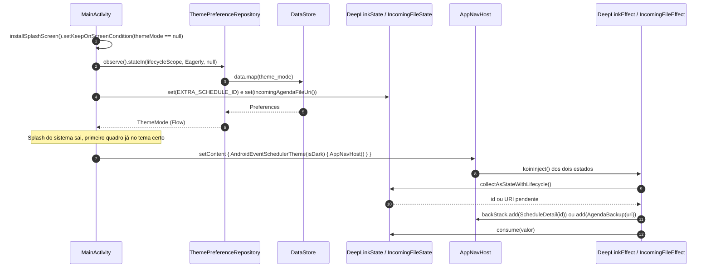

Pontos de atenção:

- **Sem `runBlocking`.** A preferência de tema é lida de forma assíncrona; a Splash do sistema
  (`androidx.core.splashscreen`) cobre a tela até o primeiro valor chegar.
- **Estado de "pendência" em `single` do Koin.** A Activity grava o id/URI em `onCreate`/`onNewIntent`, mas quem
  navega é o host, e só depois da Splash. O `DeepLinkEffect` só empilha o detalhe quando o topo é a `Home`;
  o `IncomingFileEffect`, quando o topo não é a `Splash`. `consume()` usa `compareAndSet` para não descartar um
  valor mais novo.
- **Entrada não confiável.** `incomingAgendaFileUri()` aceita só `ACTION_VIEW`/`ACTION_SEND`, MIME
  `application/json` e esquema `content://`. Aberturas pelo histórico de recentes
  (`FLAG_ACTIVITY_LAUNCHED_FROM_HISTORY`) são ignoradas para não repetir deep link antigo.

## F2. Splash

**Propósito.** Exibir a marca por 1,5 s e seguir para a Home, sem deixar a Splash no back stack.
É a tela mais simples e serve como **referência do padrão State/Event/Effect** que as demais repetem.

**Classes:** [`SplashScreen`](../app/src/main/java/com/br/androideventscheduler/feature/splash/presentation/screen/SplashScreen.kt),
[`SplashViewModel`](../app/src/main/java/com/br/androideventscheduler/feature/splash/presentation/viewmodel/SplashViewModel.kt),
[`SplashUiState`](../app/src/main/java/com/br/androideventscheduler/feature/splash/presentation/state/SplashUiState.kt),
[`SplashUiEvent`](../app/src/main/java/com/br/androideventscheduler/feature/splash/presentation/event/SplashUiEvent.kt),
[`SplashUiEffect`](../app/src/main/java/com/br/androideventscheduler/feature/splash/presentation/effect/SplashUiEffect.kt),
[`SplashEntry`](../app/src/main/java/com/br/androideventscheduler/feature/splash/navigation/SplashEntry.kt),
[`SplashModule`](../app/src/main/java/com/br/androideventscheduler/feature/splash/di/SplashModule.kt).
**Sem UseCase nem repositório.**

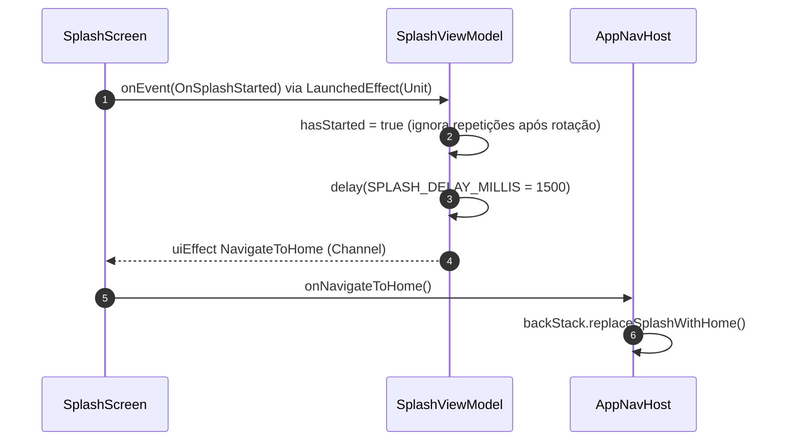

**Eventos e efeitos.** Um evento (`OnSplashStarted`) e um efeito (`NavigateToHome`). O `UiState` tem uma única
variante (`Showing`). `replaceSplashWithHome()` adiciona a Home **antes** de remover a Splash, para o back stack
nunca ficar vazio e para "voltar" na Home sair do app.

## F3. Home: calendário mensal, gaveta, filtros, adesivo do dia e toque duplo

**Propósito.** Tela principal: grade do mês com indicadores coloridos, lista do dia selecionado, troca de mês
(setas e seletor de mês/ano), gaveta lateral com filtros de calendário e atalho para Configurações, adesivo
(emoji) do dia e criação rápida (botão ou **toque duplo** no dia). Specs 05, 06, 09 e 18.

**Classes**

| Camada | Classes |
|---|---|
| UI | [`HomeScreen`](../app/src/main/java/com/br/androideventscheduler/feature/home/presentation/screen/HomeScreen.kt), [`MonthGridSection`](../app/src/main/java/com/br/androideventscheduler/feature/home/presentation/component/MonthGridSection.kt), [`DayDoubleTapDetector`](../app/src/main/java/com/br/androideventscheduler/feature/home/presentation/component/DayDoubleTapDetector.kt), [`DayScheduleList`](../app/src/main/java/com/br/androideventscheduler/feature/home/presentation/component/DayScheduleList.kt), [`CalendarDrawerSheet`](../app/src/main/java/com/br/androideventscheduler/feature/home/presentation/component/CalendarDrawerSheet.kt), [`MonthPickerSheetContent`](../app/src/main/java/com/br/androideventscheduler/feature/home/presentation/component/MonthPickerSheetContent.kt), [`QuickAddBar`](../app/src/main/java/com/br/androideventscheduler/feature/home/presentation/component/QuickAddBar.kt), [`StickerPickerDialog`](../app/src/main/java/com/br/androideventscheduler/core/ui/component/StickerPickerDialog.kt), [`NotificationPermissionEffect`](../app/src/main/java/com/br/androideventscheduler/core/permissions/NotificationPermissionEffect.kt) |
| Estado/Evento/Efeito | [`HomeUiState`](../app/src/main/java/com/br/androideventscheduler/feature/home/presentation/state/HomeUiState.kt), [`CalendarDayCell`](../app/src/main/java/com/br/androideventscheduler/feature/home/presentation/state/CalendarDayCell.kt), [`HomeUiEvent`](../app/src/main/java/com/br/androideventscheduler/feature/home/presentation/event/HomeUiEvent.kt), [`HomeUiEffect`](../app/src/main/java/com/br/androideventscheduler/feature/home/presentation/effect/HomeUiEffect.kt) |
| ViewModel | [`HomeViewModel`](../app/src/main/java/com/br/androideventscheduler/feature/home/presentation/viewmodel/HomeViewModel.kt) |
| Domínio | [`MonthGridBuilder`](../app/src/main/java/com/br/androideventscheduler/feature/home/domain/calendar/MonthGridBuilder.kt), [`HomePreferencesRepository`](../app/src/main/java/com/br/androideventscheduler/feature/home/domain/repository/HomePreferencesRepository.kt), [`ScheduleRepository`](../app/src/main/java/com/br/androideventscheduler/core/schedule/domain/repository/ScheduleRepository.kt), [`RecurrenceEngine`](../app/src/main/java/com/br/androideventscheduler/core/schedule/domain/recurrence/RecurrenceEngine.kt), [`UserSettingsRepository`](../app/src/main/java/com/br/androideventscheduler/core/preferences/domain/UserSettingsRepository.kt) |
| Dados | [`HomePreferencesRepositoryImpl`](../app/src/main/java/com/br/androideventscheduler/feature/home/data/repository/HomePreferencesRepositoryImpl.kt), [`ScheduleRepositoryImpl`](../app/src/main/java/com/br/androideventscheduler/core/schedule/data/repository/ScheduleRepositoryImpl.kt), [`ScheduleDao`](../app/src/main/java/com/br/androideventscheduler/core/schedule/data/local/ScheduleDao.kt) |
| DI/Navegação | [`HomeModule`](../app/src/main/java/com/br/androideventscheduler/feature/home/di/HomeModule.kt), [`HomeEntry`](../app/src/main/java/com/br/androideventscheduler/feature/home/navigation/HomeEntry.kt) |

**UseCase:** nenhum. Observar ocorrências e preferências é delegação pura; a regra da grade fica no
`MonthGridBuilder` e a da recorrência no `RecurrenceEngine` (chamado pelo repositório).

### Estado derivado: o coração da Home

O `HomeViewModel` **não monta o estado em resposta a eventos**. Ele mantém fontes privadas e deriva o
`HomeUiState` de um `combine`; os eventos só escrevem nessas fontes.

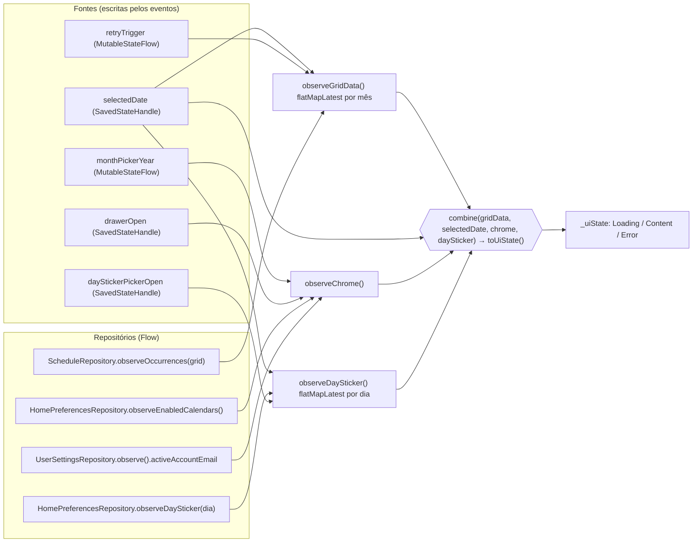

Consequências diretas desse desenho:

- **Atualização automática.** Quando outra tela grava no Room, `observeOccurrences` reemite e a grade se refaz.
- **Rotação e morte de processo.** Dia selecionado, gaveta e seletor de adesivo vivem no `SavedStateHandle`.
- **Troca de mês sem "piscar".** `flatMapLatest` cancela a consulta do mês anterior; `toUiState` devolve `null`
  enquanto o resultado é de outro mês (`filterNotNull` mantém o `Content` anterior).

### Fluxo 1: carregar e trocar de mês (dados do Room)

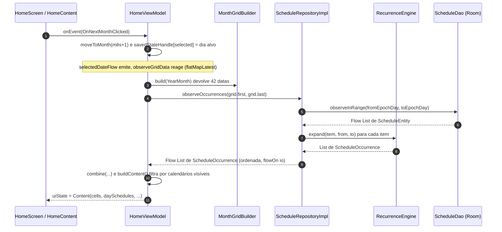

### Fluxo 2: gravação em DataStore (filtro de calendário e adesivo do dia)

Mesmo mecanismo para os dois: o evento chama o repositório e **não** altera o estado. A UI só muda quando o
`Flow` do DataStore reemite (fonte única de verdade). Falha de gravação (`IOException`) é ignorada: o estado
continua igual ao que está persistido.

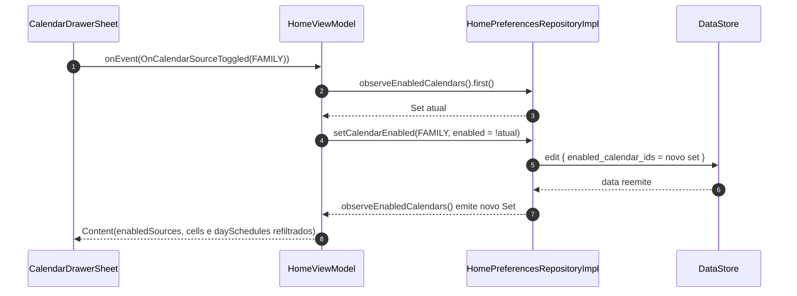

### Fluxo 3: navegação por efeito (quick add, toque duplo, detalhe, pesquisa, configurações)

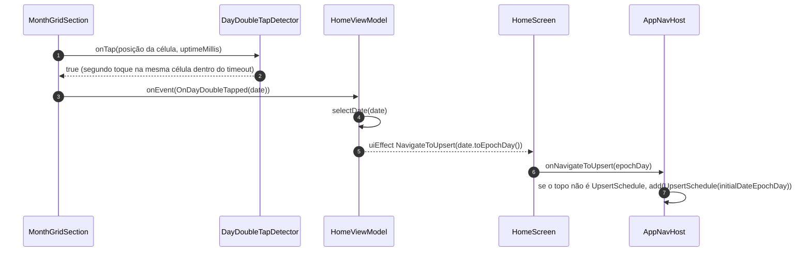

### Eventos da Home (detalhados)

| Família | Evento | Efeito no ViewModel |
|---|---|---|
| (raiz) | `OnPreviousMonthClicked` / `OnNextMonthClicked` | `moveToMonth(±1)`: hoje, se é o mês atual; senão o mesmo dia limitado ao fim do mês |
| (raiz) | `OnMonthHeaderClicked` / `OnMonthPickerDismissed` | abre/fecha o seletor (`monthPickerYearFlow`) |
| (raiz) | `OnMonthPickerYearChanged(delta)` / `OnMonthPicked(month)` | troca o ano exibido / fecha e navega para o mês |
| (raiz) | `OnSearchClicked` | efeito `NavigateToSearch` |
| (raiz) | `OnQuickAddClicked` | efeito `NavigateToUpsert(dia selecionado)` |
| (raiz) | `OnScheduleClicked(id)` | efeito `NavigateToDetail(id)` |
| (raiz) | `OnRetryClicked` | incrementa `retryTrigger` (reassina o Flow do mês) |
| `DayCellEvent` | `OnDayClicked(date)` | `selectDate(date)` |
| `DayCellEvent` | `OnDayDoubleTapped(date)` | `selectDate` + efeito `NavigateToUpsert(date)` |
| `DrawerEvent` | `OnMenuClicked` / `OnDrawerDismissed` | `savedStateHandle[drawer] = true/false` |
| `DrawerEvent` | `OnCalendarSourceToggled(source)` | `HomePreferencesRepository.setCalendarEnabled` |
| `DrawerEvent` | `OnSettingsClicked` | fecha gaveta + efeito `NavigateToSettings` |
| `DayStickerEvent` | `OnDayStickerClicked` / `OnDayStickerPickerDismissed` | abre/fecha seletor de adesivo |
| `DayStickerEvent` | `OnDayStickerSelected(emoji?)` | fecha seletor + `HomePreferencesRepository.setDaySticker` |

**Efeitos:** `NavigateToSearch`, `NavigateToUpsert(epochDay)`, `NavigateToDetail(id)`, `NavigateToSettings`.
Os demais ViewModels seguem este mesmo modelo de "efeito de navegação → lambda do host"; nas próximas seções ele
só é citado.

A Home também inclui o [`NotificationPermissionEffect`](../app/src/main/java/com/br/androideventscheduler/core/permissions/NotificationPermissionEffect.kt),
que pede `POST_NOTIFICATIONS` uma única vez (API 33+), sem passar pelo ViewModel: é detalhe de plataforma da UI.
A política de toque duplo sem atrasar o toque simples está em
[`docs/decisoes/toque-duplo-sem-atrasar-o-toque-simples.md`](decisoes/toque-duplo-sem-atrasar-o-toque-simples.md).

## F4. Criar e editar agendamento (com recorrência, cor e adesivo)

**Propósito.** Formulário único para criar (sem `scheduleId`) e editar (com `scheduleId`) um **Evento** ou um
**Lembrete**: título, datas e horas com seletores inline e atalhos, dia inteiro, alerta, calendário, local, notas,
repetição (diária/semanal com limite), cor e adesivo. Ao salvar, grava e agenda o alarme. Specs 07, 08, 09 e 18.

**Classes**

| Camada | Classes |
|---|---|
| UI | [`UpsertScheduleScreen`](../app/src/main/java/com/br/androideventscheduler/feature/upsert/presentation/screen/UpsertScheduleScreen.kt), [`DateTimeSection`](../app/src/main/java/com/br/androideventscheduler/feature/upsert/presentation/component/DateTimeSection.kt), [`InlineDatePicker`](../app/src/main/java/com/br/androideventscheduler/feature/upsert/presentation/component/InlineDatePicker.kt), [`InlineTimePicker`](../app/src/main/java/com/br/androideventscheduler/feature/upsert/presentation/component/InlineTimePicker.kt), [`QuickChipsRow`](../app/src/main/java/com/br/androideventscheduler/feature/upsert/presentation/component/QuickChipsRow.kt), [`ModeSegmentedPill`](../app/src/main/java/com/br/androideventscheduler/feature/upsert/presentation/component/ModeSegmentedPill.kt), [`RecurrencePickerDialog`](../app/src/main/java/com/br/androideventscheduler/feature/upsert/presentation/component/RecurrencePickerDialog.kt) + [`RecurrenceDialogState`](../app/src/main/java/com/br/androideventscheduler/feature/upsert/presentation/component/RecurrenceDialogState.kt), [`ColorPickerDialog`](../app/src/main/java/com/br/androideventscheduler/core/ui/component/ColorPickerDialog.kt), [`StickerPickerDialog`](../app/src/main/java/com/br/androideventscheduler/core/ui/component/StickerPickerDialog.kt), [`DatePickerMillis`](../app/src/main/java/com/br/androideventscheduler/feature/upsert/presentation/mapper/DatePickerMillis.kt) |
| Estado/Evento/Efeito | [`UpsertScheduleUiState`](../app/src/main/java/com/br/androideventscheduler/feature/upsert/presentation/state/UpsertScheduleUiState.kt), [`ActiveInlinePicker`](../app/src/main/java/com/br/androideventscheduler/feature/upsert/presentation/state/ActiveInlinePicker.kt), [`UpsertScheduleUiEvent`](../app/src/main/java/com/br/androideventscheduler/feature/upsert/presentation/event/UpsertScheduleUiEvent.kt), [`UpsertScheduleUiEffect`](../app/src/main/java/com/br/androideventscheduler/feature/upsert/presentation/effect/UpsertScheduleUiEffect.kt) |
| ViewModel | [`UpsertScheduleViewModel`](../app/src/main/java/com/br/androideventscheduler/feature/upsert/presentation/viewmodel/UpsertScheduleViewModel.kt) |
| Domínio | [`SaveScheduleUseCase`](../app/src/main/java/com/br/androideventscheduler/feature/upsert/domain/usecase/SaveScheduleUseCase.kt), [`SaveScheduleError`](../app/src/main/java/com/br/androideventscheduler/feature/upsert/domain/model/SaveScheduleError.kt), [`ScheduleDraftTimeRules`](../app/src/main/java/com/br/androideventscheduler/feature/upsert/domain/ScheduleDraftTimeRules.kt), [`ScheduleNextAlarmUseCase`](../app/src/main/java/com/br/androideventscheduler/core/alarm/domain/usecase/ScheduleNextAlarmUseCase.kt), [`AlarmScheduler`](../app/src/main/java/com/br/androideventscheduler/core/alarm/domain/scheduler/AlarmScheduler.kt) |
| Dados | `ScheduleRepositoryImpl`, `UserSettingsRepositoryImpl`, [`AndroidAlarmScheduler`](../app/src/main/java/com/br/androideventscheduler/core/alarm/data/AndroidAlarmScheduler.kt) |
| DI/Navegação | [`UpsertModule`](../app/src/main/java/com/br/androideventscheduler/feature/upsert/di/UpsertModule.kt), [`UpsertEntry`](../app/src/main/java/com/br/androideventscheduler/feature/upsert/navigation/UpsertEntry.kt) |

**Por que há UseCase:** salvar orquestra **banco + alarme** e concentra a validação (título em branco, fim antes do
início). As regras de data/hora do rascunho (manter duração ao mover o início, fim nunca antes do início, atalhos,
troca de modo) ficam em `ScheduleDraftTimeRules`, um `object` puro sem I/O usado só por esta tela.

### Fluxo 1: abrir o formulário

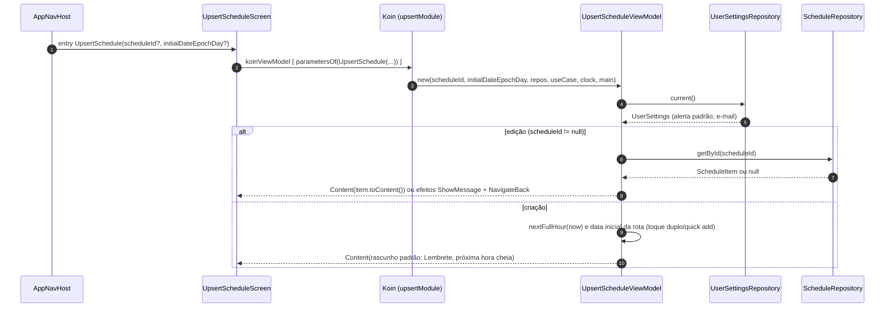

### Fluxo 2: editar o rascunho (sem I/O)

Todos os eventos de campo, data/hora, recorrência e aparência apenas transformam o `Content` com
`updateContent { ... }`. Nenhum toca no repositório: o rascunho só vira `ScheduleItem` no Salvar.

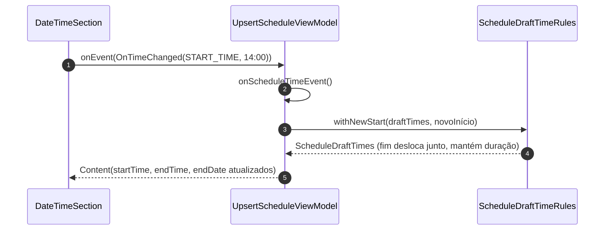

### Fluxo 3: salvar (com UseCase)

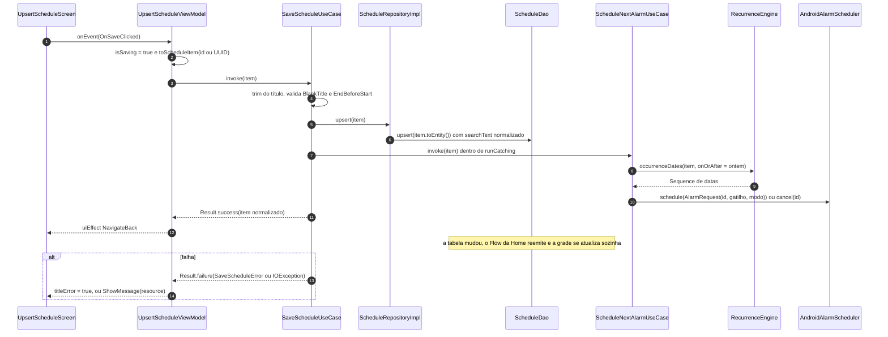

### Eventos (por família)

| Família | Eventos | Comportamento |
|---|---|---|
| `FieldEvent` | `OnModeSelected`, `OnTitleChanged`, `OnReminderOffsetSelected`, `OnCalendarSourceSelected`, `OnLocationChanged`, `OnNotesChanged` | atualiza o rascunho; trocar o modo aplica `switchToEvent`/`switchToReminder` e o calendário padrão do tipo |
| `ScheduleTimeEvent` | `OnAllDayToggled`, `OnPickerToggled`, `OnDateSelected`, `OnTimeChanged`, `OnQuickDateChipClicked`, `OnQuickTimeChipClicked` | delega a `ScheduleDraftTimeRules`; só um seletor inline aberto por vez |
| `RecurrenceEvent` | `OnRecurrenceRowClicked`, `OnRecurrenceDialogDismissed`, `OnRecurrencePatternConfirmed(pattern)` | o diálogo edita um rascunho local e só devolve o `RecurrencePattern` ao confirmar |
| `AppearanceEvent` | `OnStickerButtonClicked`, `OnStickerPickerDismissed`, `OnStickerSelected`, `OnColorButtonClicked`, `OnColorPickerDismissed`, `OnColorSelected` | visibilidade dos diálogos e valor escolhido |
| (raiz) | `OnSaveClicked`, `OnCancelClicked` | salvar (fluxo acima) / efeito `NavigateBack` |

**Efeitos:** `NavigateBack` e `ShowMessage(@StringRes)`.

## F5. Detalhes do agendamento: duplicar, excluir e compartilhar

**Propósito.** Mostrar o agendamento já formatado e oferecer **Editar**, **Duplicar**, **Excluir** (com
confirmação) e **Compartilhar** (texto pelo share sheet). A tela **observa** o item: reflete edições e fecha
sozinha se ele for excluído. Specs 10, 11 e 12.

**Classes**

| Camada | Classes |
|---|---|
| UI | [`ScheduleDetailScreen`](../app/src/main/java/com/br/androideventscheduler/feature/detail/presentation/screen/ScheduleDetailScreen.kt), [`ScheduleActionBar`](../app/src/main/java/com/br/androideventscheduler/feature/detail/presentation/component/ScheduleActionBar.kt), [`DeleteConfirmationDialog`](../app/src/main/java/com/br/androideventscheduler/feature/detail/presentation/component/DeleteConfirmationDialog.kt), [`DetailInfoRow`](../app/src/main/java/com/br/androideventscheduler/feature/detail/presentation/component/DetailInfoRow.kt), [`ShareLauncher`](../app/src/main/java/com/br/androideventscheduler/feature/detail/presentation/screen/ShareLauncher.kt) (`launchShareChooser`) |
| Estado/Evento/Efeito | [`ScheduleDetailUiState`](../app/src/main/java/com/br/androideventscheduler/feature/detail/presentation/state/ScheduleDetailUiState.kt) (+ `ScheduleDetailUi`), [`ScheduleDetailUiEvent`](../app/src/main/java/com/br/androideventscheduler/feature/detail/presentation/event/ScheduleDetailUiEvent.kt), [`ScheduleDetailUiEffect`](../app/src/main/java/com/br/androideventscheduler/feature/detail/presentation/effect/ScheduleDetailUiEffect.kt) |
| Mappers | [`ScheduleDetailMapper`](../app/src/main/java/com/br/androideventscheduler/feature/detail/presentation/mapper/ScheduleDetailMapper.kt), [`ScheduleShareTextBuilder`](../app/src/main/java/com/br/androideventscheduler/feature/detail/presentation/mapper/ScheduleShareTextBuilder.kt), [`StringProvider`](../app/src/main/java/com/br/androideventscheduler/core/common/StringProvider.kt) → [`AndroidStringProvider`](../app/src/main/java/com/br/androideventscheduler/core/common/AndroidStringProvider.kt) |
| ViewModel | [`ScheduleDetailViewModel`](../app/src/main/java/com/br/androideventscheduler/feature/detail/presentation/viewmodel/ScheduleDetailViewModel.kt) |
| Domínio | [`DuplicateScheduleUseCase`](../app/src/main/java/com/br/androideventscheduler/feature/detail/domain/usecase/DuplicateScheduleUseCase.kt), [`DeleteScheduleUseCase`](../app/src/main/java/com/br/androideventscheduler/feature/detail/domain/usecase/DeleteScheduleUseCase.kt), `ScheduleRepository`, `ScheduleNextAlarmUseCase`, `AlarmScheduler`, [`ScheduleNotFoundException`](../app/src/main/java/com/br/androideventscheduler/core/schedule/domain/model/ScheduleNotFoundException.kt) |
| DI/Navegação | [`DetailModule`](../app/src/main/java/com/br/androideventscheduler/feature/detail/di/DetailModule.kt), [`DetailEntry`](../app/src/main/java/com/br/androideventscheduler/feature/detail/navigation/DetailEntry.kt) |

**UseCases:** duplicar (copiar + agendar alarme da cópia) e excluir (apagar + cancelar alarme, **nessa ordem**).
Compartilhar **não** tem UseCase: o ViewModel monta o texto com o `ScheduleShareTextBuilder` e emite um efeito; quem
dispara o `Intent` é a tela (precisa da `Activity`).

### Fluxo 1: observar o item

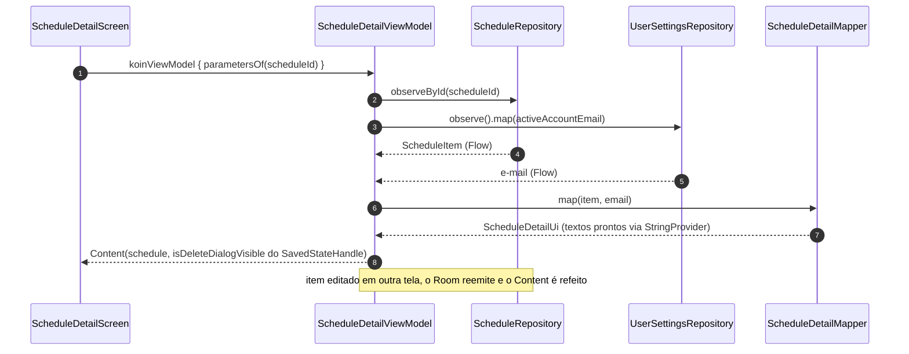

### Fluxo 2: excluir (o retorno chega pelo Flow, não pelo Result)

Este é o caso mais interessante da tela: **em sucesso o ViewModel não emite `NavigateBack`**. A exclusão faz o
`observeById` emitir `null`, e é a observação que fecha a tela. Assim existe um único caminho de saída, seja a
exclusão feita aqui ou em outro lugar.

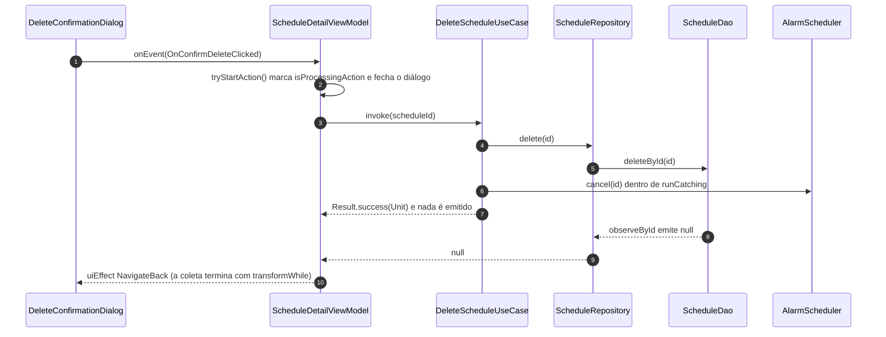

### Fluxo 3: duplicar e abrir a cópia

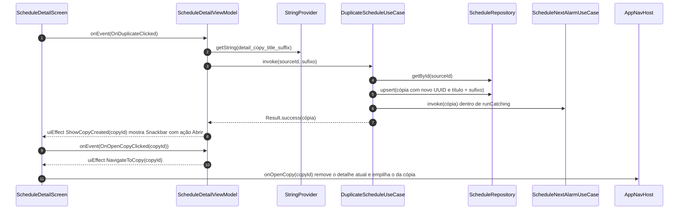

**Compartilhar** segue o mecanismo de efeito já visto: `OnShareClicked` → `ScheduleShareTextBuilder.build(...)` →
efeito `ShareText(subject, body)` → `launchShareChooser(context, ...)` na tela, com Toast se nenhum app aceitar.

**Proteção contra toques repetidos.** `tryStartAction()` marca `isProcessingAction` **de forma síncrona**, antes de
lançar a corrotina; o segundo toque encontra a flag ligada e é ignorado. O mesmo padrão aparece no alarme em tela
cheia e no backup.

**Eventos:** `OnBackClicked`, `OnEditClicked`, `OnDuplicateClicked`, `OnDeleteClicked`, `OnDismissDeleteDialog`,
`OnConfirmDeleteClicked`, `OnShareClicked`, `OnOpenCopyClicked(copyId)`.
**Efeitos:** `NavigateBack`, `NavigateToEdit(id)`, `NavigateToCopy(id)`, `ShowMessage`, `ShowCopyCreated(id)`, `ShareText`.

## F6. Pesquisa

**Propósito.** Buscar agendamentos por título, notas e local, sem diferenciar acentos nem caixa, com filtro por tipo
(Todos/Eventos/Lembretes). Spec 13.

**Classes:** [`SearchScreen`](../app/src/main/java/com/br/androideventscheduler/feature/search/presentation/screen/SearchScreen.kt),
[`SearchFilterChips`](../app/src/main/java/com/br/androideventscheduler/feature/search/presentation/component/SearchFilterChips.kt),
[`SearchResultItem`](../app/src/main/java/com/br/androideventscheduler/feature/search/presentation/component/SearchResultItem.kt),
[`SearchEmptyState`](../app/src/main/java/com/br/androideventscheduler/feature/search/presentation/component/SearchEmptyState.kt),
[`SearchViewModel`](../app/src/main/java/com/br/androideventscheduler/feature/search/presentation/viewmodel/SearchViewModel.kt),
[`SearchUiState`](../app/src/main/java/com/br/androideventscheduler/feature/search/presentation/state/SearchUiState.kt),
[`SearchResultUi`](../app/src/main/java/com/br/androideventscheduler/feature/search/presentation/state/SearchResultUi.kt),
[`SearchUiEvent`](../app/src/main/java/com/br/androideventscheduler/feature/search/presentation/event/SearchUiEvent.kt),
[`SearchUiEffect`](../app/src/main/java/com/br/androideventscheduler/feature/search/presentation/effect/SearchUiEffect.kt),
[`SearchResultMapper`](../app/src/main/java/com/br/androideventscheduler/feature/search/presentation/mapper/SearchResultMapper.kt),
[`SearchFilter`](../app/src/main/java/com/br/androideventscheduler/feature/search/domain/model/SearchFilter.kt),
`ScheduleRepository.search`, `ScheduleDao.search`, `SearchTextNormalizer`,
[`SearchModule`](../app/src/main/java/com/br/androideventscheduler/feature/search/di/SearchModule.kt),
[`SearchEntry`](../app/src/main/java/com/br/androideventscheduler/feature/search/navigation/SearchEntry.kt).
**Sem UseCase** (pesquisar é delegação pura ao repositório).

Usa o mesmo mecanismo de **estado derivado** da Home: texto e filtro vivem no `SavedStateHandle`, e o `uiState`
é um `combine(query, filter, resultsStatus)`. O que muda é o tratamento do texto:

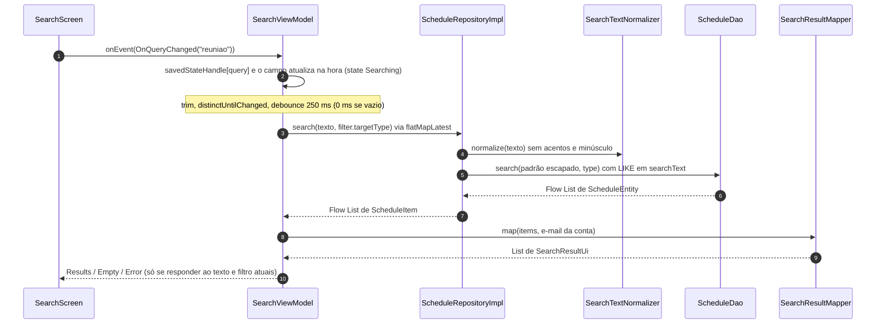

- `flatMapLatest` cancela a consulta anterior quando o texto ou o filtro mudam; trocar o filtro reconsulta na hora,
  sem debounce.
- Enquanto a resposta não corresponde ao texto/filtro atuais, a tela fica em `Searching(previousResults)`, sem
  piscar para vazio.
- `ScheduleRepositoryImpl.escapeLikePattern` faz `%`, `_` e `\` digitados serem procurados literalmente.
- O `SearchResultMapper` recebe o `StringProvider` (do `commonModule`), como os mappers de Detail e Alarm. Por isso o
  `SearchViewModelTest` roda na JVM com `FakeStringProvider`, sem Robolectric (PR #32).

**Eventos:** `OnQueryChanged`, `OnClearQueryClicked`, `OnFilterSelected`, `OnRetryClicked`, `OnResultClicked(id)`,
`OnBackClicked`. **Efeitos:** `NavigateToDetail(id)` (o host empilha o detalhe por cima da busca) e `NavigateBack`.

## F7. Configurações e tema claro/escuro

**Propósito.** Editar as preferências globais (e-mail da conta, alerta padrão, adiar padrão, alerta em tela cheia)
com **Salvar** explícito, escolher o **tema** (Sistema/Claro/Escuro, gravado na hora) e abrir importar/exportar.
Specs 03 e 19.

**Classes:** [`SettingsScreen`](../app/src/main/java/com/br/androideventscheduler/feature/settings/presentation/screen/SettingsScreen.kt),
[`SettingsRows`](../app/src/main/java/com/br/androideventscheduler/feature/settings/presentation/component/SettingsRows.kt),
[`SettingsViewModel`](../app/src/main/java/com/br/androideventscheduler/feature/settings/presentation/viewmodel/SettingsViewModel.kt),
[`SettingsUiState`](../app/src/main/java/com/br/androideventscheduler/feature/settings/presentation/state/SettingsUiState.kt),
[`SettingsUiEvent`](../app/src/main/java/com/br/androideventscheduler/feature/settings/presentation/event/SettingsUiEvent.kt),
[`SettingsUiEffect`](../app/src/main/java/com/br/androideventscheduler/feature/settings/presentation/effect/SettingsUiEffect.kt),
[`UserSettings`](../app/src/main/java/com/br/androideventscheduler/core/preferences/domain/UserSettings.kt) (com `validate()`),
[`ThemeMode`](../app/src/main/java/com/br/androideventscheduler/core/preferences/domain/ThemeMode.kt),
`UserSettingsRepository`/`Impl`, `ThemePreferenceRepository`/`Impl`,
[`SettingsModule`](../app/src/main/java/com/br/androideventscheduler/feature/settings/di/SettingsModule.kt),
[`SettingsEntry`](../app/src/main/java/com/br/androideventscheduler/feature/settings/navigation/SettingsEntry.kt).
**Sem UseCase:** a validação é do próprio modelo de domínio (`UserSettings.validate()`) e a gravação é delegação pura.

Duas formas de gravar convivem na mesma tela, e é por isso que o tema tem **repositório próprio**:

| | Rascunho (`draft`) | Tema (`themeMode`) |
|---|---|---|
| Leitura | **uma vez** (`current()`): reemissões não sobrescrevem o que está sendo editado | **observada** (`observe()`) |
| Gravação | só no **Salvar**, depois de `validate()` | **na hora** do toque |
| Repositório | `UserSettingsRepository.save()` (regrava todas as chaves) | `ThemePreferenceRepository.set()` (uma chave) |

### Fluxo 1: salvar o rascunho

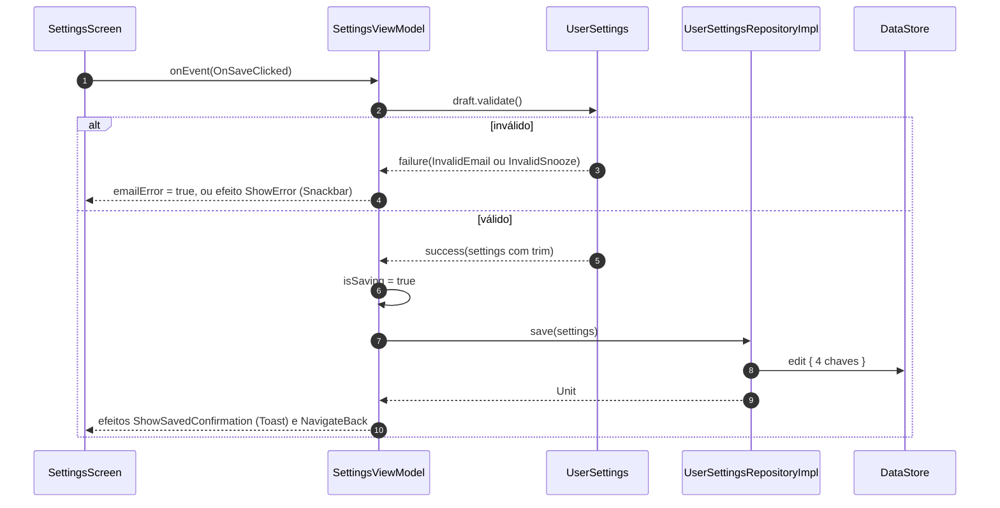

### Fluxo 2: trocar o tema (um evento, dois observadores)

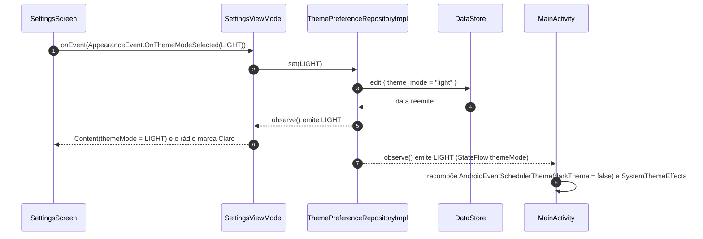

A `FullScreenAlarmActivity` observa o mesmo repositório, então o alarme também abre no tema escolhido.
`ThemeMode.isDark(systemInDarkTheme)` em [`ThemeResolution.kt`](../app/src/main/java/com/br/androideventscheduler/core/designsystem/ThemeResolution.kt)
é a regra pura que resolve "Sistema".

**Eventos:** `OnEmailChanged`, `OnReminderSelected`, `OnSnoozeSelected`, `OnFullScreenToggled` (mexem só no
rascunho), `AppearanceEvent.OnThemeModeSelected`, `OnSaveClicked`, `OnBackClicked`, `OnBackupClicked`.
**Efeitos:** `NavigateBack`, `NavigateToBackup`, `ShowSavedConfirmation` (Toast, sobrevive à saída da tela),
`ShowError` (Snackbar).

## F8. Alarmes e notificações (disparo e deep link)

**Propósito.** No horário (início − antecedência), avisar o usuário: **notificação** para lembretes e
**tela cheia** para eventos (quando permitido), e reagendar a próxima ocorrência da série. Tocar na notificação
abre o detalhe. Spec 04.

Esta funcionalidade **não tem ViewModel**: o ponto de entrada é um `BroadcastReceiver`, que chama o domínio pelo
Koin. É o caso em que o fluxo vai "do sistema ao domínio" em vez de "da UI ao domínio".

**Classes:** [`AlarmScheduler`](../app/src/main/java/com/br/androideventscheduler/core/alarm/domain/scheduler/AlarmScheduler.kt) →
[`AndroidAlarmScheduler`](../app/src/main/java/com/br/androideventscheduler/core/alarm/data/AndroidAlarmScheduler.kt),
[`AlarmRequest`](../app/src/main/java/com/br/androideventscheduler/core/alarm/domain/model/AlarmRequest.kt),
[`AlertPresentationMode`](../app/src/main/java/com/br/androideventscheduler/core/alarm/domain/model/AlertPresentationMode.kt),
[`AlarmIntents`](../app/src/main/java/com/br/androideventscheduler/core/alarm/data/AlarmIntents.kt),
[`ScheduleAlarmReceiver`](../app/src/main/java/com/br/androideventscheduler/core/alarm/data/ScheduleAlarmReceiver.kt),
[`ScheduleNotifier`](../app/src/main/java/com/br/androideventscheduler/core/alarm/data/notification/ScheduleNotifier.kt),
[`NotificationChannels`](../app/src/main/java/com/br/androideventscheduler/core/alarm/data/notification/NotificationChannels.kt),
[`ScheduleNextAlarmUseCase`](../app/src/main/java/com/br/androideventscheduler/core/alarm/domain/usecase/ScheduleNextAlarmUseCase.kt),
`RecurrenceEngine`, `ScheduleRepository`, `UserSettingsRepository`, `DeepLinkState`, `DeepLinkEffect`.

### Fluxo 1: agendar (chamado por Save, Duplicate, Import, Reschedule e pelo próprio receiver)

`ScheduleNextAlarmUseCase` busca a primeira ocorrência cujo gatilho seja **estritamente futuro**
(`RecurrenceEngine.occurrenceDates(item, onOrAfter = ontem)`), calcula `início − antecedência` (dia inteiro usa
09:00) e chama `AlarmScheduler.schedule(...)`; sem antecedência ou sem ocorrência futura, chama `cancel(id)`.
O `AndroidAlarmScheduler` usa alarme exato quando permitido e cai para o inexato sem lançar exceção. Um
`PendingIntent` por item (URI `rememberme://alarm/<id>`) garante **no máximo um alarme pendente por item**.

### Fluxo 2: disparo

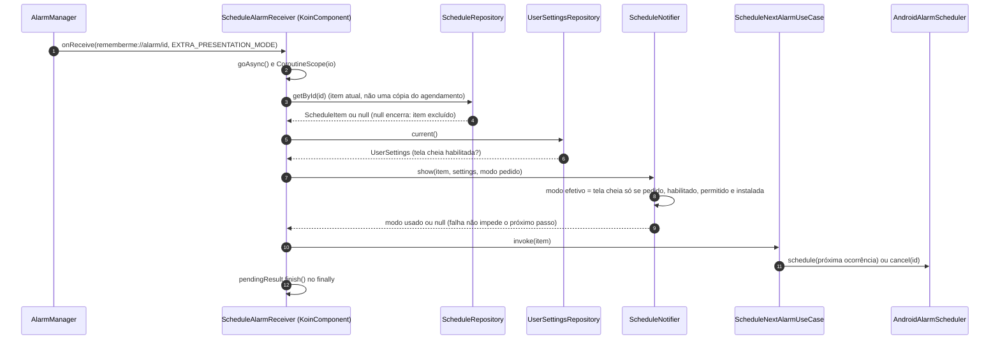

### Fluxo 3: toque na notificação → detalhe

```mermaid
sequenceDiagram
    autonumber
    participant NT as Notificação
    participant MA as MainActivity
    participant DLS as DeepLinkState (single)
    participant FX as DeepLinkEffect
    participant H as back stack

    NT->>MA: PendingIntent (SINGLE_TOP, CLEAR_TOP) com EXTRA_SCHEDULE_ID
    MA->>DLS: set(id) em onCreate ou onNewIntent
    DLS-->>FX: pendingScheduleId (StateFlow)
    FX->>H: se o topo é Home, add(ScheduleDetail(id))
    FX->>DLS: consume(id)
    Note over H: a tela de detalhe segue o fluxo da F5
```

## F9. Alarme em tela cheia e adiar

**Propósito.** Para eventos, abrir uma tela sobre a tela de bloqueio com título, horário, local e notas, e as
ações **Dispensar** e **Adiar** (5/10/15 min, padrão vindo das configurações). Spec 14.

**Classes:** [`FullScreenAlarmActivity`](../app/src/main/java/com/br/androideventscheduler/feature/alarm/presentation/screen/FullScreenAlarmActivity.kt),
[`FullScreenAlarmScreen`](../app/src/main/java/com/br/androideventscheduler/feature/alarm/presentation/screen/FullScreenAlarmScreen.kt),
[`SnoozeChipsRow`](../app/src/main/java/com/br/androideventscheduler/feature/alarm/presentation/component/SnoozeChipsRow.kt),
[`AlarmActionButtons`](../app/src/main/java/com/br/androideventscheduler/feature/alarm/presentation/component/AlarmActionButtons.kt),
[`FullScreenAlarmViewModel`](../app/src/main/java/com/br/androideventscheduler/feature/alarm/presentation/viewmodel/FullScreenAlarmViewModel.kt),
[`FullScreenAlarmUiState`](../app/src/main/java/com/br/androideventscheduler/feature/alarm/presentation/state/FullScreenAlarmUiState.kt),
[`FullScreenAlarmUiEvent`](../app/src/main/java/com/br/androideventscheduler/feature/alarm/presentation/event/FullScreenAlarmUiEvent.kt),
[`FullScreenAlarmUiEffect`](../app/src/main/java/com/br/androideventscheduler/feature/alarm/presentation/effect/FullScreenAlarmUiEffect.kt),
[`FullScreenAlarmMapper`](../app/src/main/java/com/br/androideventscheduler/feature/alarm/presentation/mapper/FullScreenAlarmMapper.kt),
[`SnoozeAlarmUseCase`](../app/src/main/java/com/br/androideventscheduler/core/alarm/domain/usecase/SnoozeAlarmUseCase.kt),
[`AlarmFeatureModule`](../app/src/main/java/com/br/androideventscheduler/feature/alarm/di/AlarmFeatureModule.kt).

Diferente das outras telas, esta **não passa pelo `AppNavHost`**: é uma Activity própria (`singleTop`, não
exportada), aberta pelo `fullScreenIntent` da notificação. O ViewModel é criado com
`koinViewModel(key = scheduleId) { parametersOf(scheduleId) }`: a chave por id faz um novo alarme (`onNewIntent`
com outro item) ganhar um ViewModel novo.

```mermaid
sequenceDiagram
    autonumber
    participant ACT as FullScreenAlarmActivity
    participant S as FullScreenAlarmScreen
    participant VM as FullScreenAlarmViewModel
    participant R as ScheduleRepository
    participant USR as UserSettingsRepository
    participant M as FullScreenAlarmMapper
    participant UC as SnoozeAlarmUseCase
    participant AS as AlarmScheduler

    ACT->>ACT: setShowWhenLocked e setTurnScreenOn, lê EXTRA_SCHEDULE_ID
    ACT->>S: FullScreenAlarmScreen(scheduleId, reloadSignal)
    S->>VM: koinViewModel(key = id) { parametersOf(id) }
    VM->>R: getById(id)
    VM->>USR: current().defaultSnoozeMinutes
    VM->>M: map(item, snoozeMinutes)
    M-->>VM: Content(título, horário, minutos até o início, ...)
    VM-->>S: uiState Content
    S->>VM: onEvent(OnSnoozeClicked)
    VM->>VM: isProcessing = true (síncrono)
    VM->>UC: invoke(id, selectedSnoozeMinutes)
    UC->>R: getById(id)
    UC->>AS: schedule(AlarmRequest(id, agora + N min, modo))
    UC-->>VM: Result.success(gatilho)
    VM-->>S: efeito CloseScreen(cancelNotification = true)
    S->>ACT: onClose(true) cancela a notificação e finish()
```

`SnoozeAlarmUseCase` **não altera o item**: agenda um disparo avulso que substitui o pendente. Quando ele dispara,
o `ScheduleAlarmReceiver` (F8) chama `ScheduleNextAlarmUseCase` e a série volta ao normal.

**Eventos:** `OnSnoozeDurationSelected(min)`, `OnSnoozeClicked`, `OnDismissClicked`, `OnBackPressed`,
`OnReloadRequested` (novo alarme com a tela aberta). **Efeito:** só `CloseScreen(cancelNotification)`.
Item inexistente fecha cancelando a notificação órfã; falha de leitura fecha sem cancelar.

## F10. Restauração dos alarmes após boot

**Propósito.** O `AlarmManager` perde os alarmes no reboot, e eles podem ficar errados após mudança de fuso/hora,
atualização do app ou mudança da permissão de alarme exato. Esta funcionalidade reagenda o próximo alarme de
**todos** os itens. Spec 15. Também sem ViewModel: mesmo mecanismo da F8 (receiver + `KoinComponent` + `goAsync`).

**Classes:** [`BootCompletedReceiver`](../app/src/main/java/com/br/androideventscheduler/core/alarm/data/BootCompletedReceiver.kt),
[`RescheduleAllAlarmsUseCase`](../app/src/main/java/com/br/androideventscheduler/core/alarm/domain/usecase/RescheduleAllAlarmsUseCase.kt),
[`RescheduleSummary`](../app/src/main/java/com/br/androideventscheduler/core/alarm/domain/model/RescheduleSummary.kt),
`ScheduleNextAlarmUseCase`, `ScheduleRepository`. Testes manuais via adb em [`testes-pos-boot-adb.md`](testes-pos-boot-adb.md).

```mermaid
sequenceDiagram
    autonumber
    participant SYS as Sistema
    participant RC as BootCompletedReceiver
    participant UC as RescheduleAllAlarmsUseCase
    participant R as ScheduleRepository
    participant NA as ScheduleNextAlarmUseCase
    participant AS as AlarmScheduler

    SYS->>RC: BOOT_COMPLETED, MY_PACKAGE_REPLACED, TIMEZONE_CHANGED, TIME_SET ou EXACT_ALARM_PERMISSION
    RC->>RC: goAsync() e CoroutineScope(io)
    RC->>UC: invoke() via get() do Koin
    UC->>R: getAll()
    R-->>UC: List de ScheduleItem
    loop cada item
        UC->>NA: invoke(item) dentro de runCatching
        NA->>AS: schedule ou cancel
        NA-->>UC: gatilho ou null (soma em scheduled, skipped ou failed)
    end
    UC-->>RC: Result.success(RescheduleSummary)
    RC->>RC: Log.i e pendingResult.finish()
```

Decisões: só `BOOT_COMPLETED` (sem `LOCKED_BOOT_COMPLETED`/`directBootAware`), porque o Room fica em armazenamento
protegido por credencial; o banco **não é regravado** (a próxima ocorrência é calculada); alertas perdidos com o
aparelho desligado não disparam retroativamente; falha de um item não interrompe os demais.

## F11. Importar e exportar a agenda

**Propósito.** Exportar a agenda inteira para um arquivo JSON (compartilhar pelo share sheet ou salvar pelo seletor
do sistema) e importar um arquivo com **pré-visualização** e **estratégia de conflito** (substituir, manter
existentes, importar como cópias). Também abre direto na pré-visualização quando outro app envia um `.json` para o
RememberMe. Spec 17. Formato em [`formato-agenda-json.md`](formato-agenda-json.md).

**Classes**

| Camada | Classes |
|---|---|
| UI | [`BackupScreen`](../app/src/main/java/com/br/androideventscheduler/feature/backup/presentation/screen/BackupScreen.kt), [`ShareFileLauncher`](../app/src/main/java/com/br/androideventscheduler/feature/backup/presentation/screen/ShareFileLauncher.kt), [`ExportSection`](../app/src/main/java/com/br/androideventscheduler/feature/backup/presentation/component/ExportSection.kt), [`ImportSection`](../app/src/main/java/com/br/androideventscheduler/feature/backup/presentation/component/ImportSection.kt), [`ImportPreviewCard`](../app/src/main/java/com/br/androideventscheduler/feature/backup/presentation/component/ImportPreviewCard.kt), [`ImportStrategySelector`](../app/src/main/java/com/br/androideventscheduler/feature/backup/presentation/component/ImportStrategySelector.kt) |
| Estado/Evento/Efeito | [`BackupUiState`](../app/src/main/java/com/br/androideventscheduler/feature/backup/presentation/state/BackupUiState.kt), [`BackupUiEvent`](../app/src/main/java/com/br/androideventscheduler/feature/backup/presentation/event/BackupUiEvent.kt), [`BackupUiEffect`](../app/src/main/java/com/br/androideventscheduler/feature/backup/presentation/effect/BackupUiEffect.kt) |
| ViewModel | [`BackupViewModel`](../app/src/main/java/com/br/androideventscheduler/feature/backup/presentation/viewmodel/BackupViewModel.kt) |
| Domínio | [`AgendaBackupRepository`](../app/src/main/java/com/br/androideventscheduler/feature/backup/domain/repository/AgendaBackupRepository.kt), [`ImportAgendaUseCase`](../app/src/main/java/com/br/androideventscheduler/feature/backup/domain/usecase/ImportAgendaUseCase.kt), [`ImportPreview`](../app/src/main/java/com/br/androideventscheduler/feature/backup/domain/model/ImportPreview.kt), [`ImportStrategy`](../app/src/main/java/com/br/androideventscheduler/feature/backup/domain/model/ImportStrategy.kt), [`ImportResult`](../app/src/main/java/com/br/androideventscheduler/feature/backup/domain/model/ImportResult.kt), [`ExportModels`](../app/src/main/java/com/br/androideventscheduler/feature/backup/domain/model/ExportModels.kt), [`BackupError`](../app/src/main/java/com/br/androideventscheduler/feature/backup/domain/model/BackupError.kt), [`BackupFileName`](../app/src/main/java/com/br/androideventscheduler/feature/backup/domain/model/BackupFileName.kt) |
| Dados | [`AgendaBackupRepositoryImpl`](../app/src/main/java/com/br/androideventscheduler/feature/backup/data/repository/AgendaBackupRepositoryImpl.kt), [`AgendaJsonCodec`](../app/src/main/java/com/br/androideventscheduler/feature/backup/data/codec/AgendaJsonCodec.kt), [`AgendaFileFormat`](../app/src/main/java/com/br/androideventscheduler/feature/backup/data/codec/AgendaFileFormat.kt), [`AgendaFileDto`](../app/src/main/java/com/br/androideventscheduler/feature/backup/data/dto/AgendaFileDto.kt), [`AgendaDtoMapper`](../app/src/main/java/com/br/androideventscheduler/feature/backup/data/mapper/AgendaDtoMapper.kt), [`DocumentStreams`](../app/src/main/java/com/br/androideventscheduler/feature/backup/data/file/DocumentStreams.kt), [`ExportFileStore`](../app/src/main/java/com/br/androideventscheduler/feature/backup/data/file/ExportFileStore.kt), [`AppVersionName`](../app/src/main/java/com/br/androideventscheduler/feature/backup/data/file/AppVersionName.kt), `ScheduleRepository` |
| DI/Navegação | [`BackupModule`](../app/src/main/java/com/br/androideventscheduler/feature/backup/di/BackupModule.kt), [`BackupEntry`](../app/src/main/java/com/br/androideventscheduler/feature/backup/navigation/BackupEntry.kt) |

Aqui o repositório da feature **compõe** o repositório do `core`: o `AgendaBackupRepositoryImpl` usa o
`ScheduleRepository` para ler a agenda e acrescenta codec JSON e acesso a arquivos. A **leitura** do arquivo fica no
repositório (não grava nada); a **gravação** fica no `ImportAgendaUseCase` (banco + alarmes), só depois da
confirmação do usuário.

### Fluxo 1: exportar e compartilhar

```mermaid
sequenceDiagram
    autonumber
    participant UI as BackupScreen
    participant VM as BackupViewModel
    participant R as AgendaBackupRepositoryImpl
    participant SR as ScheduleRepository
    participant C as AgendaJsonCodec
    participant FS as ExportFileStore

    UI->>VM: onEvent(OnShareExportClicked)
    VM->>VM: tryStart: isExporting = true
    VM->>R: export(ExportTarget.ShareCache)
    R->>SR: getAll()
    SR-->>R: List de ScheduleItem (vazia lança BackupError.EmptyAgenda)
    R->>C: encode(items, exportedAt, appVersion)
    C-->>R: JSON (via AgendaDtoMapper)
    R->>FS: writeShareFile(nome, conteúdo) em cacheDir/exports
    FS-->>R: content URI (FileProvider)
    R-->>VM: ExportResult(uri, fileName, itemCount)
    VM-->>UI: efeito ShareFile(uri, subject, body) com textos do StringProvider
    UI->>UI: launchExternalUi { share sheet com permissão de leitura da URI }
```

**Salvar em arquivo** usa o mecanismo de "efeito que abre UI do sistema e volta como evento": `OnSaveExportClicked`
→ efeito `LaunchCreateDocument(nomeSugerido)` → `ActivityResultContracts.CreateDocument` →
`OnSaveDocumentCreated(uri?)` → `export(ExportTarget.Document(uri))` → `DocumentStreams.writeText`.
A flag `isPickerOpen` ignora toques enquanto o seletor está aberto.

### Fluxo 2: importar (ler, pré-visualizar, confirmar)

```mermaid
sequenceDiagram
    autonumber
    participant UI as BackupScreen
    participant VM as BackupViewModel
    participant R as AgendaBackupRepositoryImpl
    participant D as DocumentStreams
    participant C as AgendaJsonCodec
    participant SR as ScheduleRepository
    participant UC as ImportAgendaUseCase
    participant NA as ScheduleNextAlarmUseCase

    UI->>VM: onEvent(OnPickImportClicked)
    VM-->>UI: efeito LaunchOpenDocument
    UI->>VM: onEvent(OnImportFileChosen(uri))
    VM->>R: readForImport(uri)
    R->>D: readText(uri, limite 5 MB)
    R->>C: decode(texto) valida formato, versão, limites e cada item
    C-->>R: DecodedAgenda(items válidos, invalidCount)
    R->>SR: getAll() para saber quais ids já existem
    R-->>VM: ImportPreview(novos, existentes, inválidos)
    VM-->>UI: Content(preview, strategy = REPLACE_EXISTING)
    UI->>VM: onEvent(OnStrategySelected(IMPORT_AS_COPIES))
    UI->>VM: onEvent(OnConfirmImportClicked)
    VM->>UC: invoke(preview, strategy, sufixo de cópia)
    UC->>UC: select() aplica a estratégia
    UC->>SR: upsertAll(selecionados) numa transação
    loop cada item gravado
        UC->>NA: invoke(item) dentro de runCatching
    end
    UC-->>VM: Result.success(ImportResult(importados, ignorados, falhas de alarme))
    VM-->>UI: efeitos ShowQuantityMessage (plurals) e NavigateBack
    alt arquivo recusado
        R-->>VM: BackupError (NotRememberMeFile, UnsupportedVersion, Corrupted, TooLarge, EmptyAgenda, Io)
        VM-->>UI: Content(importErrorRes) com texto de resource, nunca a mensagem da exceção
    end
```

**Arquivo recebido de outro app:** a [F1](#f1-inicialização-do-app-e-shell-de-navegação) valida a URI e empilha
`AgendaBackup(pendingImportUri)`. O `BackupModule` repassa a rota por `parametersOf`, e o `BackupViewModel` chama
`startReadImport(uri)` logo no `load()`, caindo direto no passo de pré-visualização do fluxo acima.

**Eventos:** `OnShareExportClicked`, `OnSaveExportClicked`, `OnSaveDocumentCreated(uri?)`, `OnPickImportClicked`,
`OnImportFileChosen(uri?)`, `OnStrategySelected`, `OnConfirmImportClicked`, `OnCancelImportClicked`, `OnBackClicked`.
**Efeitos:** `ShareFile`, `LaunchCreateDocument`, `LaunchOpenDocument`, `ShowMessage`, `ShowQuantityMessage`, `NavigateBack`.

---

## Apêndice A: Mapa de classes por funcionalidade

| Funcionalidade | Entrada | ViewModel | UseCase(s) | Repositório(s) | Fonte de dados |
|---|---|---|---|---|---|
| F1 Shell | `MainActivity`, `AppNavHost` | — | — | `ThemePreferenceRepository` | DataStore |
| F2 Splash | `SplashScreen` | `SplashViewModel` | — | — | — |
| F3 Home | `HomeScreen` | `HomeViewModel` | — | `ScheduleRepository`, `HomePreferencesRepository`, `UserSettingsRepository` | Room, DataStore |
| F4 Criar/editar | `UpsertScheduleScreen` | `UpsertScheduleViewModel` | `SaveScheduleUseCase` → `ScheduleNextAlarmUseCase` | `ScheduleRepository`, `UserSettingsRepository`, `AlarmScheduler` | Room, DataStore, AlarmManager |
| F5 Detalhe | `ScheduleDetailScreen` | `ScheduleDetailViewModel` | `DuplicateScheduleUseCase`, `DeleteScheduleUseCase` | `ScheduleRepository`, `UserSettingsRepository`, `AlarmScheduler` | Room, DataStore, AlarmManager |
| F6 Pesquisa | `SearchScreen` | `SearchViewModel` | — | `ScheduleRepository`, `UserSettingsRepository` | Room, DataStore |
| F7 Configurações | `SettingsScreen` | `SettingsViewModel` | — | `UserSettingsRepository`, `ThemePreferenceRepository` | DataStore |
| F8 Alarmes | `ScheduleAlarmReceiver` | — | `ScheduleNextAlarmUseCase` | `ScheduleRepository`, `UserSettingsRepository`, `AlarmScheduler` | Room, DataStore, AlarmManager, NotificationManager |
| F9 Tela cheia | `FullScreenAlarmActivity` | `FullScreenAlarmViewModel` | `SnoozeAlarmUseCase` | `ScheduleRepository`, `UserSettingsRepository`, `AlarmScheduler` | Room, DataStore, AlarmManager |
| F10 Pós-boot | `BootCompletedReceiver` | — | `RescheduleAllAlarmsUseCase` → `ScheduleNextAlarmUseCase` | `ScheduleRepository`, `AlarmScheduler` | Room, AlarmManager |
| F11 Backup | `BackupScreen` | `BackupViewModel` | `ImportAgendaUseCase` → `ScheduleNextAlarmUseCase` | `AgendaBackupRepository` (→ `ScheduleRepository`) | Room, arquivos (SAF/FileProvider) |

## Apêndice B: Funcionalidade planejada e não implementada

A spec [`16-autenticacao-dispositivo`](../.kiro/specs/16-autenticacao-dispositivo) (bloqueio do app com a credencial
do dispositivo) está planejada, mas **não existe no código** desta versão: não há pacote `core.security` nem
`AppLockController`. Os pontos de integração já estão marcados com comentários no código (por exemplo, o tratamento
de `ShareText` em `ScheduleDetailScreen` e o `launchExternalUi` em `BackupScreen`, onde a spec 16 chamará
`suppressNextLock()`), e a ordem de execução está em [`ordem-de-execucao.md`](../.kiro/specs/ordem-de-execucao.md).
