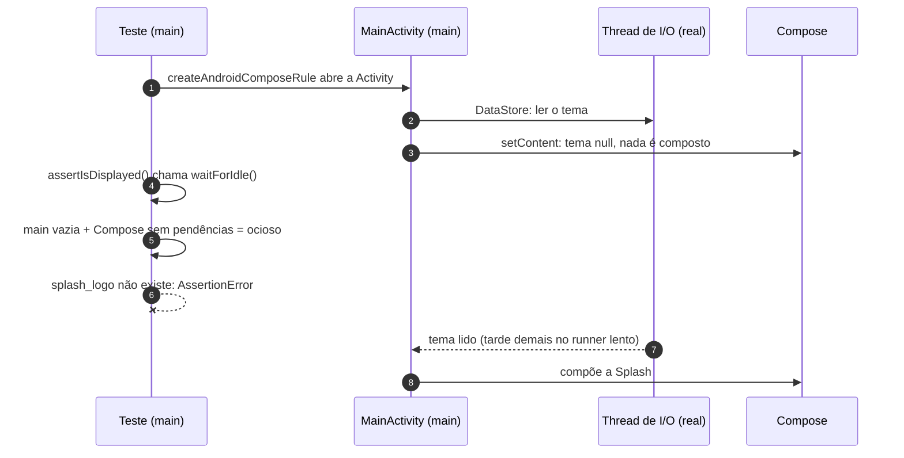

# Teste da Splash instável: o `waitForIdle` não espera threads reais

> Regra resumida no steering: [`arquitetura.md` §5.2.1](../../.kiro/steering/arquitetura.md) ("Testes com Activity
> real: esperar, nunca asserir de imediato"). Correção: PR #35. Este documento registra o diagnóstico completo, a
> hipótese errada que veio antes dele, as alternativas descartadas e as lições.

## 1. Resumo

Dois testes Robolectric que abrem a `MainActivity` falhavam às vezes no CI com
`The component with TestTag = 'splash_logo' is not displayed!`. A Splash **ainda não tinha aparecido**: a
`MainActivity` só compõe a primeira tela depois de ler o tema do DataStore numa **thread real** de I/O, e a primeira
asserção rodava antes de essa leitura terminar. O `waitForIdle()` do Compose, que toda asserção chama, só sincroniza
a main thread e o Compose; ele não sabe que existe trabalho em outra thread.

A correção está só nos testes: esperar a tela existir (`waitUntilWithMainLooper { hasNode(TAG) }`) antes de asserir,
e avançar o tempo da Splash de forma explícita no relógio virtual. Nenhuma linha de produção mudou.

## 2. Sintoma

| Quando | Onde | Teste que falhou | Linha |
|---|---|---|---|
| 09/11 | merge do #31 em `main` | `SplashNavigationRobolectricTest` | 24 |
| 13/11 | #33, tentativa 1 | `SplashNavigationRobolectricTest` | 24 |
| 13/11 | #33, tentativa 2 | `StartupAndSmokeRobolectricTest` | 35 |
| 13/11 | #34, tentativas 1 e 2 | `StartupAndSmokeRobolectricTest` | 35 |
| 13/11 | local, verificação da spec 20 (1 de 3 execuções) | `SplashNavigationRobolectricTest` | 24 |

As duas linhas eram a mesma coisa, a primeira instrução do teste:

```kotlin
@get:Rule val composeRule = createAndroidComposeRule<MainActivity>()   // abre a Activity antes do teste

@Test
fun `given app launched when main activity starts then splash is the first screen`() {
    composeRule.onNodeWithTag(SemanticsTags.SPLASH_LOGO).assertIsDisplayed()   // ← falhava aqui
    ...
}
```

Características que davam pistas:

- **só no CI**, quase nunca na máquina local;
- **sempre a primeira asserção**, nunca uma do meio;
- **nunca o mesmo teste duas vezes seguidas**: rodar de novo "resolvia";
- começou a aparecer **depois da spec 19** (tema claro/escuro).

Custo: cada PR afetado pagou de uma a duas execuções extras do CI (cerca de 3 minutos cada). E, pior, o time
aprendeu a ignorar um CI vermelho, o que esconde falhas reais.

## 3. A hipótese errada (e por que ela parecia certa)

A primeira explicação foi: *"a Splash fica 1,5 s na tela (`delay(1_500)` no `SplashViewModel`); num runner lento,
quando a asserção roda, a Splash já foi embora"*. Ela foi escrita nas descrições dos PRs #33 e #34.

Ela parecia certa porque:

- o teste falhava justamente na asserção da Splash;
- o `delay` existe e é real no app;
- "runner lento" combina com "só no CI".

Mas ela tinha um furo: **o Robolectric não usa tempo real**. Se a Splash sumisse por tempo, o relógio virtual teria
de andar 1,5 s antes da primeira asserção. Isso pedia uma medição, não um palpite.

## 4. Investigação

### 4.1 Como o tempo funciona no Robolectric (modo PAUSED)

- `SystemClock.uptimeMillis()` é **virtual**. Ele não acompanha o relógio de parede.
- Mensagens com atraso (`Handler.postDelayed`, que é como `delay` roda no `Dispatchers.Main`) só executam quando o
  relógio virtual chega no horário delas.
- O relógio virtual anda quando:
  - o teste pede: `shadowOf(looper).idleFor(...)`, `ShadowSystemClock.advanceBy(...)`;
  - ou **a cada quadro pedido ao `Choreographer`**. No Robolectric 4.17, com o `Choreographer` não pausado (o padrão),
    `ShadowDisplayEventReceiver.scheduleVsync()` faz `ShadowSystemClock.advanceBy(frameDelay)` com
    `frameDelay = 15 ms`.

### 4.2 Medição 1: tempo real não avança o relógio virtual

Um teste temporário mediu o relógio virtual em volta de um `Thread.sleep(2000)` real:

```
PROBE start uptime=145 splash=1
PROBE after real sleep 2s: uptime delta=45 real delta=2246
```

Em 2,2 s reais o relógio virtual andou 45 ms, e esses 45 ms vieram da espera de ociosidade feita pela própria
consulta, não do `sleep`. **Hipótese do §3 descartada**: tempo real não faz a Splash sumir.

### 4.3 Medição 2: o que a primeira espera encontra, sob carga

A mesma sonda, parametrizada em 25 execuções e rodada com a CPU sobrecarregada (16 processos `yes`) para imitar o
runner do CI, registrou o relógio virtual e quantos nós da Splash existiam após a primeira espera:

```
  1 uptimeAtStart=145 uptimeAfterFirstIdle=160 splash=0   ← a Splash ainda não existia
 10 uptimeAtStart=145 uptimeAfterFirstIdle=190 splash=1
  1 uptimeAtStart=145 uptimeAfterFirstIdle=205 splash=1
 13 uptimeAtStart=160 uptimeAfterFirstIdle=205 splash=1
```

Dois achados:

1. Em 1 das 25 execuções, a espera terminou com **zero** nós da Splash. Ela não tinha sumido; **não tinha
   aparecido**.
2. Mesmo sem falha, o relógio virtual no início do teste variava (145 ou 160 ms): um quadro a mais ou a menos,
   conforme o escalonamento real das threads. O relógio "virtual" não é totalmente determinístico quando há threads
   reais no meio.

### 4.4 Por que a Splash ainda não existia

A `MainActivity` (spec 19) segura a SplashScreen do sistema e **não compõe nada** até ler o tema:

```kotlin
private val themeMode: StateFlow<ThemeMode?> by lazy {
    themePreferenceRepository.observe().stateIn(lifecycleScope, SharingStarted.Eagerly, null)
}
...
setContent {
    val resolvedMode = themeMode.collectAsStateWithLifecycle().value ?: return@setContent   // null: nada é composto
    ...
}
```

O DataStore lê o arquivo num `CoroutineScope(SupervisorJob() + Dispatchers.IO)`, numa thread **real**. O resultado
volta para a main com um `Handler.post`.

Do outro lado, a espera do Compose no Robolectric
(`RobolectricIdlingStrategy.runUntilIdle()`, Compose UI Test 1.11.0) repete até ficar estável:

1. `Espresso.onIdle()`: drena a fila da **main thread**;
2. pede layout para as raízes Compose pendentes;
3. pergunta ao Compose e aos `IdlingResource`s registrados se estão ociosos.

Nenhum desses passos sabe que há uma leitura de arquivo em andamento numa thread de I/O. Enquanto ela não termina:
a main está vazia, o Compose não tem nada pendente (não há conteúdo), e o resultado é **ocioso**. A asserção roda e
o nó `splash_logo` não existe.



Na máquina local, o passo 7 quase sempre acontece antes do 4, porque o arquivo é novo, pequeno e o disco é rápido.
No runner do CI, às vezes não.

### 4.5 Reprodução determinística

Antes de corrigir, a falha foi reproduzida **sempre**, e não "às vezes". O repositório de tema foi trocado no Koin por
um que bloqueia uma thread de I/O por 500 ms reais antes de ler:

```kotlin
private class SlowThemePreferenceRepository(private val real: ThemePreferenceRepository) : ThemePreferenceRepository {
    override fun observe(): Flow<ThemeMode> = flow {
        withContext(Dispatchers.IO) { Thread.sleep(500) }   // disco lento
        emitAll(real.observe())
    }
    override suspend fun set(mode: ThemeMode) = real.set(mode)
}
```

Com ele, a asserção original falha em 100% das execuções, com a **mesma mensagem do CI**. Isso fecha a cadeia
causal: atraso na leitura do tema ⇒ asserção sem a Splash.

### 4.6 Por que só estes dois testes

Dos 22 testes que abrem uma Activity real, 20 já começavam com uma espera que tenta de novo:

```kotlin
composeRule.waitUntil(timeoutMillis = 10_000) {
    shadowOf(Looper.getMainLooper()).idle()
    composeRule.onAllNodesWithTag(TAG).fetchSemanticsNodes().isNotEmpty()
}
```

Esse padrão aguenta a thread lenta: ele volta a perguntar até a condição ficar verdadeira, e o `idle()` executa o
`Handler.post` que traz o resultado do I/O. Os dois testes da Splash foram escritos antes da spec 19, quando a
primeira tela era composta de forma síncrona e a asserção imediata funcionava sempre. A spec 19 mudou a premissa e
eles não foram revistos.

## 5. Correção

Só testes e documentação (PR #35):

| Mudança | O quê |
|---|---|
| `core/testing/ComposeWaits.kt` (novo) | `ComposeTestRule.waitUntilWithMainLooper(timeout = 10 s) { … }` e `ComposeTestRule.hasNode(tag)`: o padrão dos 20 testes corretos, agora compartilhado |
| `StartupAndSmokeRobolectricTest` | espera a Splash existir antes de `assertIsDisplayed()` |
| `SplashNavigationRobolectricTest` | espera a Splash; avança o relógio com `idleFor(SplashViewModel.SPLASH_DELAY_MILLIS)`; espera a Home. Saiu o prazo fixo de 5 s |
| `SlowThemeReadStartupRobolectricTest` (novo) | regressão: com a leitura do tema atrasada 500 ms, prova que após o `waitForIdle()` a Splash ainda não existe e que a espera a encontra |
| Steering §5.2.1, checklist §7, critério de aceite §5 | a regra, para não repetir |

Por que o `idleFor` explícito na navegação: antes, a Home só aparecia porque o `waitUntil` girava o suficiente para
que os quadros pedidos ao `Choreographer` somassem 1,5 s virtuais (cerca de 100 quadros de 15 ms). Funcionava, mas
dependia de quantos quadros o Robolectric desenha, que varia (§4.3). `idleFor(SPLASH_DELAY_MILLIS)` avança
exatamente o necessário, e usar a constante do app mantém o teste certo se o tempo da Splash mudar.

Verificação: duas execuções completas verdes (926 testes, 0 falhas); os três testes da Splash 10 vezes sob a mesma
carga de CPU, 10/10 verdes; CI do PR verde na primeira tentativa.

## 6. Alternativas descartadas

| Alternativa | Por que não |
|---|---|
| Ler o tema de forma síncrona na `MainActivity` (`runBlocking { first() }`) | I/O na main thread em produção, para facilitar um teste. A spec 19 escolheu de propósito segurar a SplashScreen do sistema até a leitura assíncrona terminar |
| Registrar um `IdlingResource` que acompanhe as leituras do DataStore | Exige instrumentar código de produção (ou embrulhar o DataStore nos testes) e cobre só o DataStore: Room e qualquer outra thread continuariam de fora. A espera por condição cobre tudo o que termina mudando a tela |
| Trocar `Dispatchers.IO` por um dispatcher síncrono nos testes Robolectric | Deixa o teste irreal (nada concorre) e não alcança os executores próprios do Room |
| Regra de *retry* (rodar de novo o teste que falhar) ou `@FlakyTest` | Esconde a falha em vez de corrigir, e esconderia também uma regressão real com o mesmo sintoma |
| Aumentar o `timeout` | Não havia espera nenhuma para aumentar: a asserção era imediata |
| `Thread.sleep` antes da asserção | Tempo real é exatamente o que o teste não deve depender; ainda poderia falhar num runner pior e deixaria a suíte lenta |

## 7. Lições

1. **O `waitForIdle()` do Compose não espera threads reais.** Ele sincroniza a main thread e o Compose. Tudo o que
   vem do `io` (DataStore, Room, arquivo) precisa de uma espera por condição.
2. **A primeira asserção depois de abrir uma Activity é a mais perigosa.** É ali que a tela ainda depende de dados
   que chegam de outra thread.
3. **No Robolectric, o tempo virtual também anda com os quadros desenhados.** Quando o teste precisa passar por um
   `delay` do app, avance o relógio de forma explícita (`idleFor(CONSTANTE_DO_APP)`).
4. **Mudança de premissa invalida testes antigos.** A spec 19 passou a esperar o DataStore antes de compor; os testes
   escritos quando a composição era síncrona deveriam ter sido revistos junto.
5. **"Passou ao rodar de novo" não é diagnóstico.** A primeira explicação (§3) era plausível e estava errada. O que
   resolveu foi medir (§4.2, §4.3) e reproduzir de forma determinística (§4.5) antes de mudar o código.
6. **Teste instável tem custo além do tempo de CI**: ensina o time a ignorar o vermelho.

## 8. Checklist para um teste novo com Activity real

- [ ] A primeira verificação é `composeRule.waitUntilWithMainLooper { composeRule.hasNode(TAG) }`.
- [ ] `assertIsDisplayed()`, `assertExists()` e cliques só depois da espera.
- [ ] `delay` do app atravessado com `shadowOf(Looper.getMainLooper()).idleFor(Duration.ofMillis(CONSTANTE_DO_APP))`.
- [ ] Nada de `Thread.sleep` nem de número mágico copiado do app.
- [ ] Se o teste depende de uma leitura lenta, há (ou dá para escrever) uma variante com um fake lento, como o
      `SlowThemePreferenceRepository`, que prova que a espera funciona.
