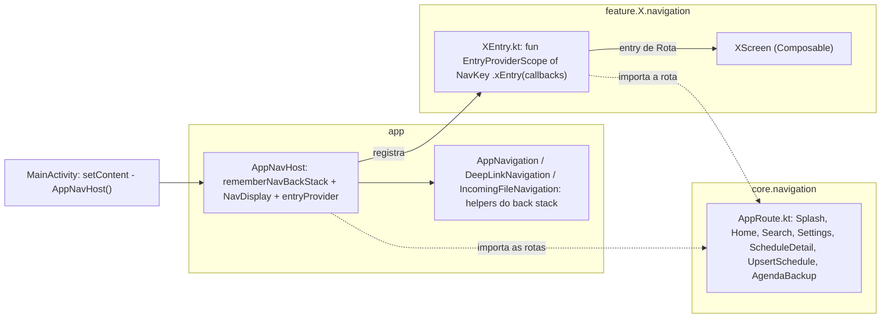
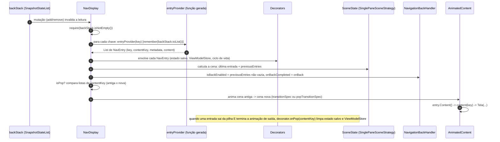
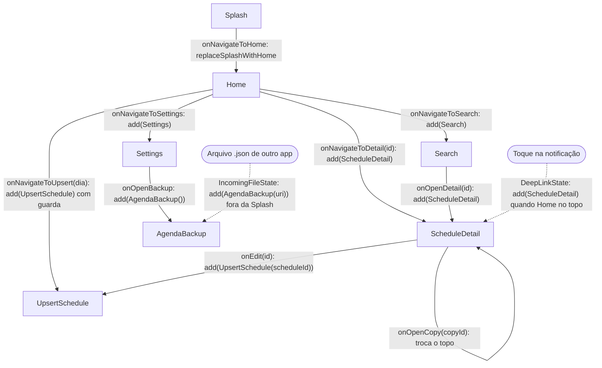
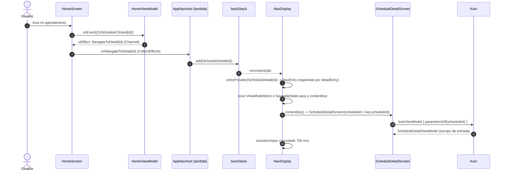
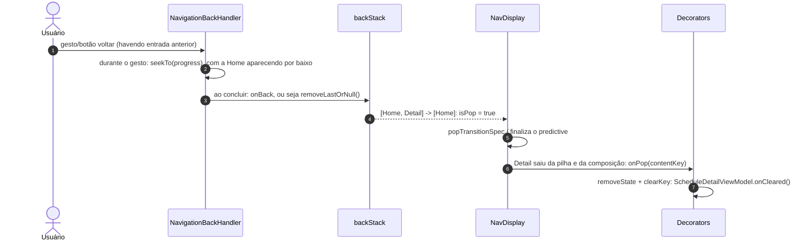

# Navegação no RememberMe (Navigation 3)

Este documento explica como a navegação do app funciona:

1. o que é cada peça do Navigation 3 (`NavKey`, back stack, `entryProvider`, `NavEntry`, decorators, `NavDisplay`);
2. como as features registram as suas telas com extensões `EntryProviderScope<NavKey>.<feature>Entry(...)`;
3. o que o `NavDisplay` faz por dentro, a cada mudança do back stack;
4. o passo a passo para adicionar uma nova tela, e quais arquivos mudam.

> Versões: `androidx.navigation3` **1.2.1** (`navigation3-runtime` e `navigation3-ui`) e
> `androidx.lifecycle:lifecycle-viewmodel-navigation3` **2.11.0** ([`libs.versions.toml`](../gradle/libs.versions.toml)).
> Os detalhes internos citados abaixo foram conferidos no código-fonte dessas versões.

Visão geral da arquitetura: [arquitetura-e-funcionalidades.md §7](arquitetura-e-funcionalidades.md#7-navegação-navigation-3).

---

## Sumário

- [1. Resumo em um minuto](#1-resumo-em-um-minuto)
- [2. As peças e onde ficam](#2-as-peças-e-onde-ficam)
- [3. Rotas: `NavKey`](#3-rotas-navkey)
- [4. Back stack: navegar é editar uma lista](#4-back-stack-navegar-é-editar-uma-lista)
- [5. `entryProvider`: de chave para tela](#5-entryprovider-de-chave-para-tela)
- [6. As extensões `EntryProviderScope<NavKey>.<feature>Entry`](#6-as-extensões-entryproviderscopenavkeyfeatureentry)
- [7. `NavDisplay` em detalhe](#7-navdisplay-em-detalhe)
- [8. Decorators: estado salvo e ViewModel por entrada](#8-decorators-estado-salvo-e-viewmodel-por-entrada)
- [9. Os fluxos do app](#9-os-fluxos-do-app)
- [10. Como adicionar uma nova tela](#10-como-adicionar-uma-nova-tela)
- [11. Erros comuns e como aparecem](#11-erros-comuns-e-como-aparecem)
- [12. Testes de navegação existentes](#12-testes-de-navegação-existentes)

---

## 1. Resumo em um minuto

- **Uma rota é um objeto Kotlin** (`NavKey`), não uma string. `ScheduleDetail(scheduleId = "42")` é ao mesmo tempo o
  destino e os argumentos.
- **O back stack é uma lista observável** de rotas (`rememberNavBackStack(Splash)`). Navegar é `add(...)`; voltar é
  `removeLastOrNull()`. Não existe `NavController`.
- **O `entryProvider` é uma função `NavKey -> NavEntry`**: dado um item do back stack, devolve a tela que o desenha.
  É montado com uma DSL em que cada `entry<Rota> { key -> Tela(...) }` registra "para esta classe de rota, desenhe
  isto".
- **Cada feature expõe uma extensão** `EntryProviderScope<NavKey>.<feature>Entry(callbacks...)` que faz esse registro.
  Essa extensão **não devolve nada** (`Unit`). Ela adiciona uma regra ao scope.
- **O `NavDisplay` observa o back stack**. A cada mudança, ele converte cada chave em `NavEntry`, aplica os
  decorators e escolhe a cena (aqui, sempre a última entrada em tela cheia). Em seguida anima a troca e trata o
  voltar do sistema, inclusive o gesto preditivo.
- **Só o pacote `app` conhece o back stack e todas as rotas.** As features recebem lambdas (`onBack`,
  `onOpenDetail`...) e não sabem para onde estão indo.

---

## 2. As peças e onde ficam



| Peça | Arquivo | Papel |
|---|---|---|
| Rotas | [`core/navigation/AppRoute.kt`](../app/src/main/java/com/br/androideventscheduler/core/navigation/AppRoute.kt) | `@Serializable` + `NavKey`. Ficam em `core` para que uma feature possa citar a rota de outra sem importá-la |
| Host | [`app/AppNavHost.kt`](../app/src/main/java/com/br/androideventscheduler/app/AppNavHost.kt) | Cria o back stack, monta o `entryProvider` e chama o `NavDisplay` |
| Entradas das features | `feature/<x>/navigation/<X>Entry.kt` (ex.: [`DetailEntry.kt`](../app/src/main/java/com/br/androideventscheduler/feature/detail/navigation/DetailEntry.kt)) | Registram a rota da feature e ligam a tela aos callbacks |
| Operações compostas | [`AppNavigation.kt`](../app/src/main/java/com/br/androideventscheduler/app/AppNavigation.kt), [`DeepLinkNavigation.kt`](../app/src/main/java/com/br/androideventscheduler/app/DeepLinkNavigation.kt), [`IncomingFileNavigation.kt`](../app/src/main/java/com/br/androideventscheduler/app/IncomingFileNavigation.kt) | Extensões de `MutableList<NavKey>` testáveis isoladamente (trocar Splash por Home, abrir pendências) |
| Pendências externas | [`DeepLinkState.kt`](../app/src/main/java/com/br/androideventscheduler/app/DeepLinkState.kt), [`IncomingFileState.kt`](../app/src/main/java/com/br/androideventscheduler/app/IncomingFileState.kt) | `single` do Koin: a `MainActivity` grava, o `AppNavHost` consome depois da Splash |
| Ponto de entrada | [`MainActivity.kt`](../app/src/main/java/com/br/androideventscheduler/MainActivity.kt) | `setContent { AppNavHost() }` e registro dos intents de notificação e de arquivo |

A regra de dependência vem do steering ([`.kiro/steering/arquitetura.md`](../.kiro/steering/arquitetura.md)): a API
pública de uma feature é só `navigation/<Feature>Entry.kt` + `di/<Feature>Module.kt`. Tela, ViewModel e modelos são
`internal`.

---

## 3. Rotas: `NavKey`

```kotlin
// core/navigation/AppRoute.kt
@Serializable data object Home : NavKey
@Serializable data class ScheduleDetail(val scheduleId: String) : NavKey
@Serializable data class UpsertSchedule(val scheduleId: String? = null, val initialDateEpochDay: Long? = null) : NavKey
@Serializable data class AgendaBackup(val pendingImportUri: String? = null) : NavKey
```

- **`NavKey` é uma interface vazia** (`public interface NavKey`). Ela só marca o tipo como rota. É ela que o
  `rememberNavBackStack` exige para saber salvar a pilha.
- **`data object`** para telas sem argumento; **`data class`** quando a tela precisa de dados. Os argumentos são
  campos da própria rota, e a tela os lê da chave (`key.scheduleId`).
- **`@Serializable` é obrigatório.** No Android, o `rememberNavBackStack` salva a pilha com o
  `NavKeySerializer`. Esse serializer grava o nome da classe e o conteúdo, e na restauração usa
  `Class.forName(nome).kotlin.serializer()`. Por isso a pilha sobrevive a rotação e à morte do processo. Uma rota
  sem `@Serializable` só quebra quando o estado é salvo (ver [§11](#11-erros-comuns-e-como-aparecem)).
- **Passe IDs, não objetos.** A rota vai para o `Bundle` salvo. `ScheduleDetail` leva o id e o ViewModel busca o
  agendamento no repositório.
- **Igualdade importa.** Cada entrada do back stack é identificada por um `contentKey`, que por padrão é
  `"$key:${key::class}"`, ou seja, o `toString()` da rota mais a classe. Assim, `ScheduleDetail("a")` e
  `ScheduleDetail("b")` são entradas distintas, cada uma com o seu estado salvo e o seu ViewModel. Duas chaves
  **iguais** na pilha compartilhariam esse estado; por isso o host evita empilhar duplicatas (ex.: o guard de
  `UpsertSchedule` na Home).

O [`AppRouteTest`](../app/src/test/java/com/br/androideventscheduler/core/navigation/AppRouteTest.kt) garante que as
rotas com argumentos fazem *round-trip* em JSON.

---

## 4. Back stack: navegar é editar uma lista

```kotlin
// AppNavHost.kt
val backStack = rememberNavBackStack(Splash)
```

`rememberNavBackStack` devolve um `NavBackStack<NavKey>`. Na biblioteca, essa classe é:

```kotlin
class NavBackStack<T : NavKey>(internal val base: SnapshotStateList<T>) :
    MutableList<T> by base, StateObject by base, RandomAccess by base
```

Ou seja, é um `MutableList` apoiado num `SnapshotStateList` do Compose. Toda mutação (`add`, `removeLastOrNull`,
`removeAll`) invalida quem lê a lista, e o `NavDisplay` recompõe. A lista é guardada com `rememberSerializable`,
então sobrevive à recriação da Activity e à morte do processo.

As operações usadas no app:

| Operação | Código | Onde |
|---|---|---|
| Empilhar | `backStack.add(Search)` | Home → Pesquisa, Configurações, Detalhe, Criar |
| Voltar | `backStack.removeLastOrNull()` | `onBack` de todas as telas e `onBack` do `NavDisplay` |
| Empilhar com guarda | `if (backStack.lastOrNull() !is UpsertSchedule) backStack.add(...)` | Toque duplo na Home não abre duas criações (spec 18) |
| Trocar o topo | `removeLastOrNull()` + `add(ScheduleDetail(copyId))` | Duplicar: a cópia substitui o detalhe atual (spec 11) |
| Trocar a raiz | [`replaceSplashWithHome()`](../app/src/main/java/com/br/androideventscheduler/app/AppNavigation.kt) | Splash → Home: adiciona a Home e remove a Splash, então voltar na Home sai do app |
| Empilhar pendência externa | [`openPendingScheduleDetail`](../app/src/main/java/com/br/androideventscheduler/app/DeepLinkNavigation.kt), [`openPendingAgendaFile`](../app/src/main/java/com/br/androideventscheduler/app/IncomingFileNavigation.kt) | Notificação → Detalhe; arquivo recebido → Backup |

Duas regras práticas:

- **O back stack nunca pode ficar vazio.** O `NavDisplay` faz `require(backStack.isNotEmpty())`. Por isso o
  `replaceSplashWithHome` adiciona a Home *antes* de remover a Splash.
- **Voltar na última tela fecha o app.** Isso não exige código: o `NavDisplay` só intercepta o voltar quando
  existe uma entrada anterior (`isBackEnabled = previousEntries.isNotEmpty()`). Com a pilha `[Home]`, o voltar segue
  para a Activity, que termina. O [`SplashNavigationRobolectricTest`](../app/src/test/java/com/br/androideventscheduler/feature/splash/SplashNavigationRobolectricTest.kt)
  verifica isso.

---

## 5. `entryProvider`: de chave para tela

O `NavDisplay` não sabe desenhar uma `ScheduleDetail`. Ele recebe uma função que sabe:

```kotlin
entryProvider: (key: T) -> NavEntry<T>
```

Um **`NavEntry`** é a tela pronta para uma chave específica:

```kotlin
class NavEntry<T : Any>(
    key: T,                                   // a rota (ex.: ScheduleDetail("42"))
    val contentKey: Any = "$key:${key::class}",  // identidade estável da entrada
    val metadata: Map<String, Any> = emptyMap(), // dicas para o NavDisplay (transição, diálogo...)
    content: @Composable (T) -> Unit,         // o que desenhar, recebendo a chave tipada
)
```

Você poderia escrever essa função à mão com um `when`:

```kotlin
// Equivalente manual (o app NÃO faz assim)
entryProvider = { key ->
    when (key) {
        is Home -> NavEntry(key) { HomeScreen(...) }
        is ScheduleDetail -> NavEntry(key) { ScheduleDetailScreen(scheduleId = key.scheduleId, ...) }
        else -> error("Unknown screen $key")
    }
}
```

A função `entryProvider { ... }` da biblioteca gera essa mesma função com uma DSL:

```kotlin
inline fun <T : Any> entryProvider(
    noinline fallback: (unknownScreen: T) -> NavEntry<T> = { throw IllegalStateException("Unknown screen $it") },
    builder: EntryProviderScope<T>.() -> Unit,
): (T) -> NavEntry<T> = EntryProviderScope(fallback).apply(builder).build()
```

Passo a passo:

1. Cria um **`EntryProviderScope<T>`**, que guarda dois mapas:
   - `clazzProviders: Map<KClass, provider>`, preenchido por `entry<Rota> { }` (registro **por classe**);
   - `providers: Map<chave, provider>`, preenchido por `entry(key = instância) { }` (registro **por instância**,
     que o app não usa).
2. Executa o `builder` (o bloco entre chaves) com o scope como receptor. Cada `entry<...>` só **adiciona** uma linha
   num desses mapas. Nenhuma tela é criada aqui.
3. `build()` devolve a função `(T) -> NavEntry<T>`. Para cada chave ela:
   - procura primeiro um registro pela **instância** (`providers[key]`);
   - senão, procura pela **classe exata** (`clazzProviders[key::class]`);
   - senão, chama o `fallback`, que por padrão lança `IllegalStateException("Unknown screen ...")`;
   - os `metadata` de cada chave ficam em cache.

Três consequências práticas:

- **A busca é pela classe exata** (`key::class`). Registrar `entry<NavKey>` ou o tipo pai de uma `sealed interface`
  **não** cobre as subclasses. Cada rota concreta precisa do seu `entry`.
- **Registrar a mesma classe duas vezes falha.** `addEntryProvider` faz
  `require(clazz !in clazzProviders) { "An `entry` with the same `clazz` has already been added: ..." }`.
- **O registro é barato e a criação é preguiçosa.** O bloco `entryProvider { ... }` roda de novo a cada
  recomposição do `AppNavHost` (só preenche mapas). Já a função resultante só é chamada pelo `NavDisplay` quando o
  back stack muda (`remember(backStack.toList())`, ver [§7](#7-navdisplay-em-detalhe)).

---

## 6. As extensões `EntryProviderScope<NavKey>.<feature>Entry`

### 6.1 O que elas são (e o que não são)

```kotlin
// feature/detail/navigation/DetailEntry.kt
fun EntryProviderScope<NavKey>.detailEntry(
    onBack: () -> Unit,
    onEdit: (String) -> Unit,
    onOpenCopy: (String) -> Unit,
) {
    entry<ScheduleDetail> { key ->
        ScheduleDetailScreen(scheduleId = key.scheduleId, onBack = onBack, onEdit = onEdit, onOpenCopy = onOpenCopy)
    }
}
```

Essas extensões **não devolvem um `entry<T>` nem um `NavEntry`**. O tipo de retorno é `Unit`. Elas são
**funções de registro**: rodam dentro do `entryProvider { }` do host e adicionam ao scope a regra "chaves da classe
`ScheduleDetail` são desenhadas por este lambda". O `NavEntry` só é criado depois, pela função gerada em
`build()`, quando uma `ScheduleDetail` aparece no back stack.

### 6.2 Como o `entry<ScheduleDetail> { }` resolve

1. A extensão tem receptor `EntryProviderScope<NavKey>`, então dentro dela `this` é o scope criado pelo
   `entryProvider { }` do host.
2. `entry<K>` é uma **função membro** `inline reified` desse scope:

   ```kotlin
   inline fun <reified K : T> entry(
       noinline clazzContentKey: (key: K) -> Any = { defaultContentKey(it) },
       metadata: Map<String, Any> = emptyMap(),
       noinline content: @Composable (K) -> Unit,
   ) {
       addEntryProvider(K::class, clazzContentKey, { metadata }, content)
   }
   ```

3. Como é `reified`, o compilador troca `K` por `ScheduleDetail::class`. Na prática a chamada vira:

   ```kotlin
   this.addEntryProvider(
       clazz = ScheduleDetail::class,
       clazzContentKey = { key -> "$key:${key::class}" },  // padrão
       metadata = { emptyMap() },                          // padrão
       content = { key: ScheduleDetail ->                  // a chave chega TIPADA
           ScheduleDetailScreen(scheduleId = key.scheduleId, onBack = onBack, onEdit = onEdit, onOpenCopy = onOpenCopy)
       },
   )
   ```

4. O `K : T` com `T = NavKey` impede registrar algo que não seja rota. O lambda `content` recebe `K`, por isso
   `key.scheduleId` compila sem cast.
5. `EntryProviderScope` é marcada com `@EntryDsl` (um `@DslMarker`). Isso impede chamar, por engano, o `entry` de um
   scope externo dentro de um lambda aninhado.

Os parâmetros opcionais de `entry` que o app ainda não usa:

| Parâmetro | Para quê | Exemplo |
|---|---|---|
| `clazzContentKey` | Mudar a identidade da entrada (estado e ViewModel) | `entry<ScheduleDetail>(clazzContentKey = { it.scheduleId }) { ... }` |
| `metadata` | Dicas para o `NavDisplay` ou para uma `SceneStrategy` | `metadata = NavDisplay.transitionSpec { slideInHorizontally { it } togetherWith slideOutHorizontally { -it } }`; `metadata = DialogSceneStrategy.dialog()` (exige `sceneStrategies = listOf(DialogSceneStrategy(), SinglePaneSceneStrategy())` no `NavDisplay`) |

### 6.3 Por que extensões, e não um `when` no host

- **Fronteira da feature.** O host só chama `detailEntry(...)`. `ScheduleDetailScreen` é `internal` à feature e o
  host não a enxerga. Quando a feature virar módulo Gradle, `navigation` + `di` são a API do módulo.
- **A feature não conhece o back stack.** Ela declara *intenções* (`onEdit(id)`, `onOpenCopy(id)`) e o host decide o
  que fazer na pilha. Exemplo: em `onOpenCopy`, o host troca o topo em vez de empilhar. Mudar isso não toca na
  feature.
- **Uma feature não importa outra.** O detalhe pede "editar o id X" sem saber que existe `UpsertSchedule`. Quem
  faz `backStack.add(UpsertSchedule(scheduleId = id))` é o host.
- **Testabilidade.** A tela recebe lambdas simples, e os testes de tela verificam que elas foram chamadas.

### 6.4 Como o host as usa

```kotlin
// AppNavHost.kt (resumo)
NavDisplay(
    backStack = backStack,
    onBack = { backStack.removeLastOrNull() },
    entryDecorators = listOf(rememberSaveableStateHolderNavEntryDecorator(), rememberViewModelStoreNavEntryDecorator()),
    entryProvider = entryProvider {                       // this: EntryProviderScope<NavKey>
        splashEntry(onNavigateToHome = { backStack.replaceSplashWithHome() })
        homeEntry(
            onNavigateToSearch = { backStack.add(Search) },
            onNavigateToUpsert = { day -> if (backStack.lastOrNull() !is UpsertSchedule) backStack.add(UpsertSchedule(initialDateEpochDay = day)) },
            onNavigateToDetail = { id -> backStack.add(ScheduleDetail(id)) },
            onNavigateToSettings = { backStack.add(Settings) },
        )
        detailEntry(
            onBack = { backStack.removeLastOrNull() },
            onEdit = { id -> backStack.add(UpsertSchedule(scheduleId = id)) },
            onOpenCopy = { copyId -> backStack.removeLastOrNull(); backStack.add(ScheduleDetail(copyId)) },
        )
        // searchEntry, settingsEntry, upsertEntry, backupEntry...
    },
)
```

Tabela das entradas registradas:

| Extensão | Rota | Tela | Callbacks |
|---|---|---|---|
| [`splashEntry`](../app/src/main/java/com/br/androideventscheduler/feature/splash/navigation/SplashEntry.kt) | `Splash` | `SplashScreen` | `onNavigateToHome` |
| [`homeEntry`](../app/src/main/java/com/br/androideventscheduler/feature/home/navigation/HomeEntry.kt) | `Home` | `HomeScreen` | `onNavigateToSearch`, `onNavigateToUpsert(epochDay)`, `onNavigateToDetail(id)`, `onNavigateToSettings` |
| [`searchEntry`](../app/src/main/java/com/br/androideventscheduler/feature/search/navigation/SearchEntry.kt) | `Search` | `SearchScreen` | `onBack`, `onOpenDetail(id)` |
| [`settingsEntry`](../app/src/main/java/com/br/androideventscheduler/feature/settings/navigation/SettingsEntry.kt) | `Settings` | `SettingsScreen` | `onBack`, `onOpenBackup` |
| [`detailEntry`](../app/src/main/java/com/br/androideventscheduler/feature/detail/navigation/DetailEntry.kt) | `ScheduleDetail(scheduleId)` | `ScheduleDetailScreen` | `onBack`, `onEdit(id)`, `onOpenCopy(copyId)` |
| [`upsertEntry`](../app/src/main/java/com/br/androideventscheduler/feature/upsert/navigation/UpsertEntry.kt) | `UpsertSchedule(scheduleId?, initialDateEpochDay?)` | `UpsertScheduleScreen` | `onBack` |
| [`backupEntry`](../app/src/main/java/com/br/androideventscheduler/feature/backup/navigation/BackupEntry.kt) | `AgendaBackup(pendingImportUri?)` | `BackupScreen` | `onBack` |

O alarme em tela cheia (`FullScreenAlarmActivity`) **não** passa pelo `NavDisplay`. É uma Activity própria, aberta
pelo full-screen intent da notificação.

---

## 7. `NavDisplay` em detalhe

### 7.1 Assinatura usada

O app chama esta sobrecarga (os parâmetros não passados ficam com o padrão):

```kotlin
@Composable
fun <T : Any> NavDisplay(
    backStack: List<T>,
    modifier: Modifier = Modifier,
    contentAlignment: Alignment = Alignment.TopStart,
    onBack: () -> Unit = { (backStack as? MutableList<T>)?.removeLastOrNull() },
    entryDecorators: List<NavEntryDecorator<T>> = listOf(rememberSaveableStateHolderNavEntryDecorator()),
    sceneStrategies: List<SceneStrategy<T>> = listOf(SinglePaneSceneStrategy()),
    sceneDecoratorStrategies: List<SceneDecoratorStrategy<T>> = emptyList(),
    sharedTransitionScope: SharedTransitionScope? = null,
    sizeTransform: SizeTransform? = null,
    transitionSpec: ... = defaultTransitionSpec(),               // fadeIn/fadeOut, 700 ms
    popTransitionSpec: ... = defaultPopTransitionSpec(),         // fadeIn/fadeOut, 700 ms
    predictivePopTransitionSpec: ... = defaultPredictivePopTransitionSpec(), // fadeIn (spring) + scaleOut(0.7)
    entryProvider: (key: T) -> NavEntry<T>,
)
```

| Parâmetro | No app | Efeito |
|---|---|---|
| `backStack` | `rememberNavBackStack(Splash)` | Fonte da verdade; o `NavDisplay` só lê |
| `onBack` | `{ backStack.removeLastOrNull() }` | Chamado quando o voltar (botão, gesto ou preditivo) é **concluído** |
| `entryDecorators` | estado salvo + ViewModelStore | Ver [§8](#8-decorators-estado-salvo-e-viewmodel-por-entrada). Ao passar a lista, o padrão é substituído, por isso o decorator de estado salvo está incluído explicitamente |
| `sceneStrategies` | padrão (`SinglePaneSceneStrategy`) | Só a última entrada aparece, em tela cheia |
| transições | padrão | Toda troca é um *crossfade* de 700 ms; o gesto preditivo encolhe a tela atual |
| `entryProvider` | `entryProvider { ... }` | Ver [§5](#5-entryprovider-de-chave-para-tela) |

### 7.2 O que acontece a cada mudança do back stack



Em detalhe:

1. **Validação.** `require(backStack.isNotEmpty()) { "NavDisplay backstack cannot be empty" }`.
2. **Chaves → entradas.** `rememberDecoratedNavEntries(backStack, entryDecorators, entryProvider)` chama
   `entryProvider(key)` para cada item, dentro de `remember(backStack.toList())`. Ou seja, só recalcula quando a
   lista muda.
3. **Decorators.** Cada `NavEntry` é embrulhada pelos decorators da lista. O primeiro da lista é o mais externo
   (`foldRight`). Depois o `rememberSceneState` acrescenta os internos da biblioteca:
   - `SceneSetupNavEntryDecorator`: põe a entrada num *movable content*;
   - `BackStackAwareLifecycleNavEntryDecorator`: limita a `CREATED` o ciclo de vida de entradas que já saíram da
     pilha;
   - e, se houver `sharedTransitionScope`, o de elementos compartilhados.
4. **Cena.** As `sceneStrategies` são consultadas em ordem; a primeira que devolver uma `Scene` vence. A
   `SinglePaneSceneStrategy` (única no app) cria uma `SinglePaneScene` com `entry = entries.last()` e
   `previousEntries` = o resto. Estratégias como `DialogSceneStrategy` geram `OverlayScene`s, desenhadas por cima da
   cena de baixo.
5. **Voltar.** O `NavigationBackHandler` registra o handler no dispatcher do sistema, com
   `isBackEnabled = currentScene.previousEntries.isNotEmpty()`. Ao concluir, chama `onBack` uma vez por entrada que
   a cena atual cobre (na cena simples, uma vez). Durante o **gesto preditivo**, ele faz `seekTo(progress)` numa
   `SeekableTransitionState`: a tela anterior aparece por baixo conforme o dedo se move. Se o gesto for cancelado,
   a animação volta.
6. **Pop ou push?** O `NavDisplay` guarda a lista anterior de `contentKey` e compara com a nova:
   - se o **primeiro** elemento mudou, a pilha inteira foi trocada e conta como **avanço**;
   - se a nova lista cresceu, é **avanço**;
   - se a nova é um prefixo exato e menor da antiga, é **pop**.

   Exemplos do app:
   - `[Splash] -> [Home]` (`replaceSplashWithHome`): avanço;
   - `[Home, Detail(a)] -> [Home, Detail(copia)]` (duplicar): avanço, porque não é prefixo;
   - `[Home, Search] -> [Home]`: pop.

   O resultado escolhe `transitionSpec` ou `popTransitionSpec` e o *z-index* (no pop, a cena que entra fica por
   baixo).
7. **Prioridade das transições.** `metadata` da entrada que transita > `metadata` da cena > padrões do `NavDisplay`.
   Para animar uma tela de forma diferente, basta pôr a transição no `metadata` do seu `entry`; o host não muda.
8. **Desenho.** O `AnimatedContent` chama `scene.content`, que chama `entry.Content()`, que executa o
   `content(key)` registrado na extensão da feature. É aí que a `ScheduleDetailScreen(scheduleId = key.scheduleId)`
   é composta.
9. **Limpeza.** Quando uma entrada deixa o back stack **e** sai da composição (fim da animação de saída), cada
   decorator recebe `onPop(contentKey)`, em ordem reversa.

---

## 8. Decorators: estado salvo e ViewModel por entrada

```kotlin
entryDecorators = listOf(
    rememberSaveableStateHolderNavEntryDecorator(),
    rememberViewModelStoreNavEntryDecorator(),
)
```

| Decorator | O que faz em `decorate` | O que faz em `onPop` | Efeito no app |
|---|---|---|---|
| `SaveableStateHolderNavEntryDecorator` (navigation3-runtime) | `saveableStateHolder.SaveableStateProvider(entry.contentKey) { entry.Content() }` | `removeState(contentKey)` | `rememberSaveable` dentro de uma tela (rolagem, campos) é preservado enquanto ela estiver na pilha, mesmo coberta por outra tela |
| `ViewModelStoreNavEntryDecorator` (lifecycle-viewmodel-navigation3) | Cria um `ViewModelStoreOwner` por `contentKey` (com `SavedStateRegistryOwner`) e o fornece via `LocalViewModelStoreOwner` | `clearKey(contentKey)`, que chama `onCleared()` nos ViewModels da entrada | Cada entrada tem os seus ViewModels; ao sair da pilha, eles são destruídos |

**Ligação com o Koin.** `koinViewModel()` usa o `LocalViewModelStoreOwner` atual. Dentro de uma entrada, esse owner é
o da entrada, então:

- [`HomeScreen`](../app/src/main/java/com/br/androideventscheduler/feature/home/presentation/screen/HomeScreen.kt):
  `koinViewModel()` dá um `HomeViewModel` que vive enquanto `Home` estiver na pilha;
- [`ScheduleDetailScreen`](../app/src/main/java/com/br/androideventscheduler/feature/detail/presentation/screen/ScheduleDetailScreen.kt):
  `koinViewModel { parametersOf(scheduleId) }`. Com duas `ScheduleDetail` na pilha (detalhe → editar → ... → outro
  detalhe), cada uma tem o seu ViewModel, porque os `contentKey` são diferentes;
- [`UpsertScheduleScreen`](../app/src/main/java/com/br/androideventscheduler/feature/upsert/presentation/screen/UpsertScheduleScreen.kt)
  e [`BackupScreen`](../app/src/main/java/com/br/androideventscheduler/feature/backup/presentation/screen/BackupScreen.kt)
  passam a **própria rota** em `parametersOf(UpsertSchedule(...))` / `parametersOf(AgendaBackup(...))`, e o módulo
  Koin a desmonta (`val route: UpsertSchedule = parameters.get()`);
- o `SavedStateHandle` injetado (ex.: no `ScheduleDetailViewModel`) também é por entrada.

Sem o `ViewModelStoreNavEntryDecorator`, todos os `koinViewModel()` cairiam no `ViewModelStore` da Activity. Dois
detalhes compartilhariam o mesmo ViewModel, e nenhum seria limpo ao voltar.

---

## 9. Os fluxos do app

### 9.1 Mapa de navegação



Todo `onBack` é `backStack.removeLastOrNull()`.

### 9.2 Avanço: tocar num item da Home

A navegação disparada pelo usuário passa pelo ViewModel (padrão State/Event/Effect):



### 9.3 Voltar



O botão de voltar da barra da tela faz o mesmo caminho pelo `onBack` que o host passou para a feature.

### 9.4 Entradas externas (notificação e arquivo)

As duas entradas externas usam o mesmo padrão, para não navegar durante a Splash:

1. A `MainActivity` grava a pendência num `single` do Koin. Isso acontece em `onCreate`, só quando
   `savedInstanceState == null`, e em `onNewIntent`. Aberturas vindas do histórico de recentes são ignoradas.
2. O `AppNavHost` roda um `LaunchedEffect(pendência, topo do back stack)`:
   [`DeepLinkEffect`](../app/src/main/java/com/br/androideventscheduler/app/DeepLinkNavigation.kt) /
   [`IncomingFileEffect`](../app/src/main/java/com/br/androideventscheduler/app/IncomingFileNavigation.kt).
3. Quando o topo permite, o efeito empilha a rota e consome a pendência:
   - o deep link só abre com a `Home` no topo;
   - o arquivo abre em qualquer tela que não seja a `Splash`.

   O consumo usa `compareAndSet`, para não apagar uma pendência mais nova.

Como a chave do efeito inclui o topo do back stack, a pendência que chega durante a Splash é aplicada assim que
`replaceSplashWithHome` põe a Home no topo.

---

## 10. Como adicionar uma nova tela

Exemplo: uma tela **"Sobre"** aberta a partir das Configurações. Depois vem a variante com argumento.

### Checklist de arquivos

| # | Arquivo | O que muda | Obrigatório? |
|---|---|---|---|
| 1 | `core/navigation/AppRoute.kt` | Nova rota `@Serializable ... : NavKey` | Sim |
| 2 | `feature/about/presentation/...` | Tela, State/Event/Effect e ViewModel (padrão do app) | Sim |
| 3 | `feature/about/di/AboutModule.kt` | `viewModel { ... }` da tela | Se houver ViewModel |
| 4 | `feature/about/navigation/AboutEntry.kt` | Extensão `EntryProviderScope<NavKey>.aboutEntry(...)` | Sim |
| 5 | Feature de origem (`settings`) | Novo callback (`onOpenAbout`) no `settingsEntry`, na tela e no Effect do ViewModel | Sim, se outra tela abre a nova |
| 6 | `app/AppNavHost.kt` | Registrar `aboutEntry(...)` **e** ligar o callback da origem a `backStack.add(About)` | Sim |
| 7 | `app/AppModules.kt` | Adicionar `aboutModule` | Se houver módulo |
| 8 | Testes | Rota (se tiver argumentos), ViewModel, tela, Koin verify e navegação | Sim |
| 9 | Docs | Steering/spec e estes documentos | Recomendado |

O que **não** precisa: manifest, grafo XML, rotas em string, registro no `NavDisplay` além do `entryProvider`, nem
mudar a `MainActivity`.

### Passo 1 — Rota

```kotlin
// core/navigation/AppRoute.kt
@Serializable
data object About : NavKey
```

### Passo 2 e 3 — Tela, ViewModel e módulo Koin

```kotlin
// feature/about/presentation/screen/AboutScreen.kt
@Composable
internal fun AboutScreen(
    onBack: () -> Unit,
    viewModel: AboutViewModel = koinViewModel(),   // escopo da entrada (§8)
) { /* CollectEffects(viewModel.uiEffect) { AboutUiEffect.NavigateBack -> onBack() } ... */ }

// feature/about/di/AboutModule.kt
val aboutModule = module {
    viewModel { AboutViewModel(dispatcher = get(named(DispatcherNames.MAIN))) }
}
```

### Passo 4 — A extensão de entrada (API pública da feature)

```kotlin
// feature/about/navigation/AboutEntry.kt
package com.br.androideventscheduler.feature.about.navigation

import androidx.navigation3.runtime.EntryProviderScope
import androidx.navigation3.runtime.NavKey
import com.br.androideventscheduler.core.navigation.About
import com.br.androideventscheduler.feature.about.presentation.screen.AboutScreen

/** API pública da feature: registra a rota [About]. */
fun EntryProviderScope<NavKey>.aboutEntry(onBack: () -> Unit) {
    entry<About> { AboutScreen(onBack = onBack) }
}
```

Para uma transição própria, use `entry<About>(metadata = NavDisplay.transitionSpec { ... } + NavDisplay.popTransitionSpec { ... }) { ... }`.
O host não muda.

### Passo 5 — A origem ganha um callback

```kotlin
// feature/settings/navigation/SettingsEntry.kt
fun EntryProviderScope<NavKey>.settingsEntry(
    onBack: () -> Unit,
    onOpenBackup: () -> Unit,
    onOpenAbout: () -> Unit,          // novo
) {
    entry<Settings> { SettingsScreen(onBack = onBack, onOpenBackup = onOpenBackup, onOpenAbout = onOpenAbout) }
}
```

No `SettingsViewModel`, o clique vira um `SettingsUiEffect.NavigateToAbout`; a `SettingsScreen` coleta e chama
`onOpenAbout()`. A feature `settings` **não** importa `About` nem a feature `about`.

### Passo 6 — Host

```kotlin
// app/AppNavHost.kt, dentro de entryProvider { ... }
settingsEntry(
    onBack = { backStack.removeLastOrNull() },
    onOpenBackup = { backStack.add(AgendaBackup()) },
    onOpenAbout = { backStack.add(About) },        // decide a operação na pilha
)
// Sobre
aboutEntry(onBack = { backStack.removeLastOrNull() })
```

A ordem das chamadas dentro do `entryProvider { }` não importa: são registros num mapa.

### Passo 7 — Módulos

```kotlin
// app/AppModules.kt
val appModules = listOf(
    // ...
    // Sobre
    aboutModule,
)
```

### Passo 8 — Testes

- **ViewModel** (JVM): evento de voltar → `AboutUiEffect.NavigateBack`.
- **Tela** (Robolectric/Compose): o botão chama `onBack`.
- **Origem**: `SettingsViewModelTest` emite `NavigateToAbout`; a tela de configurações chama `onOpenAbout`.
- **Koin**: o [`KoinModulesVerificationTest`](../app/src/test/java/com/br/androideventscheduler/app/KoinModulesVerificationTest.kt)
  passa a cobrir o `aboutModule` assim que ele está em `appModules`. Se o construtor do ViewModel receber um tipo
  que vem de `parametersOf` e ainda não está em `runtimeParameterTypes`, acrescente-o lá.
- **Navegação** (opcional): um teste Robolectric com `createAndroidComposeRule<MainActivity>()` que abre
  Configurações → Sobre e volta, nos moldes do
  [`SplashNavigationRobolectricTest`](../app/src/test/java/com/br/androideventscheduler/feature/splash/SplashNavigationRobolectricTest.kt).
  Se houver lógica de pilha nova (guarda, troca de topo), extraia-a como extensão de `MutableList<NavKey>` e teste na
  JVM, como o [`AppNavigationTest`](../app/src/test/java/com/br/androideventscheduler/app/AppNavigationTest.kt).

### Variante: tela com argumento

Exemplo: uma tela de histórico de um agendamento.

```kotlin
// 1. Rota com argumento (só IDs/primitivos)
@Serializable
data class ScheduleHistory(val scheduleId: String) : NavKey

// 4. Entrada: a chave chega tipada no lambda
fun EntryProviderScope<NavKey>.historyEntry(onBack: () -> Unit) {
    entry<ScheduleHistory> { key -> ScheduleHistoryScreen(scheduleId = key.scheduleId, onBack = onBack) }
}

// 2. Tela: o argumento vira parâmetro do ViewModel
@Composable
internal fun ScheduleHistoryScreen(
    scheduleId: String,
    onBack: () -> Unit,
    viewModel: ScheduleHistoryViewModel = koinViewModel { parametersOf(scheduleId) },
) { /* ... */ }

// 3. Módulo
val historyModule = module {
    viewModel { parameters -> ScheduleHistoryViewModel(scheduleId = parameters.get(), scheduleRepository = get()) }
}

// 6. Host: quem abre passa o id
detailEntry(
    // ...
    onOpenHistory = { id -> backStack.add(ScheduleHistory(id)) },
)
historyEntry(onBack = { backStack.removeLastOrNull() })
```

Com vários argumentos, siga o padrão de `UpsertSchedule`/`AgendaBackup`: passe a rota inteira em
`parametersOf(rota)` e desmonte no módulo. Acrescente um caso no
[`AppRouteTest`](../app/src/test/java/com/br/androideventscheduler/core/navigation/AppRouteTest.kt) para garantir o
*round-trip* da rota.

---

## 11. Erros comuns e como aparecem

| Erro | Sintoma | Onde é pego |
|---|---|---|
| Rota empilhada sem `entry` registrado | `IllegalStateException: Unknown screen About` ao navegar (o `fallback` padrão do `entryProvider`) | Teste de navegação/integração; em produção, crash ao abrir a tela |
| Mesmo `entry<Rota>` registrado duas vezes | `IllegalArgumentException: An 'entry' with the same 'clazz' has already been added: About` na primeira composição do host | Qualquer teste que componha a `MainActivity` |
| Rota sem `@Serializable` | Funciona até o estado ser salvo (app em segundo plano, rotação); aí `SerializationException` (serializer não encontrado) no `NavKeySerializer` | Teste com recriação da Activity; difícil de ver só navegando |
| Módulo não adicionado em `appModules` | `NoDefinitionFoundException` do Koin ao abrir a tela | **Não** é pego pelo `KoinModulesVerificationTest`, que só verifica o que está em `appModules`. Um teste de tela com Koin real pega |
| Esquecer o decorator de ViewModel ao mexer em `entryDecorators` | ViewModels vazam entre telas e não são limpos | Testes de ViewModel por entrada / comportamento estranho ao voltar |
| Esvaziar o back stack (remover antes de adicionar) | `IllegalArgumentException: NavDisplay backstack cannot be empty` | Testes do helper de pilha (ex.: `AppNavigationTest`) |
| Empilhar a mesma rota duas vezes seguidas (duplo toque) | Duas entradas com o mesmo `contentKey`, com estado e ViewModel compartilhados | Guarda no host (`lastOrNull() !is Rota`), como no `UpsertSchedule` |
| Objeto grande na rota | `TransactionTooLargeException` ao salvar o estado | Revisão: rotas levam IDs |

---

## 12. Testes de navegação existentes

| Teste | Tipo | O que cobre |
|---|---|---|
| [`AppRouteTest`](../app/src/test/java/com/br/androideventscheduler/core/navigation/AppRouteTest.kt) | JVM | *Round-trip* JSON das rotas com argumentos |
| [`AppNavigationTest`](../app/src/test/java/com/br/androideventscheduler/app/AppNavigationTest.kt) | JVM | `replaceSplashWithHome`: só a Home fica; idempotente |
| [`DeepLinkEffectRobolectricTest`](../app/src/test/java/com/br/androideventscheduler/app/DeepLinkEffectRobolectricTest.kt) | Robolectric | Deep link abre o detalhe só com a Home no topo, consome uma vez, aceita id novo |
| [`IncomingFileNavigationRobolectricTest`](../app/src/test/java/com/br/androideventscheduler/app/IncomingFileNavigationRobolectricTest.kt) | Robolectric | Arquivo recebido abre o backup fora da Splash, consome uma vez |
| [`SplashNavigationRobolectricTest`](../app/src/test/java/com/br/androideventscheduler/feature/splash/SplashNavigationRobolectricTest.kt) | Robolectric + `MainActivity` | Splash → Home substitui a raiz; voltar na Home fecha a Activity |
| [`StartupAndSmokeRobolectricTest`](../app/src/test/java/com/br/androideventscheduler/app/StartupAndSmokeRobolectricTest.kt) | Robolectric + `MainActivity` | A primeira tela é a Splash |
| Testes de tela/ViewModel de cada feature | JVM / Robolectric | Cada evento de navegação vira o `UiEffect` certo e a tela chama a lambda certa |

> **Atenção ao escrever testes com Activity real:** a `MainActivity` só compõe a primeira tela depois de ler o tema
> do DataStore numa thread real de I/O, e o `waitForIdle()` do Compose não espera essa thread. Uma asserção logo após
> abrir a Activity falha de forma intermitente no CI. Foi o que aconteceu com os dois testes da Splash acima, nos
> PRs #31, #33 e #34. Espere a tela existir antes de asserir (`waitUntil` drenando o looper) e avance os `delay`s do
> app com `idleFor(CONSTANTE)`. Causa, correção e regra no PR #35.
