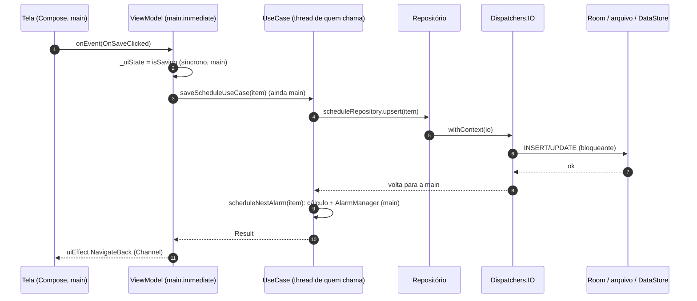

# ViewModels e dispatchers no RememberMe

Este documento responde:

1. quais dispatchers o app tem e quem usa cada um;
2. por que **todo ViewModel recebe o dispatcher `main`** (`Dispatchers.Main.immediate`) e onde o trabalho de fato
   muda de thread;
3. para cada um dos 8 ViewModels: o que ele faz, como ele organiza as corrotinas e por que esse desenho é o adequado
   para a situação da tela;
4. pontos de atenção encontrados no código.

Documentos relacionados: [arquitetura-e-funcionalidades.md](arquitetura-e-funcionalidades.md) (padrão
State/Event/Effect, §4) e [navegacao.md](navegacao.md) (escopo do ViewModel por entrada do back stack, §8).

---

## Sumário

- [1. Resumo em um minuto](#1-resumo-em-um-minuto)
- [2. Os dispatchers do app](#2-os-dispatchers-do-app)
- [3. Por que o ViewModel roda na main](#3-por-que-o-viewmodel-roda-na-main)
- [4. Onde o trabalho muda de thread](#4-onde-o-trabalho-muda-de-thread)
- [5. ViewModel por ViewModel](#5-viewmodel-por-viewmodel)
- [6. Como os testes controlam o dispatcher](#6-como-os-testes-controlam-o-dispatcher)
- [7. Pontos de atenção](#7-pontos-de-atenção)
- [8. Checklist para um ViewModel novo](#8-checklist-para-um-viewmodel-novo)

---

## 1. Resumo em um minuto

- O app registra três dispatchers no Koin: `io`, `default` e `main`. **Todos os ViewModels recebem `main`**
  (`Dispatchers.Main.immediate`). `io` é usado pelo repositório de agendamentos, pelo DataStore, pelo repositório de
  backup e pelos dois `BroadcastReceiver`s. `default` está registrado mas **ninguém o usa**.
- O ViewModel **orquestra**: muda estado, decide efeitos e chama repositórios e UseCases. Ele não faz I/O direto. Quem
  faz I/O troca de thread por conta própria (`withContext(io)` / `flowOn(io)`). Essa convenção chama-se
  *main-safety*: toda função `suspend` pode ser chamada da main sem travá-la.
- Rodar o ViewModel na main dá estado e efeitos numa única thread, sem condição de corrida. Também permite que
  `SavedStateHandle` (anotado `@MainThread`) seja escrito direto, e que eventos de UI (digitação, cliques) sejam
  aplicados no mesmo quadro graças ao `immediate`.
- O dispatcher é **injetado** (e não fixo) para que os testes troquem por um `StandardTestDispatcher` e controlem o
  tempo virtual: o `delay` da Splash e o *debounce* da pesquisa.
- O desenho de cada ViewModel muda conforme a tela:
  - **reativo**: Home, Pesquisa e Detalhe observam o banco;
  - **leitura única**: Criar/editar, Configurações (rascunho), Alarme em tela cheia e Backup carregam uma vez;
  - **temporizador**: Splash.

  O §5 explica por que cada escolha é a certa.

---

## 2. Os dispatchers do app

[`core/di/DispatchersModule.kt`](../app/src/main/java/com/br/androideventscheduler/core/di/DispatchersModule.kt) e
[`DispatcherNames.kt`](../app/src/main/java/com/br/androideventscheduler/core/di/DispatcherNames.kt):

```kotlin
val dispatchersModule = module {
    single<CoroutineDispatcher>(named(DispatcherNames.IO)) { Dispatchers.IO }
    single<CoroutineDispatcher>(named(DispatcherNames.DEFAULT)) { Dispatchers.Default }
    single<CoroutineDispatcher>(named(DispatcherNames.MAIN)) { Dispatchers.Main.immediate }
}
```

| Nome | Valor | Para quê | Quem usa |
|---|---|---|---|
| `main` | `Dispatchers.Main.immediate` | Estado de UI, efeitos, `SavedStateHandle` | **Todos os 8 ViewModels** (via módulos Koin das features) |
| `io` | `Dispatchers.IO` | Bloqueio em disco/rede: Room, arquivo, DataStore | [`ScheduleRepositoryImpl`](../app/src/main/java/com/br/androideventscheduler/core/schedule/data/repository/ScheduleRepositoryImpl.kt), escopo do [DataStore](../app/src/main/java/com/br/androideventscheduler/core/datastore/DataStoreModule.kt), [`AgendaBackupRepositoryImpl`](../app/src/main/java/com/br/androideventscheduler/feature/backup/data/repository/AgendaBackupRepositoryImpl.kt), [`ScheduleAlarmReceiver`](../app/src/main/java/com/br/androideventscheduler/core/alarm/data/ScheduleAlarmReceiver.kt), [`BootCompletedReceiver`](../app/src/main/java/com/br/androideventscheduler/core/alarm/data/BootCompletedReceiver.kt) |
| `default` | `Dispatchers.Default` | CPU pesada (ordenar, parsear, calcular) | **Ninguém** (ver [§7](#7-pontos-de-atenção)) |

Diferenças que importam:

- **`Main`** é a thread da UI. É a única que pode tocar em `View`, `Toast` e estado do Compose com segurança, e é onde
  o `SavedStateHandle` espera ser escrito.
- **`Main.immediate`**: se a corrotina **já está** na main, executa na hora, sem reenfileirar no `Looper`. Com
  `Main` simples, todo `launch` vira uma mensagem para o próximo ciclo do looper.
- **`IO`**: pool elástico (até 64 threads por padrão) para código que **bloqueia** esperando disco ou rede.
- **`Default`**: pool do tamanho do número de núcleos, para código que **ocupa CPU**. `IO` e `Default` compartilham
  threads, então trocar entre eles costuma não custar uma troca de thread de verdade.

---

## 3. Por que o ViewModel roda na main

### 3.1 A regra e de onde ela veio

> **ViewModels recebem `main` (`Main.immediate`)**: estado e efeitos nascem na thread principal, onde Toast,
> navegação e Snackbar precisam rodar. I/O e CPU pesada ficam nos repositórios/use cases, que trocam para `io`/
> `default` internamente. ([`DispatcherNames.kt`](../app/src/main/java/com/br/androideventscheduler/core/di/DispatcherNames.kt),
> steering [`arquitetura.md`](../.kiro/steering/arquitetura.md) §5.1)

A regra nasceu na spec 03. Os ViewModels recebiam `default`, e o efeito de confirmação de Configurações acabava
tratado fora da main, o que quebrava o `Toast`
([`03-configuracoes/design.md`](../.kiro/specs/03-configuracoes/design.md)). A Splash foi ajustada junto, e todas
as specs seguintes adotaram `main`.

### 3.2 Os motivos

1. **Uma thread só para o estado.** Os ViewModels fazem muito *ler-modificar-escrever*:
   `val content = _uiState.value as Content; _uiState.value = content.copy(isSaving = true)`. Numa thread só, isso é
   atômico na prática. Com `io`/`default`, dois eventos podiam intercalar e um sobrescrever o outro.
2. **Guardas de duplo toque funcionam.** Criar/editar, Detalhe e Alarme em tela cheia marcam "em andamento"
   (`isSaving`, `isProcessingAction`, `isProcessing`) **antes** de lançar a corrotina. Como o `onEvent` e a corrotina
   rodam na mesma thread, o segundo toque sempre encontra a flag ligada.
3. **`SavedStateHandle` é `@MainThread`.** Home, Pesquisa e Detalhe escrevem nele (dia selecionado, gaveta, texto da
   busca, diálogo de exclusão). Na main, isso é direto.
4. **Eventos aplicados no mesmo quadro (`immediate`).** Digitar no título do formulário ou no campo de busca atualiza
   o estado sem esperar o próximo ciclo do looper, o que evita cursor pulando e caractere "atrasado".
5. **Efeitos em ordem.** `Channel(BUFFERED)` + `receiveAsFlow()` entrega cada efeito uma vez e na ordem de envio.
   Com todos os `send` na mesma thread, "mostrar confirmação" chega antes de "voltar".
6. **O ViewModel não precisa saber o que é I/O.** Por convenção, toda função `suspend` de repositório e UseCase é
   *main-safe*. O ViewModel só chama `repository.getById(id)`; quem sabe que aquilo lê disco é o repositório.
7. **Mesma semântica do `viewModelScope`.** O `viewModelScope` do AndroidX já usa `Dispatchers.Main.immediate`.
   `viewModelScope.launch(dispatcher)` em produção dá o mesmo resultado; a injeção existe para os **testes**
   ([§6](#6-como-os-testes-controlam-o-dispatcher)).

### 3.3 Por que não `io` ou `default` no ViewModel

| Se o ViewModel usasse… | Problema |
|---|---|
| `io` | Estado escrito de várias threads (corrida nos `copy`); `SavedStateHandle` fora da main; cada evento de UI pagaria troca de thread; I/O "escondido" no ViewModel incentivaria pular o repositório |
| `default` | Os mesmos problemas de corrida, mais o caso real da spec 03 (efeito tratado fora da main) |
| `Main` sem `immediate` | Funciona, mas todo `launch` atrasa um ciclo do looper: a digitação fica um quadro atrás e os testes de tela precisam drenar mais o looper |

---

## 4. Onde o trabalho muda de thread



Camada por camada:

| Camada | Como troca de thread | Observação |
|---|---|---|
| `ScheduleRepositoryImpl` | `withContext(io)` nas funções `suspend`; `flowOn(io)` nos `Flow`s | O `map` antes do `flowOn` também roda no `io`: conversão entidade → domínio, **expansão da recorrência** (`RecurrenceEngine.expand`) e ordenação de `observeOccurrences` |
| Room | Executor próprio para as consultas dos `Flow`s | Mesmo sem o `flowOn`, a consulta não rodaria na main |
| DataStore | `CoroutineScope(SupervisorJob() + io)` passado na criação | Leitura do arquivo e gravação (`edit`) acontecem nesse escopo; quem coleta só recebe os valores |
| `AgendaBackupRepositoryImpl` | `withContext(io)` em `export` e `readForImport` | Envolve leitura/escrita do arquivo **e** codificação/decodificação do JSON |
| UseCases (`Save`, `Duplicate`, `Delete`, `Snooze`, `ImportAgenda`, `ScheduleNextAlarm`) | **Não trocam**: rodam na thread de quem chama | Ficam main-safe porque o I/O está nos repositórios. O que sobra na main é cálculo de próxima ocorrência e a chamada ao `AlarmManager` (*binder*, rápida para um item) |
| Receivers | `goAsync()` + `CoroutineScope(SupervisorJob() + io).launch { … }` e `finish()` no `finally` | Fora de qualquer ViewModel. O `onReceive` roda na main e não pode bloquear; o trabalho vai para o `io` dentro do prazo do `goAsync` |
| Coleta na tela | `collectAsStateWithLifecycle()` e [`CollectEffects`](../app/src/main/java/com/br/androideventscheduler/core/ui/CollectEffects.kt) (`repeatOnLifecycle(STARTED)`) | Sempre na main, dentro da composição |

---

## 5. ViewModel por ViewModel

Todos estendem `ViewModel` direto, expõem `StateFlow<UiState>` e `Flow<UiEffect>` (`Channel(BUFFERED)`), e usam
`viewModelScope.launch(dispatcher)` com `dispatcher = main`. Mudam o **escopo**, as **fontes de estado** e a
**forma das corrotinas**.

| ViewModel | Escopo | Fontes de estado | Forma | Trabalho fora da main |
|---|---|---|---|---|
| `SplashViewModel` | Entrada `Splash` | nenhuma | temporizador (`delay`) | nenhum |
| `HomeViewModel` | Entrada `Home` | Room (ocorrências), DataStore (calendários, adesivo, e-mail), `SavedStateHandle` | **reativo** (`combine` + `flatMapLatest`) | consulta + recorrência (`flowOn(io)`), DataStore |
| `SearchViewModel` | Entrada `Search` | `SavedStateHandle` (texto, filtro), Room (busca), DataStore (e-mail) | **reativo derivado** (`debounce` + `flatMapLatest`) | consulta (`flowOn(io)`) |
| `SettingsViewModel` | Entrada `Settings` | DataStore (leitura única do rascunho + tema observado) | **misto** | DataStore |
| `UpsertScheduleViewModel` | Entrada `UpsertSchedule` | Room + DataStore (leitura única) | **leitura única + comando** | `getById`/`upsert` (`withContext(io)`) |
| `ScheduleDetailViewModel` | Entrada `ScheduleDetail` | Room (`observeById`), DataStore (e-mail), `SavedStateHandle` | **reativo + comandos** | `observeById` (`flowOn(io)`), duplicar/excluir |
| `FullScreenAlarmViewModel` | **Activity** (`FullScreenAlarmActivity`), chave = id | Room + DataStore (leitura única) | **leitura única + comando**, recarregável | `getById`, adiamento |
| `BackupViewModel` | Entrada `AgendaBackup` | contagem + arquivo escolhido | **comandos longos** | export/import (`withContext(io)`) |

### 5.1 `SplashViewModel`

[`SplashViewModel.kt`](../app/src/main/java/com/br/androideventscheduler/feature/splash/presentation/viewmodel/SplashViewModel.kt):
`launch(dispatcher) { delay(1_500); _uiEffect.send(NavigateToHome) }`, uma única vez (flag `hasStarted`).

**Por que é o desenho certo:** não há dado a carregar, só tempo. O ViewModel sobrevive à rotação, então a contagem
não reinicia ao recompor, e o efeito em `Channel` é entregue uma vez mesmo se a tela girar no meio. O `delay` usa o
dispatcher injetado: no teste, o tempo é virtual (`advanceTimeBy`), sem esperar 1,5 s de verdade. Na main, o `delay`
não ocupa a thread; é só um agendamento no looper.

### 5.2 `HomeViewModel`

[`HomeViewModel.kt`](../app/src/main/java/com/br/androideventscheduler/feature/home/presentation/viewmodel/HomeViewModel.kt):
uma única corrotina no `init` faz
`combine(observeGridData(), selectedDateFlow, observeChrome(), observeDaySticker(), ::toUiState).collect { _uiState.value = it }`.

- `selectedDateFlow`, gaveta aberta e seletor de adesivo vêm do `SavedStateHandle` (`getStateFlow`): sobrevivem à
  morte do processo.
- `observeGridData()` faz `flatMapLatest` por **mês**. Ao trocar de mês, a consulta do mês anterior é **cancelada** e
  a nova começa. Dentro dele, `monthGridBuilder.build(month)` monta as 42 datas na main (barato), e
  `observeOccurrences` consulta e expande a recorrência no `io`.
- `observeDaySticker()` faz `flatMapLatest` por **dia**, para o adesivo do dia selecionado.
- Comandos curtos (gravar calendários visíveis, adesivo) são `launch(dispatcher)` com `try/catch (IOException)`.

**Por que é o desenho certo:** a Home precisa refletir mudanças vindas de **outras telas** (criar, editar, excluir,
importar, adiar) sem recarregar manualmente. Observar o Room resolve isso. O `flatMapLatest` evita mostrar
ocorrências de um mês que o usuário já deixou para trás. O trabalho pesado (consulta e expansão de séries) fica no
`io`. Na main sobra só juntar os resultados por dia, proporcional a 42 células.

### 5.3 `SearchViewModel`

[`SearchViewModel.kt`](../app/src/main/java/com/br/androideventscheduler/feature/search/presentation/viewmodel/SearchViewModel.kt):
o estado é **derivado**. Os eventos só escrevem no `SavedStateHandle` (`KEY_QUERY`, `KEY_FILTER`), e o `init`
combina texto, filtro e o andamento da consulta.

- `debounce` de 250 ms **só no texto**. Texto vazio passa na hora (`0L`). Trocar o filtro reconsulta na hora com o
  último texto estável.
- `flatMapLatest` cancela a consulta anterior quando o texto ou o filtro mudam.
- Um resultado só é exibido se responde ao texto e ao filtro **atuais**, o que evita "piscar" resultado velho.

**Por que é o desenho certo:** a pesquisa é por natureza uma função do texto. Guardar só as entradas no
`SavedStateHandle` e derivar o resto evita estado duplicado e sobrevive à morte do processo. O `debounce` poupa
consultas a cada tecla, e o `immediate` mantém o campo de texto em dia. O `debounceMillis` injetável e o dispatcher
de teste permitem testar o *debounce* com tempo virtual.

### 5.4 `SettingsViewModel`

[`SettingsViewModel.kt`](../app/src/main/java/com/br/androideventscheduler/feature/settings/presentation/viewmodel/SettingsViewModel.kt):

- **Rascunho**: leitura **única** (`userSettingsRepository.current()`), editada em memória e gravada só em Salvar.
- **Tema**: **observado** (`themePreferenceRepository.observe().collect`) e gravado na hora, sem tocar no rascunho.
- Salvar: `isSaving` → `save()` no DataStore → efeitos `ShowSavedConfirmation` (Toast) e `NavigateBack`, nessa ordem.

**Por que é o desenho certo:** se o rascunho fosse reativo, uma reemissão do DataStore (por exemplo, o tema
mudando) sobrescreveria o que o usuário está digitando. O tema, ao contrário, precisa refletir o valor persistido
porque muda o app inteiro na hora. É esta tela que motivou a regra do `main` ([§3.1](#31-a-regra-e-de-onde-ela-veio)):
o Toast de confirmação.

### 5.5 `UpsertScheduleViewModel`

[`UpsertScheduleViewModel.kt`](../app/src/main/java/com/br/androideventscheduler/feature/upsert/presentation/viewmodel/UpsertScheduleViewModel.kt):

- `loadInitialState()`: leitura **única**. Na edição, `getById` (`io`); na criação, padrões de `UserSettings`, data
  da rota e próxima hora cheia (`Clock` injetado). Item inexistente gera efeitos `ShowMessage` + `NavigateBack`.
- Os eventos de campo atualizam o estado de forma síncrona na main.
- `save()`: monta o item, liga `isSaving` **antes** do `launch` e chama `SaveScheduleUseCase` (valida, grava no `io`
  e agenda o alarme).

**Por que é o desenho certo:** um formulário é um rascunho local. Ele não deve mudar sozinho enquanto o usuário
edita, então uma leitura única é o correto. A gravação é um comando com resultado (`Result`), com erro de domínio
mapeado para `@StringRes` e guarda contra duplo toque. Toda a digitação na main com `immediate` mantém os campos
responsivos.

### 5.6 `ScheduleDetailViewModel`

[`ScheduleDetailViewModel.kt`](../app/src/main/java/com/br/androideventscheduler/feature/detail/presentation/viewmodel/ScheduleDetailViewModel.kt):

- `observeSchedule()`: `combine(observeById(id), e-mail)` com `transformWhile` até o item virar `null`.
  - Se ele nunca existiu: `NotFound` + mensagem + voltar.
  - Se existia e foi excluído (aqui ou em outra tela): só voltar.
- Duplicar e excluir: `tryStartAction()` liga `isProcessingAction`, chama o UseCase e emite o efeito. A exclusão não
  emite `NavigateBack`: quem volta é a observação, quando o item some (uma única fonte da verdade).
- Compartilhar: só monta o texto (sem I/O) e emite `ShareText`; quem abre o Intent é a tela.
- Diálogo de exclusão no `SavedStateHandle`.

**Por que é o desenho certo:** o detalhe fica no back stack embaixo da edição. Ao voltar de "Editar", ele precisa
mostrar o item atualizado sem recarregar, e a observação do Room faz isso. Fazer a exclusão "voltar pela
observação" elimina a corrida entre "voltar" e "o item sumiu".

### 5.7 `FullScreenAlarmViewModel`

[`FullScreenAlarmViewModel.kt`](../app/src/main/java/com/br/androideventscheduler/feature/alarm/presentation/viewmodel/FullScreenAlarmViewModel.kt):

- **Escopo diferente**: vive no `ViewModelStore` da `FullScreenAlarmActivity` (fora do `NavDisplay`) e é criado com
  `koinViewModel(key = scheduleId)`. Um alarme de **outro** item gera outro ViewModel.
- `loadSchedule()` guarda o `Job` e o cancela antes de recarregar. O `onNewIntent` com a tela aberta incrementa
  `reloadSignal` e dispara `OnReloadRequested`.
- Leitura **única** do item e do adiamento padrão. Falha de leitura fecha sem cancelar a notificação; item inexistente
  fecha cancelando a notificação órfã.
- Adiar: `isProcessing` antes do `launch`, `SnoozeAlarmUseCase`, e `CancellationException` **relançada**, para não
  tratar cancelamento como erro.

**Por que é o desenho certo:** o alarme é uma foto do momento em que tocou. Observar o banco não acrescentaria nada
e poderia mudar a tela enquanto o usuário decide. A chave por id e o `loadJob` cancelável cobrem a Activity
reaproveitada por um novo alarme.

### 5.8 `BackupViewModel`

[`BackupViewModel.kt`](../app/src/main/java/com/br/androideventscheduler/feature/backup/presentation/viewmodel/BackupViewModel.kt):

- `load()`: contagem de itens (`countItems`).
- Exportar (compartilhar ou salvar): `export(...)` no repositório, que lê tudo, codifica o JSON e grava o arquivo no
  `io`.
- Importar: escolher o arquivo e chamar `readForImport` no `io` (limite de tamanho, *parse*, validação e prévia). Em
  seguida, estratégia e confirmação chamam `ImportAgendaUseCase`.
- Seletores de documento e compartilhamento são **efeitos** (`LaunchCreateDocument`, `LaunchOpenDocument`,
  `ShareFile`); a tela os executa.

**Por que é o desenho certo:** são operações longas, disparadas pelo usuário, com etapas (prévia → confirmação). O
ViewModel guarda a etapa e a prévia, e o trabalho pesado de arquivo e JSON fica todo no `io`, dentro do repositório.
Ver em [§7](#7-pontos-de-atenção) o que ainda roda na main na importação.

---

## 6. Como os testes controlam o dispatcher

[`MainDispatcherRule`](../app/src/test/java/com/br/androideventscheduler/core/testing/MainDispatcherRule.kt) troca
`Dispatchers.Main` por um `StandardTestDispatcher` e expõe o mesmo dispatcher para injetar no ViewModel:

```kotlin
@get:Rule val mainRule = MainDispatcherRule()

@Test
fun `given creation when starting then it shows loading and then defaults`() = runTest(mainRule.dispatcher) {
    val viewModel = UpsertScheduleViewModel(..., dispatcher = mainRule.dispatcher)
    assertEquals(UpsertScheduleUiState.Loading, viewModel.uiState.value)   // nada rodou ainda
    advanceUntilIdle()                                                     // agora o init roda
    ...
}
```

- **Por que injetar, se o `viewModelScope` já usa a main?** Com o dispatcher injetado e o mesmo do `runTest`, o teste
  decide **quando** cada corrotina roda (`advanceUntilIdle`, `runCurrent`) e avança o **tempo virtual**
  (`advanceTimeBy(1_500)` na Splash, o *debounce* de 250 ms na pesquisa). O `setMain` cobre também os
  `viewModelScope.launch { _uiEffect.send(...) }` sem dispatcher explícito.
- **Repositórios** recebem `io` por construtor. Nos testes JVM, entram fakes, ou o próprio dispatcher de teste.
- **Robolectric com grafo real** (testes de tela e ponta a ponta) usa a main de verdade (o looper do Robolectric).
  Trabalho que termina no `io` volta para a main via `Handler.post`, por isso os testes drenam o looper dentro do
  `waitUntil` (`shadowOf(Looper.getMainLooper()).idle()`), como registra o steering. Pelo mesmo motivo, a **primeira** asserção depois de abrir uma Activity também espera: a `MainActivity` só compõe
  depois de ler o tema do DataStore no `io`, e o `waitForIdle()` do Compose não espera essa thread (PR #35).

---

## 7. Pontos de atenção

Encontrados ao revisar o código para este documento. Nenhum causa erro hoje; são riscos ou inconsistências.

| # | Ponto | Risco | Sugestão |
|---|---|---|---|
| 1 | [`ImportAgendaUseCase`](../app/src/main/java/com/br/androideventscheduler/feature/backup/domain/usecase/ImportAgendaUseCase.kt) roda na thread de quem chama (a main do `BackupViewModel`). Depois do `upsertAll` (no `io`), ele chama `scheduleNextAlarm(item)` **para cada item** na main: próxima ocorrência + chamada *binder* ao `AlarmManager` | Um arquivo grande (o limite é 5 MB, milhares de itens) pode travar a UI durante a importação, com risco de ANR | Fazer o laço de alarmes em `withContext(io)` dentro do UseCase (recebendo o dispatcher por construtor) ou reaproveitar o caminho do `RescheduleAllAlarmsUseCase` |
| 2 | `default` está registrado e não é usado. A expansão de recorrência e a ordenação, que são CPU, rodam no `io` via `flowOn(io)` | Nenhum hoje (`IO` e `Default` compartilham threads); só semântica | Manter como está, ou remover o `default` até haver uso, para não sugerir uma regra que não existe |
| 3 | O exemplo de código do steering ([`arquitetura.md`](../.kiro/steering/arquitetura.md), por volta da linha 162) mostra `viewModel { HomeViewModel(get(), get(named("default"))) }` | Contradiz a regra da mesma página (ViewModel recebe `main`); quem copiar o exemplo reintroduz o problema da spec 03 | Trocar o exemplo para `get(named(DispatcherNames.MAIN))` |
| 4 | `BackupViewModel.load()` chama `countItems()`, que faz `getAll().size`: carrega e converte **todos** os itens só para contar | Custo de memória e de I/O proporcional à agenda (no `io`, não trava a UI) | Uma consulta `COUNT(*)` no DAO |
| 5 | Vários ViewModels usam `runCatching { suspend… }`, que também captura `CancellationException`. O `FullScreenAlarmViewModel` relança; os outros não | Se o ViewModel for destruído no meio de uma gravação, o "erro" pode virar mensagem ou efeito tardio em vez de cancelar em silêncio. Raro, porque o `viewModelScope` cancelado não entrega mais nada à tela | Padronizar: relançar `CancellationException` (como no alarme) ou usar um helper `suspendRunCatching` |

---

## 8. Checklist para um ViewModel novo

- [ ] Recebe `dispatcher: CoroutineDispatcher` por construtor; no módulo Koin, `get(named(DispatcherNames.MAIN))`.
- [ ] Todo `launch` usa `viewModelScope.launch(dispatcher)`. Nada de `Dispatchers.IO`/`Default` no ViewModel.
- [ ] I/O fica no repositório (`withContext(io)` / `flowOn(io)`). UseCase novo que faça laço de CPU ou de I/O sobre
      muitos itens troca de dispatcher dentro dele ([§7](#7-pontos-de-atenção), item 1).
- [ ] Escolha a forma pelo comportamento da tela:
  - **reativo** (`combine`/`flatMapLatest` sobre `Flow` do Room/DataStore) quando outra tela pode mudar o dado
    enquanto esta está no back stack;
  - **leitura única** quando o usuário edita um rascunho, ou quando a tela é uma foto do momento;
  - **derivado** do `SavedStateHandle` quando o estado é função de entradas do usuário (busca).
- [ ] Guardas de duplo toque ligadas **antes** do `launch`.
- [ ] Estado que precisa sobreviver à morte do processo vai no `SavedStateHandle`.
- [ ] Efeitos one-shot por `Channel(BUFFERED).receiveAsFlow()`, coletados com `CollectEffects`.
- [ ] Teste com `MainDispatcherRule` e `runTest(mainRule.dispatcher)`; tempo com `advanceTimeBy`, nunca com espera
      real.
