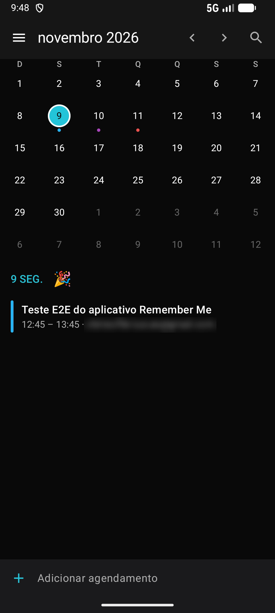
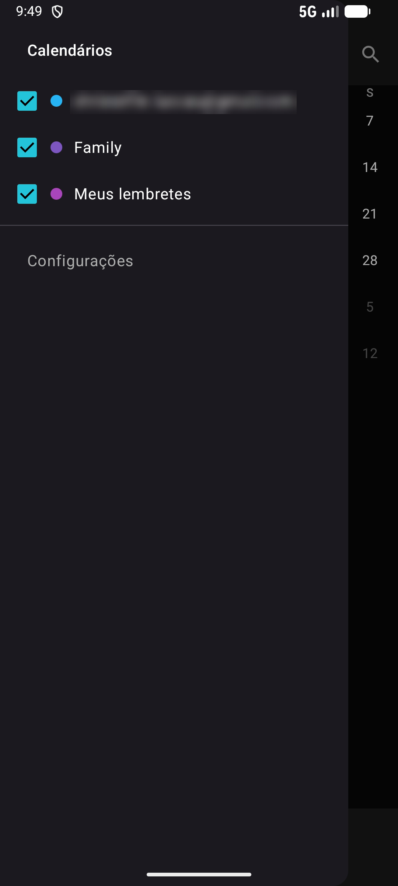
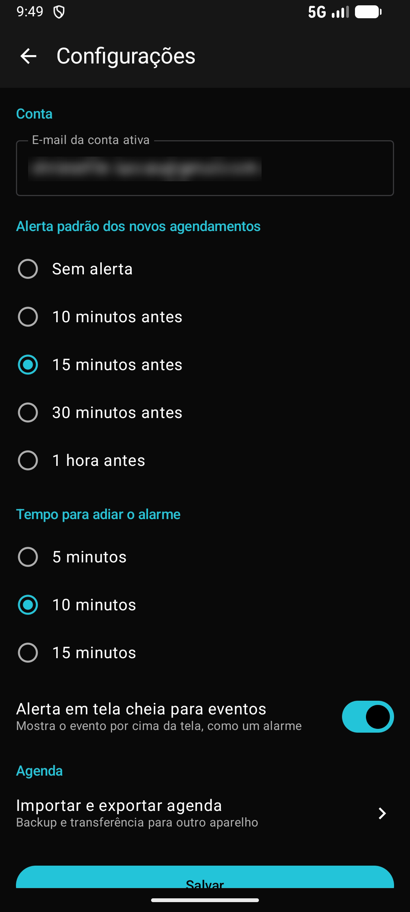

# RememberMe — Android Event Scheduler

Aplicativo Android **100% offline** para organizar a rotina pessoal com **Eventos** e **Lembretes**: calendário mensal, agenda do dia, alertas pontuais ou recorrentes (notificação ou tela cheia) e pesquisa. Os dados ficam no aparelho (Room + DataStore), sem conta nem servidor.

> O projeto nasceu de um design para Kotlin Multiplatform (`desenvolvimento_remember_me.pdf`) e foi adaptado para **somente Android**. O desenvolvimento é guiado por specs em `AndroidEventScheduler/.kiro/specs/`.

## Capturas de tela

<table>
  <tr>
    <td align="center" width="33%">
      
    </td>
    <td align="center" width="33%">
      
    </td>
    <td align="center" width="33%">
      
    </td>
  </tr>
  <tr>
    <td align="center"><b>Calendário e agenda do dia</b></td>
    <td align="center"><b>Filtro de calendários</b></td>
    <td align="center"><b>Configurações</b></td>
  </tr>
</table>

**Vídeo de demonstração:** [assistir ao uso do app em aparelho](AndroidEventScheduler/docs/media/rememberme-demo.mp4) (MP4, 2 min 34 s, 1,3 MB, sem áudio; o e-mail da conta aparece desfocado).

## Funcionalidades

- **Calendário mensal** com indicadores coloridos por dia, troca de mês por deslize/botões e seletor rápido de mês e ano.
- **Agenda do dia** com os compromissos do dia selecionado, adesivo (emoji) por dia e adição rápida; **toque duplo num dia** abre a criação de evento ou lembrete naquela data.
- **Eventos e Lembretes**: título, dia inteiro, início e fim, local, notas, cor e emoji, com seletores de data e hora inline e atalhos rápidos ("Amanhã", "Daqui a 1 hora"…).
- **Recorrência**: não repetir, diariamente ou semanalmente (dias à escolha) com limite opcional de ocorrências.
- **Alertas**: antecedência configurável (sem alerta, 5, 10, 15 ou 30 minutos ou 1 hora antes); Lembretes geram notificação e Eventos podem abrir **alarme em tela cheia** com **Adiar** (5/10/15 min) e **Dispensar**.
- **Restauração de alarmes** após reiniciar o aparelho, atualizar o app ou mudar fuso/hora.
- **Gaveta lateral** para ligar/desligar a visibilidade dos calendários (conta pessoal, Family, Meus lembretes).
- **Detalhes** com Duplicar, Editar, Compartilhar (share sheet nativo) e Excluir (com confirmação).
- **Pesquisa** reativa por título, notas e local (sem diferenciar acentos/maiúsculas), com filtro Todos / Eventos / Lembretes.
- **Configurações**: conta ativa, antecedência padrão, adiamento padrão e alerta em tela cheia.
- **Tema claro e escuro** (ou seguir o sistema), escolhido em Configurações e lembrado entre aberturas do app.
- **Proteção com o bloqueio do celular** (PIN, padrão ou senha), opcional, com tempo para pedir de novo.
- **Importar e exportar a agenda** em arquivo JSON, compartilhando por e-mail ou qualquer app compatível, ou salvando no seletor de arquivos.

## Stack

| Camada | Tecnologia |
|---|---|
| UI | Jetpack Compose + Material 3 (tema claro e escuro) |
| DI / Inicialização | Koin + Jetpack App Startup |
| Persistência | Room (KSP) e DataStore Preferences |
| Assíncrono | Kotlin Coroutines + Flow |
| Datas | `java.time` com core library desugaring (minSdk 24) |
| Navegação | Navigation 3 |
| Alarmes | `AlarmManager` + `NotificationManager` |
| Testes | JUnit4, MockK, coroutines-test, Compose UI Test, Robolectric (sem Turbine) |
| Qualidade | ktlint + detekt (`build-logic`) + CI no GitHub Actions |

## Arquitetura

**Clean Architecture + MVVM com State/Event/Effect (MVI)**, em **um único módulo `:app` organizado por pacotes**, pronto para ser modularizado depois sem reescrita.

```
View (Compose, stateless)
   │  UiEvent                    ▲ UiState (StateFlow)  /  UiEffect (Channel, one-off)
   ▼                             │
ViewModel (estende ViewModel) ───┘
   │
   ▼  (UseCase só quando há regra compartilhada, orquestração ou lógica própria)
Repository (interface no domain) ◄── implementado em ── data
                                                         │
                                         Room · DataStore · AlarmManager
```

Princípios:
- **Feature-first**: cada feature tem `data/ domain/ presentation/ navigation/ di/` e **nunca importa outra feature**; o que é comum sobe para `core`.
- **`core` não importa `feature` nem `app`**; por isso o `AppNavHost`, que conhece todas as telas, fica em `app`.
- **`domain` sem `android.*`**; repositórios são interfaces no domínio.
- **UseCases são exceção**, não regra: existem sete (`SaveSchedule`, `ScheduleNextAlarm`, `DuplicateSchedule`, `DeleteSchedule`, `SnoozeAlarm`, `RescheduleAllAlarms`, `ImportAgenda`). O resto dos fluxos usa o repositório direto.
- **Efeitos one-off** (navegar, Snackbar, compartilhar, fechar tela) via `Channel`, nunca no `UiState`.
- Relógio, fuso e dispatchers são **injetados**, o que torna alarmes e recorrência testáveis de forma determinística.

Detalhes completos em [`AndroidEventScheduler/.kiro/steering/arquitetura.md`](AndroidEventScheduler/.kiro/steering/arquitetura.md).

## Distribuição das funcionalidades

```
com.br.androideventscheduler
│
├── app/                                  Composição do app (único que conhece todas as features)
│   ├── KoinInitializer · AppModules      DI inicializada pelo App Startup
│   ├── AppNavHost                        Navigation 3: agrega as telas das features
│   ├── DeepLinkState                     Toque na notificação → detalhe
│   └── IncomingFileState                 Arquivo .json recebido (VIEW/SEND) → pré-visualização
│
├── core/                                 Compartilhado entre features
│   ├── designsystem · ui · navigation    Temas claro e escuro, CollectEffects, SemanticsTags, diálogos
│   │                                     de cor/emoji, formatadores pt-BR, rotas
│   ├── di · common · testing             Dispatchers, StringProvider, MainDispatcherRule/FakeClock
│   ├── database · datastore              RememberMeDatabase (Room) · DataStore único
│   ├── schedule/                         ── Agregado central ──
│   │   ├── domain                        ScheduleItem, RecurrencePattern, RecurrenceEngine,
│   │   │                                 ScheduleRepository
│   │   └── data                          Entidade/DAO Room, mappers, repositório
│   ├── alarm/                            ── Infra de alertas ──
│   │   ├── domain                        AlarmScheduler · ScheduleNextAlarm · SnoozeAlarm ·
│   │   │                                 RescheduleAllAlarms
│   │   └── data                          AndroidAlarmScheduler · ScheduleAlarmReceiver ·
│   │                                     BootCompletedReceiver · Notifier/Canais
│   ├── preferences/                      UserSettings compartilhado (conta, alertas, adiamento)
│   └── permissions/                      Permissão de notificação
│
└── feature/
    ├── splash/                           Marca "RememberMe" → Home
    ├── home/                             ── Tela principal ──
    │   ├── calendário mensal · agenda do dia · seletor de mês
    │   ├── gaveta lateral + filtros de calendário (persistidos)
    │   └── adesivo do dia
    ├── upsert/                           ── Criar / editar ──
    │   ├── Evento | Lembrete · data/hora inline · alerta · local · notas
    │   ├── recorrência (RecurrencePickerDialog)
    │   └── cor e emoji do item   (SaveScheduleUseCase)
    ├── detail/                           ── Detalhes ──
    │   ├── visualização reativa · Editar
    │   ├── Duplicar · Excluir            (DuplicateSchedule / DeleteSchedule)
    │   └── Compartilhar                  (efeito de UI → share sheet)
    ├── search/                           Pesquisa com debounce e filtro por tipo
    ├── settings/                         Configurações do usuário
    ├── alarm/                            Alarme em tela cheia + Adiar / Dispensar
    └── backup/                           Importar/exportar a agenda (JSON, SAF, FileProvider)
```

### Fluxo de navegação

```
Splash ──► Home ──┬──► Search ──► Detail
                  ├──► Detail ──► Upsert (editar)
                  ├──► Upsert (criar)
                  └──► Settings ──► Importar/exportar agenda
Notificação ──► Detail          Alarme (tela cheia) ──► Adiar / Dispensar
Arquivo .json (Abrir com / Compartilhar) ──► Importar/exportar agenda (pré-visualização)
```

### Fluxo de um alarme

```
Salvar agendamento ─► SaveScheduleUseCase ─► Room
                                         └─► ScheduleNextAlarmUseCase ─► AlarmManager
                                                         ▲                    │ dispara
 Boot / atualização / mudança de fuso ─► RescheduleAll ──┘                    ▼
                                                              ScheduleAlarmReceiver
                                  Lembrete ─► notificação        │  Evento ─► tela cheia
                                                                 └─► reagenda próxima ocorrência
```

## Specs de desenvolvimento

O plano está em [`AndroidEventScheduler/.kiro/specs/`](AndroidEventScheduler/.kiro/specs/README.md): 20 specs (`00-fundacao-projeto` … `19-tema-claro-escuro`), cada uma com `requirements.md`, `design.md`, `tasks.md` e `prompt.md` para execução. Ordem e dependências estão no README das specs. O que define uma spec bem implementada está em [`criterios-de-aceite.md`](AndroidEventScheduler/.kiro/specs/criterios-de-aceite.md).

| # | Spec | # | Spec |
|---|---|---|---|
| 00 | Fundação do projeto | 08 | Recorrência |
| 01 | Núcleo de agendamentos | 09 | Seletor de cor e emoji |
| 02 | Splash | 10 | Detalhes |
| 03 | Configurações | 11 | Duplicar e excluir |
| 04 | Alarmes e notificações | 12 | Compartilhar |
| 05 | Home: calendário e agenda | 13 | Pesquisa |
| 06 | Home: gaveta e filtros | 14 | Alarme em tela cheia e Adiar |
| 07 | Criar e editar | 15 | Restauração pós-boot |
| | | 16 | Autenticação com o bloqueio do dispositivo |
| | | 17 | Importar e exportar a agenda |
| | | 18 | Toque duplo numa data cria evento ou lembrete |
| | | 19 | Tema claro e escuro persistente |

## Como executar

Requisitos: Android Studio recente, JDK compatível com o Gradle do projeto e um dispositivo/emulador com Android 7.0 (API 24) ou superior.

```bash
./gradlew :app:assembleDebug          # compila o app
./gradlew testDebugUnitTest           # testes unitários e de UI (Robolectric)
./gradlew ktlintCheck detekt          # qualidade (build-logic; roda também na CI)
```

> Comportamentos dependentes do sistema — alarme exato, tela cheia sobre o bloqueio, broadcast de boot e permissões em runtime — só são totalmente verificáveis em aparelho ou emulador.
> Roteiro com os comandos `adb` para validar a restauração de alarmes após reinício (e variações: atualização do app, fuso, hora, Doze): [`docs/testes-pos-boot-adb.md`](AndroidEventScheduler/docs/testes-pos-boot-adb.md).

## Permissões

O app pede só o necessário para lembrar no horário certo — notificações, alarmes exatos e alerta em tela cheia — e **nenhum** acesso à internet, armazenamento, localização ou contatos. Cada permissão, sua justificativa, o comportamento quando negada e as implicações de política do Google Play estão em [`docs/permissoes.md`](AndroidEventScheduler/docs/permissoes.md).

## Documentos de decisão

- [`docs/decisoes/mvi-viewmodel-abstrata.md`](AndroidEventScheduler/docs/decisoes/mvi-viewmodel-abstrata.md) — proposta (em avaliação) de uma `MviViewModel` abstrata: migração, vantagens, desvantagens, alternativas e matriz de decisão.
- [`docs/decisoes/commits-compilaveis-e-git-bisect.md`](AndroidEventScheduler/docs/decisoes/commits-compilaveis-e-git-bisect.md) — regra "todo commit compila": o caso do PR #16, como verificar cada commit antes do PR e como usar o `git bisect` no projeto.
- [`docs/decisoes/persistencia-do-tema-datastore-vs-sharedpreferences.md`](AndroidEventScheduler/docs/decisoes/persistencia-do-tema-datastore-vs-sharedpreferences.md) — onde guardar a escolha de tema: Preferences DataStore × SharedPreferences (e por que não Proto DataStore, Room ou `UiModeManager`), com vantagens, desvantagens e a recomendação.
- [`docs/decisoes/toque-duplo-sem-atrasar-o-toque-simples.md`](AndroidEventScheduler/docs/decisoes/toque-duplo-sem-atrasar-o-toque-simples.md) — por que a grade usa um detector de toque duplo próprio: `combinedClickable`/`detectTapGestures` atrasam o toque simples em 300 ms (medido), a solução com `pointerInput` passivo e o que ela trata a mais (deslize, dia de mês vizinho, TalkBack).
- [`docs/decisoes/dependabot-atualizacao-de-dependencias.md`](AndroidEventScheduler/docs/decisoes/dependabot-atualizacao-de-dependencias.md) — por que as versões novas chegam por PRs semanais do Dependabot e não por erro do Lint (build que muda com a data), a configuração do `.github/dependabot.yml` opção por opção, o ciclo do PR com as travas `allWarningsAsErrors`/`warningsAsErrors` e o que ele não cobre.

## Qualidade de código e CI

- **`build-logic/`** (composite build) com o convention plugin `androideventscheduler.code.quality`, aplicado a todos os módulos: **detekt** (análise estática, `config/detekt/detekt.yml`) e **ktlint** (estilo, `.editorconfig`). Reprovam o build em violação; `./gradlew ktlintFormat` corrige o estilo e `./gradlew detektBaseline` registra findings legados.
- **GitHub Actions** (`.github/workflows/ci-validation.yml`): job `quality` (`ktlintCheck detekt`) e job `build` (`testDebugUnitTest` + `:app:assembleDebug`) em push/PR para `main`.
- **Pre-commit opcional**: `./scripts/setup-git-hooks.sh` (a partir de `AndroidEventScheduler/`) ativa `ktlintFormat` + `detekt` nos arquivos staged.
- **Reutilizável em outros projetos Android/KMP**: toda essa fundação é gerada pelo script [`docs/project-foundation/bootstrap-foundation.sh`](AndroidEventScheduler/docs/project-foundation/README.md) (documentação, opções e limitações no README da pasta).

## Status

Funcional e em evolução, desenvolvido spec a spec (ordem, dependências e status detalhado em [`ordem-de-execucao.md`](AndroidEventScheduler/.kiro/specs/ordem-de-execucao.md)).

| Situação | Specs |
|---|---|
| **Implementadas na `main`** | 00–15, 17 e 18: fundação, núcleo de agendamentos, Splash, Configurações, alarmes e notificações, Home (calendário, gaveta, filtros, cor e emoji, toque duplo), criar e editar, recorrência, detalhes, duplicar, excluir, compartilhar, pesquisa, alarme em tela cheia com Adiar, restauração pós-boot e importar/exportar |
| **Em branch intermediária** | 16, autenticação com o bloqueio do dispositivo: em `integracao/16-autenticacao-dispositivo`, ainda fora da `main` |
| **Especificada, não implementada** | 19, tema claro e escuro persistente ([`19-tema-claro-escuro`](AndroidEventScheduler/.kiro/specs/19-tema-claro-escuro/requirements.md)) |

- **Testes:** 858 testes unitários e de UI (JUnit + Robolectric/Compose UI Test) na `main`, com ktlint, detekt e compilação verdes na CI a cada PR.
- **Não verificado em aparelho:** os comportamentos que dependem do sistema (alarme exato real, tela cheia sobre o bloqueio, reinício do aparelho, TalkBack) estão listados em cada PR; o roteiro de pós-boot está em [`docs/testes-pos-boot-adb.md`](AndroidEventScheduler/docs/testes-pos-boot-adb.md).
